[⌂ Volver al inicio](index.md)

## Índice

- [1. Introducción](#1-introducción)
- [2. Objetivos de la unidad](#2-objetivos-de-la-unidad)
- [3. Criterios de evaluación](#3-criterios-de-evaluación)
- [4. Tipos de gestores de contenidos](#4-tipos-de-gestores-de-contenidos)
- [5. Licencias de uso](#5-licencias-de-uso)
- [6. Moodle y sus requerimientos](#6-moodle-y-sus-requerimientos)
  - [Práctica 1: instalación de LMS](#práctica-1-instalación-de-lms)
- [7. Instalación de Moodle en Ubuntu Server 2404](#7-instalación-de-moodle-en-ubuntu-server-2404)
  - [Práctica 2: instalación de Moodle 5.1 en Ubuntu 24.04](#práctica-2-instalación-de-moodle-51-en-ubuntu-2404)
- [8. Estructura de Moodle](#8-estructura-de-moodle)
- [9. Creación de contenidos](#9-creación-de-contenidos)
- [10. Personalización de la interfaz](#10-personalización-de-la-interfaz)
  - [Práctica 3: personalización del tema y listado de cursos en PHP](#103-práctica-3-personalización-del-tema-y-listado-de-cursos-en-php)
- [11. Mecanismos de seguridad](#11-mecanismos-de-seguridad)
- [12. Verificación y rendimiento](#12-verificación-y-rendimiento)
- [13. Publicación](#13-publicación)
- [14. Proyecto práctico final](#14-proyecto-práctico-final)
- [15. Fuentes y documentación](#15-fuentes-y-documentación)

---

## 1. Introducción

Un gestor de contenidos (CMS, *Content Management System*) permite crear, organizar y publicar información desde una interfaz web, sin tener que programar cada página desde cero. En esta unidad implantaremos **Moodle**, un gestor de aprendizaje (LMS, *Learning Management System*), en **Ubuntu Server 24.04 LTS**.

Moodle permite organizar cursos, matricular participantes, publicar recursos, proponer actividades y evaluar el aprendizaje. Para que funcione necesita un servidor web, PHP, una base de datos y un directorio de datos separado del código de la aplicación.

La práctica utilizará la pila Apache, PHP y MySQL. Las versiones concretas de Moodle y sus dependencias deben comprobarse en la documentación oficial antes de cada despliegue: no se debe asumir que una versión antigua sigue recibiendo actualizaciones de seguridad.

## 2. Objetivos de la unidad

- Diferenciar los principales tipos de gestores de contenidos y elegir uno según su finalidad.
- Interpretar las licencias de uso de una aplicación y de sus contenidos.
- Identificar los requisitos de funcionamiento de Moodle.
- Instalar y configurar Moodle en Ubuntu Server 24.04.
- Crear una base de datos y comprender la estructura de directorios de Moodle.
- Crear un curso con recursos y actividades, y adaptar su apariencia.
- Crear un complemento local sencillo en PHP y visualizar su salida dentro de Moodle.
- Aplicar medidas de seguridad, comprobar el funcionamiento y valorar el rendimiento.
- Publicar la plataforma de forma segura y documentar el proceso.

## 3. Criterios de evaluación

Se evaluará que el alumnado sea capaz de:

- Clasificar gestores de contenidos y justificar la elección de Moodle para un entorno educativo.
- Explicar las licencias del software y respetar las condiciones de reutilización de materiales.
- Relacionar Apache, PHP, MySQL, Moodle y el directorio de datos.
- Instalar la aplicación, crear su base de datos y completar su configuración.
- Organizar un curso y añadir contenidos y actividades coherentes.
- Crear una página sencilla mediante un complemento local, usando la API de Moodle y controlando el acceso.
- Personalizar la interfaz sin comprometer la actualización del sistema.
- Aplicar controles básicos de seguridad y realizar pruebas funcionales y de rendimiento.
- Publicar la plataforma mediante HTTPS y aportar evidencias del trabajo realizado.

## 4. Tipos de gestores de contenidos

Los CMS se pueden clasificar atendiendo al uso que se hace de ellos:

| Tipo | Finalidad | Ejemplos |
| --- | --- | --- |
| CMS generalista | Sitios web, noticias, páginas y blogs | WordPress, Drupal, Joomla |
| LMS o gestor de aprendizaje | Cursos, usuarios, actividades y evaluación | Moodle, Canvas |
| Gestor documental | Almacenamiento, clasificación y flujo de documentos | Alfresco, SharePoint |
| CMS desacoplado o *headless* | Gestiona contenidos y los entrega mediante una API a distintos clientes | Strapi, Directus |

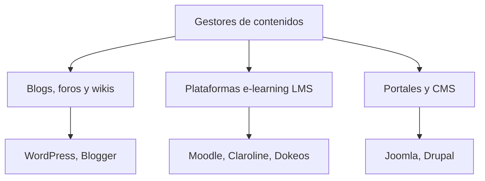

### Blogs, foros y wikis


*Logotipo de WordPress, uno de los gestores de blogs más usados. Fuente: Wikimedia Commons.*

- **Blogs:** sitios web en los que se publican artículos de uno o varios autores en orden cronológico inverso. Los lectores pueden comentar cada entrada y es habitual ofrecer sindicación mediante RSS o Atom. Pueden usarse servicios con alojamiento gratuito (Blogger, WordPress.com) o instalarse en un servidor propio (WordPress), lo que da control total pero exige disponer de ese servidor.
- **Foros:** espacios para compartir opiniones y formar comunidades en torno a un interés. Se diferencian de los blogs en que admiten más usuarios y las conversaciones se anidan. WordPress, Joomla o Moodle incluyen foros propios.
- **Wikis:** sitios cuyas páginas pueden ser editadas por varios usuarios desde el navegador. Guardan un historial de cambios que permite recuperar versiones anteriores e identificar al autor de cada modificación. Sus páginas se escriben en wikitexto y se enlazan entre sí, una estructura más sencilla que una base de datos.

### Plataformas de e-learning


*Logotipo de Moodle. Fuente: Wikimedia Commons.*


Son gestores de contenidos orientados a la gestión de cursos. Incluyen herramientas de comunicación y colaboración entre los participantes, así como cuestionarios y tareas para valorar su aprendizaje. Son una de las soluciones más usadas en la educación semipresencial y a distancia. Ejemplos: Moodle, Claroline, Dokeos o WebCT.

### Portales y gestores de contenidos (CMS)

Los portales de contenidos son sitios de gran envergadura con funciones variadas, como los de un periódico: noticias, anuncios, repositorios de documentos, blogs, foros, ofertas de empleo o información meteorológica. Gestores como Joomla o Drupal permiten crearlos y administrarlos sin grandes conocimientos de programación web.

Moodle es un LMS: además de publicar páginas, organiza el aprendizaje en cursos y ofrece herramientas de matriculación, seguimiento, comunicación y evaluación. La elección debe basarse en el propósito, el número de usuarios, las integraciones, los conocimientos de administración y los recursos disponibles.

## 5. Licencias de uso

<video controls width="480" style="max-width: 100%">
  <source src="./assets/img/Licencias_de_software.mp4" type="video/mp4">
</video>

Una licencia establece qué se puede hacer con un programa o con una obra. No se debe confundir que un producto sea gratuito con que carezca de licencia o de condiciones de uso.

- **Software propietario:** el titular conserva el control del código y concede permisos de uso bajo unas condiciones determinadas.
- **Software libre:** permite, conforme a su licencia, usar, estudiar, modificar y redistribuir el programa.
- **Software de código abierto:** ofrece acceso al código y permisos de uso definidos por su licencia; hay que leer las condiciones concretas de cada proyecto.

Moodle se distribuye bajo la licencia **GNU GPL versión 3 o posterior**. Esta licencia permite usar y modificar el programa y redistribuirlo respetando sus condiciones. Los temas, complementos y materiales educativos pueden tener licencias diferentes: hay que comprobarlas por separado. Para contenidos educativos pueden emplearse licencias Creative Commons, que especifican condiciones como atribución, uso no comercial o compartir con la misma licencia.

### La licencia de uso

La licencia es el documento con el que el autor expresa los límites y el alcance del uso que se puede hacer de su obra: copia, reproducción, modificación, traducción y adaptación. Debe especificar, al menos, qué se permite en cuanto a:

- Reproducción o copia.
- Realización de obras derivadas o adaptaciones.
- Beneficio económico.

Las licencias van desde las más restrictivas, en las que el autor se reserva todos los derechos, hasta las más permisivas, cuyo caso extremo es el dominio público. En todas se respetan los **derechos morales**: nadie puede atribuirse la autoría de una obra que no ha creado y, si se conoce al autor, hay que citarlo.

### Tipos de licencias

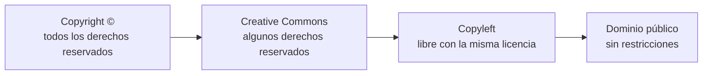

*De la licencia más restrictiva (izquierda) a la más permisiva (derecha). Las licencias CC abarcan un rango amplio según las condiciones elegidas.*


*Símbolos de copyright, copyleft y Creative Commons. Fuente: Wikimedia Commons.*

- **Copyright (©):** el autor se reserva todos los derechos.
- **Copyleft:** permite la libre distribución de copias y versiones modificadas, exigiendo que las obras derivadas mantengan los mismos derechos. Nació con el software libre, cuyo autor incluye el código fuente para que se use, modifique y distribuya. Puede ser *completa* (permite cualquier modificación excepto cambiar la licencia) o *parcial* (limita las partes modificables).
- **Creative Commons (CC):** suelen usarse para contenidos más que para software y siguen el lema «algunos derechos reservados». El autor elige qué derechos cede de entre los que posee.

En todas las licencias CC se presupone que el autor concede los derechos de copia y distribución. Sobre esa base, se combinan estas condiciones:

| Condición | Significado |
| --- | --- |
| Reconocimiento (*Attribution*) | Se permite copiar, distribuir y comunicar la obra y sus derivadas siempre que se cite al autor original. |
| No comercial (*Non-Commercial*) | Se permite su uso siempre que no tenga fines comerciales. |
| Sin obras derivadas (*No Derivatives*) | Se permite copiar y distribuir la obra original, pero no crear trabajos derivados. |
| Compartir igual (*Share Alike*) | Se permiten obras derivadas siempre que se distribuyan con una licencia idéntica a la original. |

Una obra con licencia copyleft completa cumple *share-alike*, pero una obra *share-alike* no tiene por qué ser copyleft completa: si tiene algún derecho restringido, sería copyleft parcial. Las licencias CC se han adaptado a la legislación de distintos países mediante el proyecto iCommons (International Commons).

Hay que ser consciente de las implicaciones legales del software que se usa. En el mejor de los casos, incumplir una licencia obliga a desinstalar el programa o pagar por su uso, pero también existen multas por incumplimiento.

Antes de instalar un complemento o publicar un recurso, se debe verificar su procedencia, licencia, compatibilidad con la versión instalada y política de actualizaciones.

### **Práctica 1:** instalación de LMS

Existen otros LMS de código abierto o con edición gratuita. Elige **uno** de la siguiente lista:

La columna **Nota máxima** indica el límite de nota para cada LMS según la dificultad relativa de su instalación en Windows y la investigación que requiere. La nota obtenida dentro de ese límite dependerá de la calidad de la investigación, la instalación, las pruebas y la documentación. El LMS con el reto de instalación mayor permite optar a 10 puntos.

| LMS | Tecnología | Descarga para Windows | Guía de instalación paso a paso | Nota máxima |
| --- | --- | --- | --- | ---: |
| **Chamilo** | PHP + MySQL/MariaDB | [Descargar Chamilo](https://chamilo.org/en/download/) | [Ver guía (XAMPP)](https://docs.chamilo.org/administration-guide/admin-guide/installation) | 7 |
| **Open edX (Tutor)** | Python + Docker | [Descargar Tutor](https://docs.tutor.edly.io/install.html) | [Ver guía (WSL2 y Docker)](https://discuss.openedx.org/t/how-to-install-openedx-v20-with-tutor-on-windows-os-with-wsl2/17417) | 9 |
| **Canvas LMS** (Community) | Ruby on Rails + PostgreSQL | [Quick Start / Descarga](https://github.com/instructure/canvas-lms/wiki/Quick-Start) | [Ver guía (Docker)](https://github.com/instructure/canvas-lms/wiki/Quick-Start) | 9 |
| **ILIAS** | PHP + MySQL/MariaDB | [Descargar ILIAS](https://www.ilias.de/en/download/) | [Tutorial](https://iliastutorials.com/faq/how-to-install-ilias/) / [Guía Oficial](https://github.com/ILIAS-eLearning/ILIAS/blob/release_11/docs/configuration/install.md) | 8 |
| **Sakai** | Java | [Descargar Sakai](https://www.sakailms.org/try-sakai-lms-free) | [Guía Oficial](https://sakaiproject.atlassian.net/wiki/spaces/DOC/pages/32201507113/Sakai+22+Install+Guide+Source) | 10 |
| **Opigno LMS** | Drupal (PHP) | [Descargar Opigno](https://www.opigno.org/en/download) | [Ver guía](https://www.valuebound.com/resources/blog/how-install-opigno-lms) | 8 |

Las guías de ILIAS y Chamilo parten de un servidor local; puedes montarlo con XAMPP (https://www.apachefriends.org/download.html). Algunos LMS no tienen instalador para Windows y se ejecutan con Docker Desktop o con un servidor local como XAMPP. Los enlaces pueden cambiar: si alguno no funciona, búscalo desde la web oficial del proyecto.

**Investiga y documenta:**

1. Licencia exacta, versión estable actual y fecha de la última publicación.
2. Requisitos de software y hardware. Tenoclogías sobre las que trabaja.
3. Funcionalidades principales: cursos, tareas, cuestionarios, foros y calificaciones.
4. Comparativa con otros LMS: ventajas, inconvenientes, comunidad y documentación.

**Instalación y comprobación en Windows:**

1. Elige un método de instalación compatible con Windows: instalador oficial, paquete de servidor local (XAMPP o WampServer, para los LMS en PHP) o Docker Desktop. Justifica tu elección.
2. Instala el LMS en tu equipo siguiendo la documentación oficial y anota los pasos y los problemas encontrados. Documenta la instalación paso a paso.
3. Comprueba su funcionamiento:
   - Accede como administrador.
   - Crea un curso con al menos un recurso y una tarea o cuestionario.
   - Crea un usuario alumno, matricúlalo y accede con él para realizar la actividad.
4. Si el LMS no es compatible con Windows de forma directa, indica el motivo y la alternativa que has usado.

**Entrega:** un informe con la investigación, capturas de pantalla de la instalación y de cada comprobación, y una conclusión sobre en qué casos elegirías este LMS.

## 6. Moodle y sus requerimientos

### 6.1 Arquitectura

En nuestra instalación, el navegador solicita una página a Apache. Apache entrega los archivos estáticos o deriva la ejecución de PHP. Moodle ejecuta la lógica de la petición y consulta MySQL para leer o guardar información. Los archivos subidos y otros datos se guardan en un directorio independiente, fuera de la zona pública del servidor web.

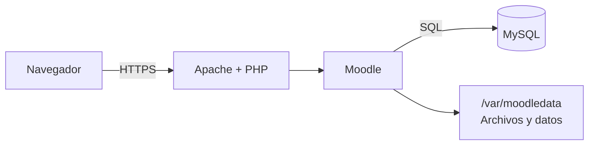

### 6.2 Requisitos

Para **Moodle 5.1**, los requisitos mínimos relevantes para esta práctica son:

| Componente | Requisito de Moodle 5.1 | Situación en Ubuntu Server 24.04 |
| --- | --- | --- |
| Sistema | Sistema actualizado y PHP de 64 bits | Ubuntu Server 24.04 LTS es adecuado |
| PHP | Mínimo 8.2.0; se admiten PHP 8.3 y 8.4 | La versión predeterminada es PHP 8.3, compatible |
| Extensión PHP | `sodium` es obligatoria; también se necesitan las extensiones habituales de Moodle | Comprueba las extensiones instaladas para PHP de Apache y CLI |
| Configuración PHP | `max_input_vars` debe ser al menos `5000` | Ajustar en la configuración de PHP usada por Apache |
| Base de datos | MySQL 8.4 como mínimo | Comprueba la versión instalada; MySQL 8.0 no cumple este requisito |
| Codificación de la base de datos | `utf8mb4` | Se configura al crear la base de datos |
| Servidor web | Apache es compatible | Apache HTTP Server está disponible en los repositorios |
| Red para publicación | Dominio y HTTPS para acceso público | Necesita DNS, conectividad entrante y certificado TLS |

Comprueba las versiones realmente instaladas antes de continuar: `php -v` y `mysql --version`; confirma la versión del servidor con `mysql -NBe 'SELECT VERSION();'`. Moodle 5.1 requiere MySQL 8.4 o posterior: si tienes MySQL 8.0, actualízalo antes de instalar Moodle. Verifica también que el PHP de 64 bits está instalado (`php -r 'echo PHP_INT_SIZE * 8, PHP_EOL;'`, que debe mostrar `64`) y que Sodium está disponible (`php -m | grep -i sodium`). Estas comprobaciones de terminal verifican el PHP CLI; el instalador de Moodle permite revisar el PHP que carga Apache. Para un servidor real, dimensiona CPU, memoria y almacenamiento según usuarios concurrentes y volumen de archivos: Moodle no establece una cifra única válida para todos los centros.

## 7. Instalación de Moodle en Ubuntu Server 24.04

La siguiente práctica es una base para un entorno de laboratorio. En producción se debe elegir una rama de Moodle que continúe recibiendo actualizaciones, aplicar HTTPS y adaptar la capacidad del servidor.

### 7.1 Comprobar, actualizar e instalar los servicios necesarios

### Comprobación de servicios y paquetes necesarios

Antes de instalar nada, comprueba Apache, PHP y MySQL, que ya están instalados en este servidor. Así evitarás reinstalar servicios que ya funcionan:

```bash
sudo apt update
sudo apt upgrade
sudo systemctl is-active apache2 mysql
sudo apache2ctl configtest
apache2 -v
php -v
php -r 'echo PHP_INT_SIZE * 8, PHP_EOL;'
php -m
mysql --version
sudo mysql -NBe 'SELECT VERSION();'
```
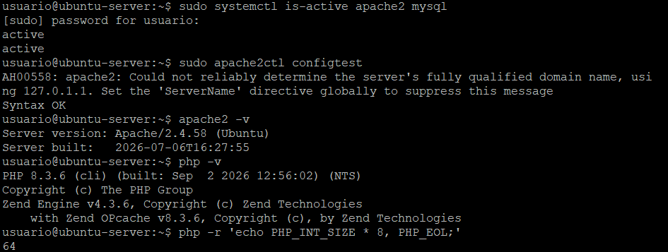
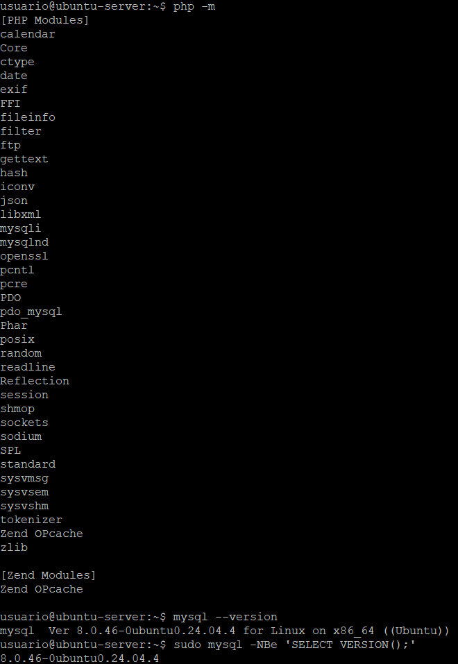

Apache y MySQL deben aparecer como `active` y la prueba de Apache debe indicar `Syntax OK`. PHP debe ser de 64 bits y tener, como mínimo, las extensiones `curl`, `gd`, `intl`, `mbstring`, `mysqli`, `soap`, `xml`, `zip`, `Zend OPcache` y `sodium`. Comprueba también si están instalados los paquetes requeridos:

```bash
dpkg -s apache2 git php libapache2-mod-php php-cli php-mysql \
	php-xml php-curl php-gd php-intl php-mbstring php-soap \
	php-zip php-opcache
```

Si `dpkg -s` indica que falta algún paquete de esta lista, ejecuta el siguiente comando. `apt` instalará los que falten y mantendrá los que ya estén instalados:

```bash
sudo apt install apache2 git \
	php libapache2-mod-php php-cli php-mysql php-xml php-curl \
	php-gd php-intl php-mbstring php-soap php-zip php-opcache
```

Si Apache no está instalado, el comando anterior lo instalará. No instales de nuevo MySQL si ya está presente. 

### Actualización de MySQL a la versión 8.4

Moodle 5.1 requiere MySQL 8.4 o posterior. Como esta instalación está recién hecha y no contiene datos que quieras conservar, puedes actualizar MySQL 8.0 directamente desde el repositorio APT oficial de Oracle. Estos comandos descargan el paquete oficial `mysql-apt-config_0.8.40-1_all.deb` y configuran el repositorio:

```bash
wget https://dev.mysql.com/get/mysql-apt-config_0.8.40-1_all.deb
sudo dpkg -i mysql-apt-config_0.8.40-1_all.deb
```

En el menú, selecciona **1. MySQL Server & Cluster** y pulsa Intro. En la siguiente lista selecciona **3. mysql-8.4-lts** y pulsa Intro. Al volver al menú inicial, selecciona **3. Ok** y pulsa Intro para guardar y salir; no vuelvas a entrar en la opción 1. Luego ejecuta estos comandos para comprobar que APT propone MySQL 8.4 e instalar la actualización:

```bash
sudo apt update
apt-cache policy mysql-server
```

En la salida, confirma que `Candidate` empieza por `8.4`. Si muestra otra versión, no continúes: vuelve a configurar el repositorio con `sudo dpkg-reconfigure mysql-apt-config` y selecciona **mysql-8.4-lts**. Si indica 8.4, actualiza e inicia el servicio:

```bash
sudo apt install mysql-server
sudo systemctl enable --now mysql
```

Al terminar, confirma la versión del servidor y que el servicio está activo:

```bash
sudo systemctl status mysql --no-pager
sudo mysql -NBe 'SELECT VERSION();'
```

La versión debe ser 8.4 o posterior antes de continuar con Moodle. Si MySQL no arranca, consulta el registro con `sudo journalctl -u mysql -n 100 --no-pager`.

### Inicio de los servicios

Cuando los servicios estén instalados, habilítalos e inicia los que estuvieran inactivos:

```bash
sudo systemctl enable --now apache2 mysql
```

### Configuración de PHP para Moodle

En Ubuntu 24.04, la configuración de PHP 8.3 para Apache está en `/etc/php/8.3/apache2/php.ini`. En estos pasos se permitirá subir archivos de hasta `100M`; `post_max_size` se establece en `110M` para incluir también los datos adicionales de la petición. Si necesitas otro límite, sustituye esos valores por los que quieras usar, manteniendo `post_max_size` igual o superior a `upload_max_filesize`.

Establece `max_input_vars` en `5000`, el mínimo recomendado para Moodle:

```bash
sudo sed -i -E 's/^[[:space:]]*;?[[:space:]]*max_input_vars[[:space:]]*=.*/max_input_vars = 5000/' /etc/php/8.3/apache2/php.ini
```

Establece el tamaño máximo de cada archivo subido en `100M`:

```bash
sudo sed -i -E 's/^[[:space:]]*;?[[:space:]]*upload_max_filesize[[:space:]]*=.*/upload_max_filesize = 100M/' /etc/php/8.3/apache2/php.ini
```

Establece el tamaño máximo total de los datos enviados en una petición en `110M`:

```bash
sudo sed -i -E 's/^[[:space:]]*;?[[:space:]]*post_max_size[[:space:]]*=.*/post_max_size = 110M/' /etc/php/8.3/apache2/php.ini
```

Comprueba que los tres valores han quedado configurados:

```bash
grep -E '^[[:space:]]*(max_input_vars|upload_max_filesize|post_max_size)[[:space:]]*=' /etc/php/8.3/apache2/php.ini
```

La salida debe incluir `max_input_vars = 5000`, `upload_max_filesize = 100M` y `post_max_size = 110M`.

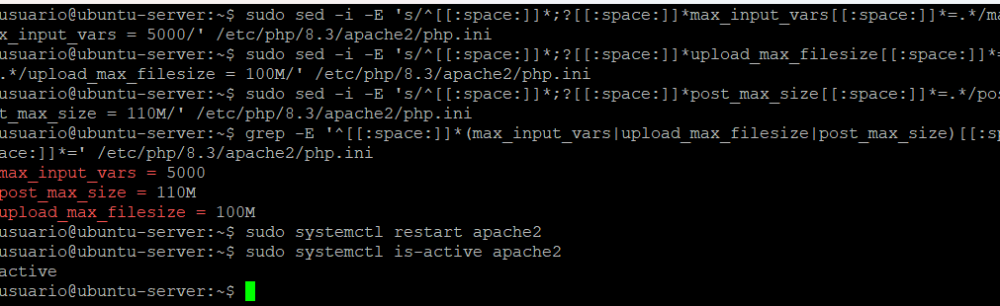

Reinicia Apache para que PHP cargue la nueva configuración:

```bash
sudo systemctl restart apache2
```

Por último, confirma que Apache sigue activo:

```bash
sudo systemctl is-active apache2
```

El resultado esperado es `active`.

### 7.2 Crear la base de datos

Accede a MySQL como administrador local:

```bash
sudo mysql
```

En el indicador de MySQL, crea una base de datos y un usuario exclusivos para Moodle. Sustituye la contraseña de ejemplo por una contraseña robusta y única; no la publiques ni la reutilices.

```sql
CREATE DATABASE moodle
	DEFAULT CHARACTER SET utf8mb4
	COLLATE utf8mb4_unicode_ci;
CREATE USER 'moodleuser'@'localhost' IDENTIFIED BY 'CAMBIAR_POR_UN_SECRETO_ROBUSTO';
GRANT ALL PRIVILEGES ON moodle.* TO 'moodleuser'@'localhost';
FLUSH PRIVILEGES;
EXIT;
```

La aplicación debe conectarse con `moodleuser`, no con el usuario administrador de MySQL. Limitar el usuario a `localhost` reduce las conexiones desde otros equipos.

### 7.3 Descargar Moodle y preparar los directorios

En este apartado se descargará Moodle 5.1. La palabra *rama* indica la línea de desarrollo que se descarga; `MOODLE_501_STABLE` es la rama estable de Moodle 5.1. Asegúrate de que la versión de Moodle elegida sigue mantenida y es compatible con PHP y MySQL antes de continuar.

Comprueba que Git está disponible:

```bash
git --version
```

Descarga el código de Moodle en `/var/www/moodle`. Ejecuta este comando una sola vez; si el directorio ya existe porque el comando se ejecutó antes, no lo repitas:

```bash
sudo git clone --branch MOODLE_501_STABLE https://github.com/moodle/moodle.git /var/www/moodle
```

Comprueba que se ha descargado la rama correcta y que existe el directorio público que Apache utilizará:

```bash
git -C /var/www/moodle branch --show-current
```

El resultado esperado es `MOODLE_501_STABLE`. Comprueba ahora que existe `public`:

```bash
test -d /var/www/moodle/public && echo "Directorio public encontrado"
```

Asigna el código a `root` y al grupo `www-data`. De este modo Apache podrá leerlo, pero no modificarlo:

```bash
sudo chown -R root:www-data /var/www/moodle
```

Comprueba el propietario y los permisos del directorio:

```bash
ls -ld /var/www/moodle
```

El resultado debe ser similar a este; el número, la fecha y el tamaño variarán:

```text
drwxr-xr-x 1x root www-data 4096 oct  4 10:35 /var/www/moodle
```

Comprueba que el propietario es `root`, el grupo es `www-data` y los permisos son `drwxr-xr-x`. Si el grupo es `root`, vuelve a ejecutar el comando `chown`.

Crea `/var/moodledata`, donde Moodle guardará archivos de usuarios y cursos. Esta carpeta queda fuera del directorio público de Apache y solo el servicio web y el administrador podrán acceder a ella:

```bash
sudo install -d -o www-data -g www-data -m 770 /var/moodledata
```

Comprueba que se creó con el propietario y los permisos esperados:

```bash
ls -ld /var/moodledata
```

El resultado debe mostrar `www-data` como propietario y grupo, y permisos `drwxrwx---`. No coloques `moodledata` dentro de `/var/www/moodle` ni de `/var/www/moodle/public`.

### 7.4 Configurar Apache

En Moodle 5.1, el directorio `public` es la raíz web. De esta forma no se exponen directamente al navegador otros archivos del código fuente. Si utilizas otra rama, sigue las instrucciones de instalación correspondientes a esa versión.

#### Paso 1. Averiguar la IP del servidor

Si no tienes un nombre DNS, accederás a Moodle mediante la IP de la máquina. Anótala:

```bash
hostname -I
```

#### Paso 2. Crear el archivo del sitio

Abre un archivo nuevo con el editor `nano`:

```bash
sudo nano /etc/apache2/sites-available/moodle.conf
```

Pega este contenido. Sustituye `192.168.0.36` por la IP del paso 1 si es distinta (también sirve un nombre DNS del laboratorio):

```apache
<VirtualHost *:80>
    ServerName 192.168.0.36
    DocumentRoot /var/www/moodle/public

    <Directory /var/www/moodle/public>
        AllowOverride None
        Options FollowSymLinks
        Require all granted
    </Directory>

    ErrorLog ${APACHE_LOG_DIR}/moodle_error.log
    CustomLog ${APACHE_LOG_DIR}/moodle_access.log combined
</VirtualHost>
```

Guarda con `Ctrl+O`, pulsa `Enter` y sal con `Ctrl+X`.

#### Paso 3. Comprobar que el archivo se ha guardado

```bash
cat /etc/apache2/sites-available/moodle.conf
```

#### Paso 4. Activar el módulo `rewrite`

```bash
sudo a2enmod rewrite
```

#### Paso 5. Activar el sitio de Moodle

```bash
sudo a2ensite moodle.conf
```

#### Paso 6. Desactivar el sitio por defecto

Así Apache no muestra la página de bienvenida en lugar de Moodle:

```bash
sudo a2dissite 000-default.conf
```

#### Paso 7. Comprobar la configuración

```bash
sudo apache2ctl configtest
```

Debe mostrar `Syntax OK`. Puede aparecer antes un aviso sobre `ServerName`, que no es un error. Si aparece otro mensaje de error, revisa el archivo del paso 2.

#### Paso 8. Aplicar los cambios

```bash
sudo systemctl reload apache2
```

#### Paso 9. Comprobar que Apache responde

```bash
sudo systemctl is-active apache2
curl -I http://localhost
```

El primer comando debe mostrar `active`. El segundo debe devolver una respuesta `HTTP/1.1 200 OK` o `302 Found`, que indica que Apache sirve Moodle.

### 7.5 Completar la instalación

#### Acceder desde el host de Windows

La instalación se hace desde el navegador del equipo Windows (el host) que ejecuta la máquina virtual. Sigue estos pasos:

1. **Comprueba la IP de la VM.** En la VM ejecuta `hostname -I`. En este laboratorio es `192.168.0.36`.
2. **Comprueba que el host llega a la VM.** En PowerShell de Windows:

   ```powershell
   ping 192.168.0.36
   ```

   Deben aparecer respuestas (`Respuesta desde 192.168.0.36`). Si no responde, la VM debe tener la red en **modo puente** (*bridge*), de modo que esté en la misma red que el host. Con NAT, el host no ve la IP de la VM sin reenviar puertos.
3. **Comprueba que el puerto 80 está accesible.** En PowerShell:

   ```powershell
   Test-NetConnection 192.168.0.36 -Port 80
   ```

   Debe mostrar `TcpTestSucceeded : True`. Si da `False`, comprueba que Apache está activo en la VM (`sudo systemctl is-active apache2`) y que el cortafuegos no bloquea el puerto (`sudo ufw status`; si está activo, `sudo ufw allow 80/tcp`).
4. **Abre el navegador** del host y escribe en la barra de direcciones `http://192.168.0.36`. Debe cargarse el instalador de Moodle. Usa la misma IP que pusiste en `ServerName` del apartado 7.4; si accedes con otra dirección, Moodle puede mostrar un error o redirigir.

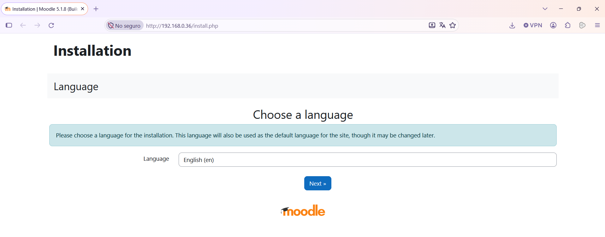

5. **Opcional: usar un nombre en lugar de la IP.** Si prefieres `moodle.ejemplo.local`, cambia `ServerName` en el 7.4 por ese nombre y, en Windows, añade la línea `192.168.0.36 moodle.ejemplo.local` al archivo `C:\Windows\System32\drivers\etc\hosts`. Para editarlo, abre el Bloc de notas **como administrador**. Después accede a `http://moodle.ejemplo.local`.

#### Datos del instalador

Sigue el instalador. Selecciona el idioma, confirma las rutas y proporciona los datos de conexión a MySQL:

- Tipo de base de datos: MySQL mejorado (controlador `mysqli`).
- Servidor: `localhost`.
- Base de datos: `moodle`.
- Usuario: `moodleuser`.
- Contraseña: la definida al crear el usuario.
- Directorio de datos: `/var/moodledata`. El instalador propone `/var/www/moodledata`: cámbialo por `/var/moodledata`, que es el directorio creado en el apartado 7.3.

#### Crear el archivo `config.php` a mano

Al terminar la configuración, Moodle muestra la pantalla «Configuración finalizada» con el contenido del archivo `config.php`. Moodle no puede crearlo por sí mismo porque `/var/www/moodle` pertenece a `root` y Apache (`www-data`) no tiene permiso de escritura. Es lo esperado y lo más seguro, así que debes crearlo tú.

1. Abre el archivo en la raíz de Moodle (no en `public`):

   ```bash
   sudo nano /var/www/moodle/config.php
   ```

2. Pega el contenido que muestra el instalador, desde `<?php` hasta `require_once(__DIR__ . '/lib/setup.php');`. Guarda con `Ctrl+O`, `Enter` y sal con `Ctrl+X`.

3. Comprueba que se ha guardado correctamente. La primera línea debe ser `<?php  // Moodle configuration file`:

   ```bash
   head -n 5 /var/www/moodle/config.php
   ```

4. El archivo contiene la contraseña de la base de datos: asigna propietario y permisos para que Apache solo pueda leerlo:

   ```bash
   sudo chown root:www-data /var/www/moodle/config.php
   sudo chmod 640 /var/www/moodle/config.php
   ```

5. Verifica el resultado. Debe mostrar `-rw-r----- 1 root www-data`:

   ```bash
   ls -l /var/www/moodle/config.php
   ```

6. Vuelve al navegador y pulsa el botón para continuar, o recarga `http://192.168.0.36`. Moodle detectará `config.php` y seguirá con las comprobaciones y la creación de tablas, que tarda varios minutos. No cierres ni recargues la página mientras avanza.

Completa la configuración del sitio y crea una cuenta de administración con una contraseña única. No reutilices las credenciales de la base de datos. Al finalizar, verifica que Moodle recomienda eliminar o proteger el instalador y que el directorio de datos no es accesible mediante una URL.

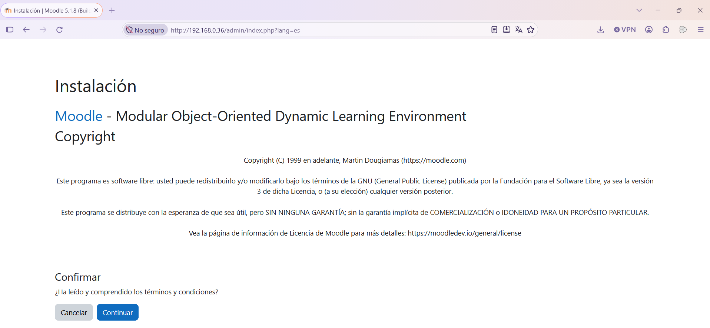

### 7.6 Configurar las tareas programadas

Moodle necesita ejecutar tareas periódicas para enviar notificaciones, procesar tareas y mantener el sitio. Configura el cron para que se ejecute cada minuto como `www-data`.

> **Aclaración:** si `sudo crontab` responde `crontab: command not found`, el servicio `cron` no está instalado. Instálalo y actívalo antes de continuar:
>
> ```bash
> sudo apt install -y cron
> sudo systemctl enable --now cron
> sudo systemctl is-active cron
> ```
>
> El último comando debe mostrar `active`.

Edita el cron del usuario `www-data` (la primera vez te pide elegir un editor; elige `nano`):

```bash
sudo crontab -u www-data -e
```

Añade esta línea, guarda con `Ctrl+O`, `Enter` y sal con `Ctrl+X`:

```cron
* * * * * /usr/bin/php /var/www/moodle/admin/cli/cron.php >/dev/null
```

Comprueba que se ha guardado:

```bash
sudo crontab -u www-data -l
```

En el área de administración, comprueba después que la última ejecución del cron es reciente y que no hay tareas atascadas.

### 7.7 **Práctica 2:** instalación de Moodle 5.1 en Ubuntu 24.04

**Enunciado**

Despliega Moodle 5.1 en una máquina virtual con Ubuntu Server 24.04 LTS y deja la plataforma operativa y accesible desde el equipo anfitrión. Utiliza como guía los pasos de instalación de este apartado y consulta la documentación oficial para comprobar los requisitos y las versiones compatibles.

Entrega una memoria que incluya:

- Las características de la máquina virtual y la configuración de red utilizada, sin incluir contraseñas ni otros datos sensibles.
- Los pasos y comandos principales para instalar y configurar Apache, PHP, MySQL y Moodle.
- La configuración de la base de datos y de `moodledata`, explicando cómo se evita que los datos y archivos sensibles queden expuestos por HTTP.
- Evidencias de acceso a Moodle, de la creación de la cuenta administradora y de la ejecución correcta de las tareas programadas.
- Las comprobaciones realizadas y los problemas encontrados, junto con la solución aplicada.

Al finalizar, verifica que el sitio carga desde el equipo anfitrión, que puedes iniciar sesión con la cuenta administradora y que el cron se ejecuta.

## 8. Estructura de Moodle

Para entender Moodle conviene separar la **estructura técnica de la instalación** de la **estructura académica que ve el alumnado**. La primera permite que el servicio funcione y conserve sus datos; la segunda organiza los cursos y el aprendizaje.

### 8.1. Estructura técnica

En la instalación de la práctica hay tres componentes persistentes:

- **Código de Moodle** (`/var/www/moodle`): aplicación PHP, temas y complementos. En Moodle 5.1, la raíz servida por el servidor web se encuentra en `public/`; Apache debe apuntar a esa raíz pública, no al directorio de datos.
- **Directorio de datos** (`/var/moodledata`): archivos que suben los usuarios, archivos de los cursos, cachés y datos temporales. Debe estar fuera de la raíz pública y ser legible/escribible por el usuario del servidor web, pero no descargable directamente mediante una URL.
- **Base de datos** (`moodle`): usuarios, cursos, matriculaciones, permisos, calificaciones, ajustes y metadatos de los archivos. Moodle relaciona estos registros con el contenido almacenado en `moodledata`.

Un archivo PDF, por ejemplo, **no se guarda como un archivo público con el nombre original** dentro del código. Moodle administra su almacenamiento en `moodledata` y controla su acceso a través de la aplicación. Por eso no se debe mover, editar ni publicar manualmente el contenido de `moodledata`. Las copias de seguridad deben coordinar una copia de la base de datos con otra de `moodledata` y conservar también el código, los complementos y las versiones correspondientes.

### 8.2. Organización académica

La organización más habitual es **categorías > cursos > secciones > actividades y recursos**. Una categoría puede representar un departamento o nivel; un curso contiene una asignatura o formación concreta; y las secciones dividen el curso en unidades manejables. La sección inicial suele servir para la bienvenida, las instrucciones y los avisos generales.

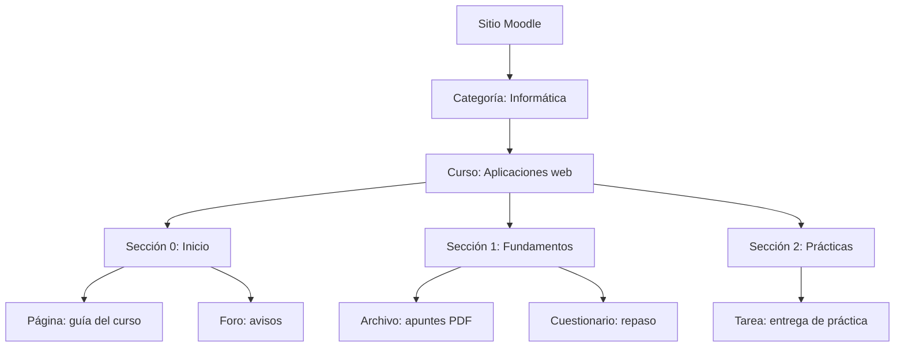

La **categoría** facilita localizar y administrar cursos; no es una sección ni una unidad didáctica. El **formato del curso** determina cómo se presentan las secciones:

| Formato | Cómo organiza el curso | Ejemplo de uso |
|---|---|---|
| **Temas** | Secciones que el docente titula y ordena por unidades o resultados de aprendizaje. | Tema 1: HTML; tema 2: CSS; tema 3: accesibilidad. |
| **Semanal** | Secciones asociadas a semanas a partir de la fecha de inicio. | Curso de ocho semanas con una unidad y una entrega por semana. |
| **Actividad única** | El curso muestra una actividad principal. | Curso cuyo propósito es realizar una encuesta o participar en un foro. |
| **Otros formatos** | Formatos adicionales, como mosaicos o rejilla, si están instalados y habilitados. | Curso introductorio en el que cada mosaico representa un módulo. |

La disponibilidad y el nombre de los formatos dependen de la versión, el tema y los complementos instalados. En las opciones del curso también se puede elegir si se muestran todas las secciones en una página o una sección por página. La segunda opción puede facilitar la navegación en cursos extensos. Consulta [formatos de curso en MoodleDocs](https://docs.moodle.org/501/en/Course_formats).

Dentro de cada sección se combinan dos clases de elementos:

- **Recursos**, que presentan o enlazan información para consultar.
- **Actividades**, que proponen una acción del estudiante, como entregar un trabajo, responder preguntas o debatir.

### 8.3. Usuarios, roles y permisos

Un usuario puede participar en cursos distintos con roles distintos. Los permisos se controlan mediante **roles** y **contextos** —por ejemplo, el sitio, una categoría, un curso o una actividad concreta—; no es necesario convertir a cada docente en administrador para que pueda gestionar su curso.

| Rol habitual | Función y ejemplo |
|---|---|
| **Administrador del sitio** | Configura Moodle, instala actualizaciones y complementos y administra la plataforma completa. Debe asignarse a muy pocas cuentas. |
| **Gestor** | Administra categorías o cursos según los permisos que tenga. |
| **Profesor con permiso de edición** | Diseña el curso, añade recursos y actividades, configura grupos y califica. |
| **Profesor sin permiso de edición** | Puede acompañar al alumnado y calificar, pero no modificar el contenido del curso. |
| **Estudiante** | Accede a los materiales, participa en las actividades y consulta sus resultados. |
| **Invitado** | Accede solo a las partes que el curso permite y normalmente no puede participar en actividades que requieren entrega o seguimiento individual. |

La **matriculación** determina quién puede entrar en un curso. Puede hacerse manualmente por el docente, mediante automatriculación con clave o mediante cohortes, si el sitio está configurado para ello. La matriculación y el rol son conceptos relacionados, pero distintos: primero se concede acceso al curso y después se determina qué acciones permite el rol. Para una comprobación realista, revisa el curso con el rol de estudiante o con una cuenta de prueba, no solo desde la vista del docente.

#### Gestionar participantes de un curso

Los participantes son los usuarios matriculados en el curso. Para consultar y gestionar la lista, abre el curso y selecciona **Participantes**. Las opciones y su ubicación exacta pueden variar ligeramente según el tema, los permisos y los métodos de matriculación habilitados.

**Añadir a una persona manualmente:**

1. En **Participantes**, pulsa **Matricular usuarios**.
2. Busca el usuario por nombre, apellido o correo. Si no aparece, primero hay que crear su cuenta o solicitar que se registre, según la configuración del sitio.
3. Selecciona el **rol** que tendrá en este curso (por ejemplo, Estudiante o Profesor sin permiso de edición) y, si procede, establece el periodo de matriculación.
4. Confirma la acción y comprueba que la persona aparece en la lista con el rol esperado.

Este procedimiento requiere que la matriculación manual esté habilitada y que quien lo realiza tenga los permisos adecuados. Para incorporar un grupo amplio o recurrente, el administrador puede crear cuentas mediante **Administración del sitio > Usuarios > Cuentas > Subir usuarios** usando un CSV, o gestionar una **cohorte** y matricularla en el curso si esa opción está configurada. Antes de procesar un archivo grande, prueba con unas pocas cuentas y revisa la vista previa. El CSV contiene datos personales: compártelo por un canal seguro, limita quién puede acceder y elimina las copias temporales cuando ya no hagan falta.

**Cambiar el rol o suspender el acceso:** desde la lista de participantes, utiliza las acciones de edición de matriculación de esa persona para cambiar su rol o suspenderla. La suspensión es útil cuando se quiere impedir temporalmente el acceso y conservar su inscripción en la lista; puede reactivarse más adelante. Revisa también las fechas de inicio y fin de la matriculación, pues una fecha vencida puede impedir el acceso.

**Quitar de un curso:** en las acciones de matriculación, selecciona **Cancelar matriculación** o **Anular la matriculación**, y confirma. Esto quita el acceso por ese método de matriculación, pero **no elimina necesariamente la cuenta de usuario del sitio**: la persona podría seguir inscrita en otros cursos. Antes de confirmar, revisa el aviso de Moodle y las políticas de conservación de calificaciones y datos de actividad; los efectos sobre datos existentes pueden depender del método de matriculación y de la configuración. Si solo se necesita una pausa, suspender suele ser más apropiado que cancelar.

Al final, comprueba la lista, el rol asignado y el acceso desde la perspectiva del participante. Para más información, consulta la documentación oficial sobre [matriculación manual](https://docs.moodle.org/501/en/Manual_enrolment), [participantes del curso](https://docs.moodle.org/501/en/Participants) y [subida de usuarios](https://docs.moodle.org/501/en/Upload_users).

## 9. Creación de contenidos

El contenido de un curso debe responder a una secuencia didáctica: **orientar, explicar, practicar, recibir retroalimentación y comprobar el aprendizaje**. Antes de subir documentos, planifica las secciones y decide qué hará el alumnado en cada una. Moodle no es únicamente un repositorio de archivos: sus actividades permiten interacción, seguimiento y evaluación.

### 9.1. Preparar un curso

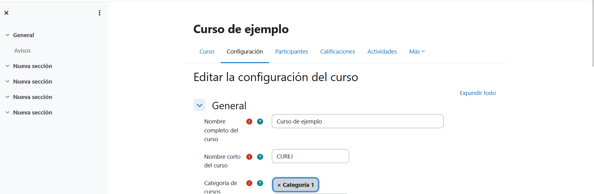

Con el rol de administrador o de docente con permisos:

1. **Crea o selecciona una categoría.** Desde la administración de cursos, organiza las categorías con una jerarquía sencilla, por ejemplo `Informática > Desarrollo web`. Evita crear una categoría distinta para cada curso si no aporta valor a la navegación.
2. **Crea el curso.** Abre la categoría y selecciona **Crear un nuevo curso**. Indica un nombre completo reconocible (por ejemplo, *Aplicaciones web — 1.º ASIR*), un nombre corto (por ejemplo, `AW-ASIR1`), una descripción y, cuando corresponda, fechas de inicio y finalización.
3. **Configura su formato y apariencia.** Elige Temas o Semanal, define el número inicial de secciones y decide la disposición. El formato se puede cambiar después; revisa el resultado porque algunos formatos interpretan las secciones de manera diferente.
4. **Configura el acceso.** Revisa los métodos de matriculación, la disponibilidad y la visibilidad del curso. Una clave de automatriculación no sustituye una política de acceso adecuada: compártela solo con el grupo previsto y cámbiala cuando deje de ser necesaria.
5. **Matricula al equipo docente y al alumnado.** Asigna el rol mínimo necesario. Si se usa automatriculación, verifica que el método esté habilitado y que sus fechas y límites sean los esperados.
6. **Activa el modo de edición.** En la página del curso, usa **Activar edición**. En la sección deseada, selecciona **Añadir una actividad o un recurso**, elige el elemento y completa su formulario.
7. **Ordena y comprueba.** Arrastra los elementos para establecer el orden de lectura, utiliza títulos claros y abre el curso como estudiante para verificar permisos, enlaces, fechas y disponibilidad.

La ventana **Añadir una actividad o un recurso** permite buscar y seleccionar el tipo de elemento que se incorporará a la sección. La captura oficial siguiente ilustra el selector; su aspecto y la lista de opciones pueden variar según la versión y los complementos habilitados.

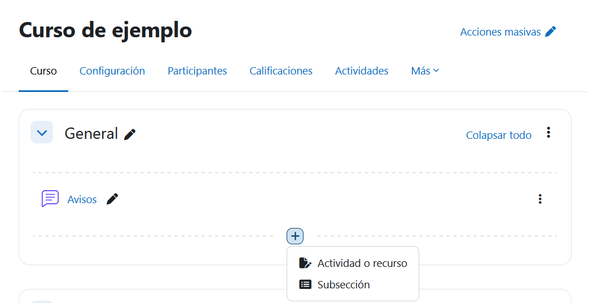

### 9.2. Recursos: presentar información

Los recursos permiten explicar, orientar y proporcionar materiales. Se configuran desde el selector de la sección correspondiente. Estos son recursos habituales de Moodle:

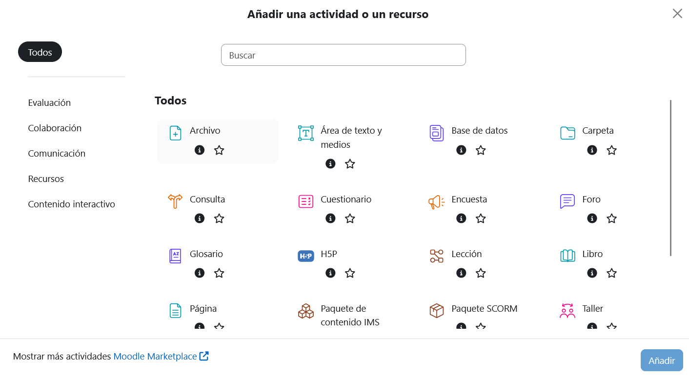

| Recurso | Qué permite hacer | Ejemplo |
|---|---|---|
| **Archivo** | Publicar un archivo individual, como PDF, imagen, presentación o plantilla. | `guia-practica-01.pdf`, con un nombre comprensible en vez de `doc_final_v7.pdf`. |
| **Carpeta** | Agrupar varios archivos relacionados en un solo elemento. | Carpeta con datos de ejemplo, instrucciones y una plantilla descargable. |
| **Página** | Crear contenido HTML dentro de Moodle, con texto, imágenes, enlaces y medios compatibles. | Página “Antes de empezar” con objetivos, requisitos previos y enlaces. |
| **Libro** | Organizar contenido en capítulos y subcapítulos con navegación interna. | Manual breve de instalación con capítulos de preparación, configuración y verificación. |
| **URL** | Enlazar una fuente externa. | Enlace a la documentación oficial de PHP o a un vídeo educativo con licencia adecuada. |
| **Etiqueta** (puede mostrarse como texto y medios en algunas versiones) | Insertar texto, encabezados o elementos visuales directamente en la página principal del curso. | Un encabezado “Material de la unidad” o una indicación corta entre dos actividades. |
| **Paquete IMS de contenido** | Mostrar un paquete educativo IMS Content Package, si se dispone de uno compatible. | Material de autoestudio exportado desde una herramienta de autoría. |

**¿Página o archivo?** Utiliza una página cuando el contenido sea breve, deba leerse en el navegador o necesite actualizarse con facilidad. Usa un archivo cuando sea importante descargarlo, imprimirlo o conservar su formato original. Una carpeta es preferible a publicar muchos archivos sueltos si estos pertenecen a una misma práctica. Para un enlace externo, proporciona un texto descriptivo y verifica que no requiera una cuenta o permiso que el alumnado no tenga.

### 9.3. Actividades: practicar, colaborar y evaluar

Las actividades solicitan una acción y, según su configuración, registran entregas, respuestas, participación, calificaciones o finalización. La actividad apropiada depende de lo que se quiere observar: no conviene elegir un cuestionario solo porque sea el elemento más rápido de crear.

| Actividad | Uso principal | Ejemplo de consigna |
|---|---|---|
| **Tarea** | Recibir archivos o texto en línea, establecer una fecha límite y calificar con nota, comentarios o rúbrica. | “Entrega el informe en PDF. Incluye capturas de las pruebas y responde a los tres apartados de la rúbrica.” |
| **Cuestionario** | Combinar preguntas, intentos, límites de tiempo, retroalimentación y calificación automática o manual. | Prueba de repaso con preguntas de opción múltiple, verdadero/falso y respuesta breve. |
| **Foro** | Mantener debates, anuncios o preguntas y respuestas. Puede permitir suscripciones y calificación de participación. | “Describe un problema de accesibilidad encontrado en una web y propone una mejora razonada.” |
| **Lección** | Presentar páginas de contenido intercaladas con preguntas y rutas según las respuestas. | Recorrido ramificado para decidir cómo responder ante un error de configuración. |
| **Consulta** | Recoger rápidamente la elección entre opciones. | Elegir una fecha de exposición o el tema de un proyecto. |
| **Retroalimentación / Encuesta** | Recoger opiniones y respuestas; el nombre y las opciones disponibles dependen de la instalación. | Encuesta anónima de satisfacción al acabar la unidad. |
| **Glosario** | Construir una colección de definiciones que puede ser colaborativa. | Diccionario compartido de términos de redes o desarrollo web. |
| **Taller** | Gestionar entregas y evaluación entre iguales con fases y criterios definidos por el docente. | Cada estudiante entrega un diseño y evalúa dos propuestas mediante una rúbrica. |
| **Base de datos** | Recopilar fichas estructuradas aportadas por los participantes. | Catálogo de herramientas con nombre, finalidad y enlace. |
| **Paquete SCORM** | Ejecutar contenido de aprendizaje empaquetado y registrar los datos que exponga el paquete. | Módulo interactivo de una herramienta de autoría compatible. |
| **H5P u otras actividades interactivas** | Crear o integrar contenido interactivo cuando la herramienta o el complemento esté instalado y habilitado. | Vídeo interactivo con preguntas incrustadas. |

#### Ejemplo: configurar una tarea

Para recibir una práctica en PDF:

1. En la sección **Prácticas**, selecciona **Añadir una actividad o un recurso > Tarea**.
2. Escribe un nombre específico, por ejemplo, **Práctica 1: validar el formulario**. En la descripción incluye el objetivo, los pasos mínimos, el formato de entrega y los criterios de evaluación.
3. Establece las fechas de disponibilidad y entrega. Decide si se permitirán entregas tardías y si se habilitarán varios intentos.
4. En **Tipos de entrega**, habilita el envío de archivos y limita la cantidad y el tamaño a lo necesario. Si se quiere que el alumnado redacte dentro de Moodle, habilita texto en línea en lugar de —o además de— archivos.
5. En **Calificación**, configura la escala o rúbrica. Explica los criterios antes de la entrega: por ejemplo, funcionamiento (50 %), justificación (30 %) y presentación accesible (20 %).
6. Guarda los cambios y realiza una entrega de prueba como estudiante. Comprueba que se puede abrir la consigna, cargar el archivo y ver el estado de entrega.

#### Ejemplo: configurar un cuestionario

Un cuestionario de repaso puede tener cinco preguntas de opción múltiple, dos preguntas de verdadero/falso y una respuesta breve. Define si cada pregunta se califica automáticamente, cuántos intentos se permiten, si el orden de preguntas se mezcla y cuándo se muestran las respuestas correctas. Para una actividad formativa, proporciona retroalimentación tras cada respuesta y permite varios intentos; para una prueba sumativa, comunica de antemano los intentos, el tiempo y las fechas.

Las preguntas se guardan en el **banco de preguntas** y pueden organizarse en categorías para reutilizarlas. Antes de abrir el cuestionario, previsualízalo: comprueba la puntuación total, la respuesta correcta, la retroalimentación, el tiempo y la visualización en móvil.

#### Banco de preguntas: crear, organizar y reutilizar

El banco de preguntas permite almacenar preguntas fuera de un cuestionario concreto, mantenerlas organizadas y añadirlas a uno o varios cuestionarios del curso. Según los permisos y la configuración del sitio, se accede desde el menú del curso mediante **Más > Banco de preguntas** o desde la administración del cuestionario. Los rótulos pueden cambiar entre versiones o temas.

Una forma práctica de organizarlo es crear categorías por unidad y objetivo, por ejemplo:

```text
Aplicaciones web
├── Unidad 1 - HTML
│   ├── Conceptos
│   └── Aplicación
├── Unidad 2 - CSS
└── Unidad 3 - Accesibilidad
```

Las categorías pueden tener subcategorías. Al crear una pregunta, elige dónde guardarla, ponle un nombre interno reconocible (por ejemplo, `U1_HTML_semantica_01`) y redacta el enunciado para el alumnado. El nombre interno sirve para localizarla en el banco; no sustituye el enunciado que verá quien realiza el cuestionario. Si copias o reutilizas preguntas, verifica que la categoría de destino sea la correcta y que la redacción siga siendo válida.

**Tipos habituales de pregunta:**

| Tipo | Cuándo usarlo | Ejemplo |
|---|---|---|
| **Opción múltiple** | Una o varias respuestas correctas, con calificación y retroalimentación configurables. | “¿Qué elemento HTML representa la navegación principal?” |
| **Verdadero/falso** | Comprobar una afirmación sencilla; evita enunciados ambiguos o con dobles negaciones. | “El atributo `alt` puede ofrecer una alternativa textual a una imagen.” |
| **Respuesta corta** | Comparar la respuesta escrita con una o varias respuestas aceptadas. | Escribir el nombre de un elemento HTML. Hay que prever variantes y mayúsculas si corresponde. |
| **Numérica** | Evaluar un valor numérico, con tolerancia si procede. | Calcular el porcentaje de una nota. |
| **Emparejamiento** | Relacionar conceptos de dos listas. | Asociar cada elemento HTML con su función. |
| **Ensayo** | Recibir una respuesta extensa que requiere calificación manual. | Justificar cómo se mejoraría la accesibilidad de un formulario. |
| **Calculada** | Generar valores numéricos a partir de conjuntos de datos, si se necesita variar los parámetros. | Resolver un cálculo con valores distintos en cada intento. |
| **Arrastrar y soltar** | Relacionar elementos o ubicarlos en un texto o imagen; los tipos disponibles dependen de la instalación. | Arrastrar etiquetas a las partes de un formulario. |

**Añadir preguntas a un cuestionario:**

1. Crea una actividad **Cuestionario** y guarda sus ajustes de disponibilidad, intentos, calificación y revisión.
2. En el cuestionario, abre **Añadir pregunta** o **Añadir** y elige preguntas del banco.
3. Filtra por categoría y selecciona las preguntas adecuadas. Ajusta la puntuación máxima de cada una y la calificación total del cuestionario.
4. Para variar los cuestionarios, añade **preguntas aleatorias** de una categoría. Moodle seleccionará preguntas de esa categoría en cada intento. Asegúrate de que hay suficientes preguntas equivalentes y que todas tienen dificultad y puntuación comparables; si el banco contiene menos preguntas que las solicitadas, no se podrá formar el conjunto esperado.
5. Usa la vista previa y realiza un intento de prueba para confirmar que las preguntas aparecen, que la puntuación suma lo previsto y que la retroalimentación se muestra en el momento adecuado.

**Ejemplo de banco y cuestionario:** crea la categoría `Unidad 1 - HTML > Conceptos` e incorpora ocho preguntas de opción múltiple sobre estructura semántica, cada una con puntuación y explicación de la respuesta. En un cuestionario de repaso, selecciona cinco preguntas al azar de esa categoría y permite tres intentos con retroalimentación inmediata. Para una evaluación calificada, especifica además el tiempo, las fechas y el comportamiento de revisión, y comprueba que las preguntas aleatorias cubren los mismos objetivos.

También se pueden importar y exportar preguntas desde las opciones del banco. Los formatos admitidos dependen de la instalación; **Moodle XML** es una opción habitual para intercambiar preguntas con sus datos y organización compatibles, y **GIFT** es un formato de texto útil para preguntas sencillas. Después de importar, revisa las preguntas en el banco y previsualiza un cuestionario: la importación no garantiza que el formato, las respuestas o la retroalimentación hayan quedado como se pretendía.

Ejemplo sencillo de pregunta de opción múltiple en **GIFT**:

```text
::HTML - elemento semantico::
¿Qué elemento identifica el contenido principal de una página? {
=<main>
~<footer>
~<small>
}
```

La línea que empieza por `=` marca la respuesta correcta y `~` introduce distractores. Guarda el texto con la codificación esperada por el sitio e impórtalo eligiendo GIFT como formato; después, verifica el enunciado y las respuestas desde el banco.

**Vídeo: banco de preguntas de Moodle**

[](https://youtu.be/eUBI1cXSoFw?si=EZiDmN3f7Ng8JDEa)

Consulta la documentación oficial sobre [actividades](https://docs.moodle.org/501/en/Activities), [recursos](https://docs.moodle.org/501/en/Resources), [cuestionarios](https://docs.moodle.org/501/en/Quiz_activity), [banco de preguntas](https://docs.moodle.org/501/en/Question_bank), [importación de preguntas](https://docs.moodle.org/501/en/Import_questions) y [formato GIFT](https://docs.moodle.org/501/en/GIFT_format).

### 9.4. Ejemplo de curso completo

Este ejemplo organiza una unidad titulada **Aplicaciones web: formularios accesibles**. Cada sección presenta un objetivo, un material para aprender y una acción que permite practicar o demostrar el aprendizaje:

| Sección | Objetivo | Recursos | Actividades |
|---|---|---|---|
| **Inicio: cómo trabajar** | Entender el calendario, la forma de evaluación y el funcionamiento del curso. | Página de bienvenida, libro con la guía y enlace a la documentación de Moodle. | Foro de avisos y consulta para escoger horario de tutoría. |
| **1. Conceptos y ejemplos** | Reconocer los controles y mensajes habituales de un formulario. | Página con explicación, imágenes con texto alternativo y glosario. | Cuestionario breve de diagnóstico, sin nota o con intentos ilimitados. |
| **2. Diseño y accesibilidad** | Aplicar etiquetas, instrucciones y mensajes de error comprensibles. | Archivo PDF de referencia y carpeta de ejemplos. | Foro de análisis: cada estudiante propone una mejora para un formulario. |
| **3. Construcción guiada** | Implementar un formulario y comprobar su comportamiento. | Libro con pasos y página con requisitos de validación. | Lección ramificada con decisiones sobre los mensajes de error. |
| **4. Entrega y revisión** | Entregar una solución y justificar las decisiones tomadas. | Página con el enunciado y los criterios de calificación. | Tarea con entrega de archivos y rúbrica; opcionalmente, taller para revisión entre iguales. |
| **Cierre** | Valorar el progreso e identificar dudas pendientes. | Resumen de la unidad y enlaces de ampliación. | Cuestionario final y encuesta de autoevaluación. |

La tabla es un modelo, no una receta obligatoria: las actividades se deben adaptar al objetivo y a la evaluación. Por ejemplo, si se evalúa una destreza práctica, una tarea con evidencias y rúbrica aporta más información que una prueba basada solo en preguntas de memoria.

### 9.5. Seguimiento, accesibilidad y publicación

Antes de dar el curso por preparado, revisa la **disponibilidad y el seguimiento**:

- **Restricción de acceso:** una actividad puede abrirse a partir de una fecha, tras completar otra actividad o al alcanzar una calificación. Explica las condiciones al alumnado y evita encadenamientos que puedan bloquearle accidentalmente.
- **Finalización de actividad:** se puede marcar manualmente o configurarse para que Moodle la registre cuando el estudiante la vea, entregue una tarea o alcance una nota. La finalización solo es útil si los criterios representan una acción significativa.
- **Calificaciones:** comprueba la escala, el peso de cada elemento y la categoría del libro de calificaciones. Una tarea puede estar visible y, aun así, no tener nota configurada como se espera.
- **Grupos:** si se trabaja por equipos, configura los grupos o agrupamientos y comprueba quién puede ver y responder a cada actividad.
- **Visibilidad:** un curso oculto o una actividad no disponible no se mostrarán al alumnado aunque el docente los vea en modo de edición.

También aplica buenas prácticas al crear materiales:

1. Usa títulos concretos y consistentes, como **“Unidad 2 — Validación de formularios”**, en vez de **“Material nuevo”**.
2. Divide textos largos con encabezados, listas y enlaces cuyo texto describa el destino. Evita “haz clic aquí” como único contexto.
3. Añade texto alternativo a imágenes informativas; si una imagen es decorativa, no repitas en el texto lo que ya comunica.
4. No transmitas información únicamente mediante el color. Comprueba contraste, tamaño de letra y lectura desde móvil.
5. Añade subtítulos o transcripción a vídeos cuando estén disponibles. Evita documentos escaneados que no permitan seleccionar o leer el texto.
6. Comprueba la licencia del material externo y cita la fuente cuando corresponda. No publiques datos personales, listados de notas ni información de otros estudiantes.
7. Prueba cada enlace, recurso y actividad con una cuenta de estudiante. Comprueba también las fechas, las condiciones de acceso, el límite de subida y los avisos que recibe el participante.

Cuando todo funcione, deja el curso visible en el momento adecuado y comunica cómo matricularse, dónde empezar y a quién pedir ayuda. La documentación oficial de [la página principal del curso](https://docs.moodle.org/501/en/Course_homepage) describe la interfaz que verá el participante.

## 10. Personalización de la interfaz

Desde la administración del sitio se puede seleccionar un tema, configurar el logotipo, los colores, la página principal, los bloques y los formatos de curso. La personalización debe mejorar la legibilidad y la navegación, y mantener una experiencia usable desde móvil.

Antes de instalar un tema o complemento, comprueba que sea compatible con la versión de Moodle, que proceda de una fuente fiable y que tenga mantenimiento activo. Conserva una copia de seguridad antes de actualizarlo. No modifiques directamente los archivos del núcleo: las actualizaciones podrían sobrescribir los cambios.

### 10.1. Cambiar el tema desde Moodle

El tema se cambia desde la administración del sitio, sin escribir PHP:

1. Inicia sesión con una cuenta de administrador.
2. Abre **Administración del sitio > Apariencia > Temas > Selector de temas**.
3. Selecciona el tema disponible y pulsa **Cambiar tema**. Si aparecen opciones para escritorio y móvil, selecciona el tema en cada apartado.
4. Comprueba la portada, un curso y una actividad con distintos tamaños de pantalla.

Para instalar un tema que todavía no está disponible, descárgalo del directorio oficial de plugins de Moodle y comprueba que sea compatible con Moodle 5.1. Instálalo desde **Administración del sitio > Plugins > Instalar plugins** y, cuando Moodle lo haya detectado, selecciónalo desde el selector de temas.

#### Personalizar Boost en Moodle 5.1

Si el sitio utiliza el tema **Boost** y solo se quieren cambiar colores, logotipo o tipografía, no hace falta crear un tema ni escribir PHP:

1. Inicia sesión como administrador y abre **Administración del sitio > Apariencia > Temas > Boost**. Si no ves esa opción directamente, entra en **Selector de temas**, localiza Boost y pulsa su icono de configuración.
2. En **Ajustes generales**, selecciona un **Preset** o sube un archivo de preset `.scss` para cambiar el aspecto general. En esta misma página puedes configurar el **Color de marca** y subir el **Logotipo** y el **Logotipo compacto**, si esos campos aparecen en tu instalación.
3. Para escribir estilos propios, busca la sección **Ajustes avanzados** y pega el código en **SCSS en bruto (Raw SCSS)**. Por ejemplo:

   ```scss
   body {
       font-family: Georgia, serif;
   }

   a {
       color: #7a1f5c;
   }
   ```

   El campo **SCSS inicial en bruto (Raw initial SCSS)** se procesa antes que los estilos del tema y se suele usar para cambiar variables SCSS; **SCSS en bruto** se procesa después y sirve para añadir o ajustar reglas CSS. Para empezar, utiliza **SCSS en bruto** y guarda los cambios.
4. Purga las cachés desde **Administración del sitio > Desarrollo > Purgar todas las cachés** y revisa el resultado en una página del curso.

Los nombres pueden variar ligeramente según el idioma de la interfaz. Estos campos pertenecen a la configuración de Boost y contienen SCSS/CSS, no PHP. No edites directamente los archivos de Boost: una actualización podría sobrescribir esos cambios.

Para una personalización extensa, crea un tema hijo o un tema propio siguiendo las API de Moodle.

### 10.2. Programación básica en PHP para Moodle

PHP no se escribe en una etiqueta o recurso del curso para ejecutarlo. Para que el código se ejecute de forma integrada y segura, se crea un complemento. En esta práctica construiremos un **complemento local** que genera una página de Moodle con un saludo y la fecha del servidor. El aviso aparecerá con el estilo del tema activo.

En esta práctica crearás un complemento local llamado `local_saludo`. En la instalación de Moodle 5.1 del apartado 7, el código está en `/var/www/moodle` y la raíz web es `public`, así que los archivos del complemento irán en `/var/www/moodle/public/local/saludo`. La estructura será:

```text
public/local/saludo/
├── version.php
├── index.php
└── lang/
    ├── en/local_saludo.php
    └── es/local_saludo.php
```

Los comandos siguientes usan esa ruta. Si Moodle está instalado en otro directorio, sustituye `/var/www/moodle` por la ruta correspondiente. Antes de instalar un complemento o ejecutar una actualización, realiza una copia de seguridad de Moodle, la base de datos y `moodledata`.

#### 1. Crear las carpetas del complemento

```bash
sudo mkdir -p /var/www/moodle/public/local/saludo/lang/es
sudo mkdir -p /var/www/moodle/public/local/saludo/lang/en
```

#### 2. Crear `version.php`

Abre el archivo:

```bash
sudo nano /var/www/moodle/public/local/saludo/version.php
```

Pega este contenido:

```php
<?php
defined('MOODLE_INTERNAL') || die();

$plugin->component = 'local_saludo';
$plugin->version = 2026102300;
$plugin->requires = 2025100600;
```

Guarda con `Ctrl+O`, pulsa `Intro` y sal con `Ctrl+X`. `$plugin->version` identifica la versión de este complemento. `$plugin->requires` indica la versión mínima de Moodle requerida; `2025100600` corresponde a Moodle 5.1.0. Comprueba la versión de tu instalación con:

```bash
grep -E '^\$version[[:space:]]*=' /var/www/moodle/version.php
```

Si tu Moodle es anterior a 5.1, ajusta `$plugin->requires` a una versión compatible. No continúes si el requisito es superior a la versión instalada.

#### 3. Crear `index.php`

Abre el archivo:

```bash
sudo nano /var/www/moodle/public/local/saludo/index.php
```

Pega este código:

```php
<?php
require(__DIR__ . '/../../../config.php');

require_login();

$context = context_system::instance();

$PAGE->set_context($context);
$PAGE->set_url(new moodle_url('/local/saludo/index.php'));
$PAGE->set_title(get_string('pluginname', 'local_saludo'));
$PAGE->set_heading(get_string('pluginname', 'local_saludo'));

echo $OUTPUT->header();

echo $OUTPUT->heading(get_string('heading', 'local_saludo'));

echo $OUTPUT->notification(
    s(get_string('welcome', 'local_saludo', fullname($USER))),
    \core\output\notification::NOTIFY_INFO
);

echo html_writer::div(
    s(get_string('serverdate', 'local_saludo', userdate(time())))
);

echo $OUTPUT->footer();
```

Guarda y cierra Nano. El archivo carga la configuración de Moodle, exige una sesión iniciada y utiliza la salida del tema activo. `s()` escapa el texto antes de mostrarlo como HTML.

#### 4. Crear el archivo de idioma español

```bash
sudo nano /var/www/moodle/public/local/saludo/lang/es/local_saludo.php
```

En Nano, pega:

```php
<?php
$string['pluginname'] = 'Saludo PHP';
$string['heading'] = 'Una página generada con PHP';
$string['welcome'] = '¡Hola, {$a}! Este mensaje lo genera un complemento de Moodle.';
$string['serverdate'] = 'Fecha y hora del servidor: {$a}';
```

Guarda y cierra Nano.

#### 5. Crear el archivo de idioma inglés

Abre el archivo:

```bash
sudo nano /var/www/moodle/public/local/saludo/lang/en/local_saludo.php
```

Pega las cadenas en inglés:

```php
<?php
$string['pluginname'] = 'PHP greeting';
$string['heading'] = 'A page generated with PHP';
$string['welcome'] = 'Hello, {$a}! This message is generated by a Moodle plugin.';
$string['serverdate'] = 'Server date and time: {$a}';
```

Guarda y cierra Nano. Moodle mostrará las cadenas del idioma seleccionado por cada usuario.
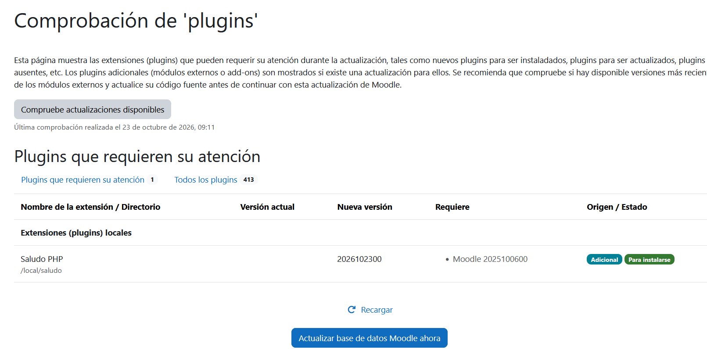

#### 6. Comprobar la sintaxis de PHP

Ejecuta cada comprobación. Todas deben mostrar `No syntax errors detected`:

```bash
php -l /var/www/moodle/public/local/saludo/version.php
```

```bash
php -l /var/www/moodle/public/local/saludo/index.php
```

```bash
php -l /var/www/moodle/public/local/saludo/lang/es/local_saludo.php
```

```bash
php -l /var/www/moodle/public/local/saludo/lang/en/local_saludo.php
```

#### 7. Asignar permisos de lectura

El código de Moodle debe poder ser leído por Apache, pero no debe ser modificable por el servidor web. Para mantener el propietario y grupo usados en esta instalación:

```bash
sudo chown -R root:www-data /var/www/moodle/public/local/saludo
sudo find /var/www/moodle/public/local/saludo -type d -exec chmod 755 {} \;
sudo find /var/www/moodle/public/local/saludo -type f -exec chmod 644 {} \;
```

Estos comandos dejan al propietario `root` como responsable de los archivos y permiten que Apache (`www-data`) los lea. No hagas escribible todo el código de Moodle por `www-data`.

#### 8. Instalar el complemento

Inicia sesión en Moodle como administrador y abre **Administración del sitio > Notificaciones** (o `/admin/index.php`). Moodle detectará el nuevo complemento y mostrará la pantalla para completar la instalación.

También se puede ejecutar la actualización desde la terminal:

```bash
sudo -u www-data php /var/www/moodle/admin/cli/upgrade.php
```

Este comando puede aplicar todas las actualizaciones pendientes de Moodle y sus complementos, no solo instalar `local_saludo`. Ejecútalo únicamente después de revisar las actualizaciones pendientes y tener una copia de seguridad.

#### 9. Purgar las cachés

Si cambias las cadenas de idioma y Moodle aún muestra el texto anterior, purga las cachés:

```bash
sudo -u www-data php /var/www/moodle/admin/cli/purge_caches.php
```

#### 10. Abrir y probar la página

En el navegador, abre:

```text
http://localhost/local/saludo/index.php
```

Si accedes desde otro equipo o la instalación utiliza un dominio o subcarpeta, sustituye `localhost` por la dirección y ruta de tu sitio; por ejemplo, `http://192.168.0.36/local/saludo/index.php`.

Comprueba que aparecen el saludo con el nombre de la persona usuaria, el aviso con el estilo del tema y la fecha y hora. Cierra la sesión e intenta abrir la página de nuevo: `require_login()` debe redirigir a la pantalla de acceso.

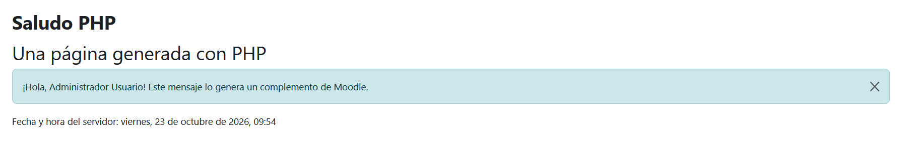

La práctica enseña cómo PHP produce contenido dentro de Moodle. Si el objetivo es cambiar los colores de toda la plataforma, se debe personalizar el tema mediante sus opciones y CSS/SCSS, no intentar hacerlo insertando PHP en el contenido del curso. No modifiques los archivos del núcleo ni permitas ejecutar scripts PHP subidos como recursos.

### 10.3 **Práctica 3:** personalización del tema y listado de cursos en PHP

**Enunciado**

En la instalación de Moodle 5.1 realizada en la práctica anterior, personaliza la apariencia del sitio y crea un complemento local nuevo, `local_miscursos`, que muestre a cada persona usuaria la lista de cursos en los que está matriculada, con enlace a cada curso. No hace falta saber PHP: se proporciona el código de los archivos y debes decidir cómo crearlos, instalarlos y comprobarlos con lo aprendido en 10.1 y 10.2.

Realiza las siguientes tareas:

1. Selecciona un tema compatible con Moodle 5.1. Si no hay otro tema instalado, utiliza **Boost**.
2. Personaliza la apariencia mediante las opciones del tema: cambia al menos los colores y añade o configura un logotipo. Si utilizas Boost, puedes aplicar un preset o emplear **SCSS en bruto** para los estilos, como se explica en el apartado 10.1.
3. Crea el complemento `local_miscursos` con la estructura y el código indicados más abajo.
4. Instala el complemento desde la administración del sitio y comprueba que su página usa el tema personalizado.
5. Matricula una cuenta de prueba en uno o dos cursos y comprueba que la página los lista; comprueba también el mensaje que aparece cuando no hay ningún curso.
6. Cierra la sesión y verifica que, al intentar abrir la página, Moodle solicita autenticarse.

#### Estructura del complemento

```text
public/local/miscursos/
├── version.php
├── index.php
└── lang/
    ├── en/local_miscursos.php
    └── es/local_miscursos.php
```

Ubícalo en `/var/www/moodle/public/local/miscursos`. Usa el mismo método de trabajo, permisos e instalación que en el apartado 10.2.

#### `version.php`

```php
<?php
defined('MOODLE_INTERNAL') || die();

$plugin->component = 'local_miscursos';
$plugin->version = 2026102300;
$plugin->requires = 2025100600;
```

#### `index.php`

```php
<?php
require(__DIR__ . '/../../../config.php');

// Obliga a iniciar sesión.
require_login();

// Configuración de la página.
$PAGE->set_context(context_system::instance());
$PAGE->set_url(new moodle_url('/local/miscursos/index.php'));
$PAGE->set_title(get_string('pluginname', 'local_miscursos'));
$PAGE->set_heading(get_string('pluginname', 'local_miscursos'));

// Cursos en los que está matriculada la persona que ha iniciado sesión.
$courses = enrol_get_my_courses();

echo $OUTPUT->header();
echo $OUTPUT->heading(get_string('heading', 'local_miscursos'));

if (empty($courses)) {
    echo $OUTPUT->notification(
        get_string('nocourses', 'local_miscursos'),
        \core\output\notification::NOTIFY_INFO
    );
} else {
    echo html_writer::tag('p', get_string('total', 'local_miscursos', count($courses)));

    $table = new html_table();
    $table->head = [
        get_string('course', 'local_miscursos'),
        get_string('shortname', 'local_miscursos'),
        get_string('startdate', 'local_miscursos'),
    ];

    foreach ($courses as $course) {
        $url = new moodle_url('/course/view.php', ['id' => $course->id]);
        $table->data[] = [
            html_writer::link($url, format_string($course->fullname)),
            format_string($course->shortname),
            userdate($course->startdate, get_string('strftimedatefullshort', 'langconfig')),
        ];
    }

    echo html_writer::table($table);
}

echo $OUTPUT->footer();
```

En resumen: `require_login()` exige sesión iniciada, `enrol_get_my_courses()` obtiene los cursos de la persona usuaria y el resto genera la tabla con la salida del tema activo.

#### `lang/es/local_miscursos.php`

```php
<?php
$string['pluginname'] = 'Mis cursos';
$string['heading'] = 'Cursos en los que estoy matriculado';
$string['total'] = 'Estás matriculado en {$a} curso(s).';
$string['nocourses'] = 'Todavía no estás matriculado en ningún curso.';
$string['course'] = 'Curso';
$string['shortname'] = 'Nombre corto';
$string['startdate'] = 'Fecha de inicio';
```

#### `lang/en/local_miscursos.php`

```php
<?php
$string['pluginname'] = 'My courses';
$string['heading'] = 'Courses I am enrolled in';
$string['total'] = 'You are enrolled in {$a} course(s).';
$string['nocourses'] = 'You are not enrolled in any course yet.';
$string['course'] = 'Course';
$string['shortname'] = 'Short name';
$string['startdate'] = 'Start date';
```

**Entrega**

Entrega una memoria con capturas del tema antes y después de personalizarlo, la estructura y el código del complemento, y la página «Mis cursos» funcionando con y sin cursos matriculados. Incluye una breve explicación de los cambios realizados y de las pruebas de acceso. No incluyas contraseñas ni datos personales reales.

No modifiques archivos del núcleo ni del tema instalado, y no publiques código PHP como recurso del curso. Los cambios visuales deben hacerse desde las opciones del tema o mediante SCSS/CSS; la lista de cursos debe implementarse como complemento de Moodle.

## 11. Mecanismos de seguridad

Moodle incluye mecanismos de autenticación, roles y capacidades, permisos por contexto, gestión de sesiones, validación de formularios y registro de eventos. Estas funciones deben configurarse correctamente y complementarse con la seguridad del servidor:

- Mantener Ubuntu, Moodle, temas y complementos actualizados.
- Publicar el sitio mediante HTTPS y redirigir HTTP a HTTPS.
- Utilizar contraseñas robustas, limitar las cuentas administrativas y revisar los métodos de autenticación.
- Asignar el mínimo de permisos necesario y no compartir cuentas.
- Mantener `moodledata` fuera de la raíz pública y restringir sus permisos.
- Restringir puertos con el cortafuegos; exponer solo los servicios necesarios, normalmente SSH y HTTPS.
- Realizar copias de seguridad de la base de datos y de `moodledata`, y probar su restauración.
- Revisar registros de Apache, tareas programadas, alertas y eventos de seguridad.
- No instalar complementos sin verificar su origen y compatibilidad.

La licencia de software libre no sustituye las obligaciones de privacidad, protección de datos ni las políticas del centro.

## 12. Verificación y rendimiento

La instalación se considera operativa cuando se puede acceder, iniciar sesión, navegar por un curso, abrir recursos, completar una actividad y guardar los resultados. También hay que verificar el cron, la conexión con la base de datos y la carga de archivos.

Comprobaciones básicas en el servidor:

```bash
sudo systemctl is-active apache2 mysql
sudo apache2ctl configtest
curl -I http://moodle.ejemplo.local
sudo tail -n 50 /var/log/apache2/moodle_error.log
```

En Moodle, revisa **Administración del sitio > Servidor > Entorno** y el estado de las tareas programadas. Corrige las advertencias de requisitos antes de publicar. Para evaluar rendimiento, registra el tiempo de respuesta y el uso de CPU, memoria, disco y base de datos durante una prueba representativa; aumenta usuarios gradualmente y observa cuándo aparecen errores o degradación. No realices pruebas de carga contra sistemas ajenos ni contra producción sin autorización.

El rendimiento también depende de la caché, el almacenamiento, la configuración de PHP, el tamaño de los cursos, las consultas a la base de datos y el número de usuarios simultáneos. Cualquier cambio debe medirse antes y después.

## 13. Publicación

Para publicar Moodle en Internet se necesita un dominio que resuelva a la dirección del servidor, reglas de red adecuadas y un certificado TLS válido. En un dominio real, Certbot puede automatizar la configuración de HTTPS para Apache:

```bash
sudo apt install certbot python3-certbot-apache
sudo certbot --apache -d aula.ejemplo.org
```

El dominio del ejemplo debe sustituirse por uno real configurado previamente. No se puede obtener un certificado público para un nombre ficticio o exclusivamente local. Comprueba la renovación automática del certificado y configura en Moodle la URL pública `https://aula.ejemplo.org`.

Antes de anunciar el sitio, verifica desde una red externa el acceso HTTPS, el inicio de sesión, la carga de recursos, los permisos, las copias de seguridad y la ausencia de errores. Documenta la versión instalada, los cambios realizados, las cuentas entregadas de forma segura y el procedimiento de recuperación.

## 14. Proyecto práctico final

### Enunciado

Prepara en **Moodle** un curso de demostración para un centro educativo. Partiendo de la instalación realizada en la práctica 2, crea y personaliza el curso, incorpora recursos y actividades, y gestiona una cuenta de alumno para comprobar cómo se ve y se utiliza desde su perfil.

### Temas a elegir

Cada alumno tendrá asignado uno de estos temas introductorios:

1. Servidores.
2. Sistemas operativos.
3. Comandos Linux.
4. Copias de seguridad.
5. Lenguajes de programación.
6. Hardware de equipos.
7. Direccionamiento IP.
8. Redes informáticas.
9. DNS.
10. Monitorización de sistemas.
11. Bases de datos.
12. Máquinas virtuales.

### Trabajo que debes realizar

1. **Crea un curso de demostración.** Elige uno de los temas de la lista y organiza el curso en al menos tres secciones. Explica brevemente qué aprenderá el alumnado.
2. **Personaliza el curso.** Configura su presentación y añade una descripción, una imagen o elementos visuales relacionados con el tema. Incorpora al menos dos recursos (por ejemplo, una página y un archivo o enlace) y dos actividades (por ejemplo, un cuestionario y una tarea).
3. **Gestiona al alumnado.** Crea una cuenta de alumno de prueba y matricúlala en el curso. Revisa su perfil y accede al curso con esa cuenta para comprobar cómo se presenta el contenido y qué opciones tiene disponibles.
4. **Comprueba el funcionamiento.** Desde la cuenta de alumno, abre los recursos y realiza o envía las actividades. Registra los resultados y añade capturas legibles de la vista del curso, su personalización, la matrícula y el perfil del alumno. Oculta cualquier dato personal innecesario.

### Entrega

Entrega una memoria ordenada que describa el tema y la organización del curso, las personalizaciones realizadas, los recursos y actividades incluidos y las comprobaciones efectuadas con la cuenta de alumno. Acompáñala de capturas legibles del curso y de la gestión del alumno (matrícula y perfil); oculta cualquier dato personal innecesario.

### Criterios de finalización

El proyecto estará completo cuando el curso esté organizado en al menos tres secciones, incluya las personalizaciones, recursos y actividades solicitados, y una cuenta de alumno esté matriculada y permita comprobar la vista del curso, el perfil y la realización de las actividades. La memoria debe explicar el trabajo y aportar evidencias de estas comprobaciones.

## 15. Fuentes y documentación

- [Documentación oficial de Moodle](https://docs.moodle.org/)
- [Desarrollo de complementos locales en Moodle 5.1](https://moodledev.io/docs/5.1/apis/plugintypes/local)
- [Archivo `version.php` y requisitos de versión de un complemento](https://moodledev.io/docs/5.1/apis/commonfiles/version.php)
- [Requisitos de servidor de Moodle 5.1](https://moodledev.io/general/releases/5.1#server-requirements)
- [Requisitos del servidor Moodle](https://docs.moodle.org/501/en/Server_requirements)
- [Instalación de Moodle](https://docs.moodle.org/501/en/Installing_Moodle)
- [Documentación de Ubuntu Server](https://documentation.ubuntu.com/server/)
- [Licencia GNU GPL](https://www.gnu.org/licenses/gpl-3.0.html)