[⌂ Volver al inicio](index.md)

## Índice

- [1. Introducción](#1-introducción)
- [2. Objetivos de la unidad](#2-objetivos-de-la-unidad)
- [3. WordPress: conceptos básicos](#3-wordpress-conceptos-básicos)
- [4. Instalación de WordPress en Ubuntu Server 24.04](#4-instalación-de-wordpress-en-ubuntu-server-2404)
  - [Práctica 1: instalación de WordPress en Ubuntu Server 24.04](#práctica-1-instalación-de-wordpress-en-ubuntu-server-2404)
- [5. El panel de administración](#5-el-panel-de-administración)
- [6. Creación de contenidos](#6-creación-de-contenidos)
- [7. Temas y plantillas](#7-temas-y-plantillas)
  - [Práctica 2: diseño del sitio con plantillas y tema hijo](#práctica-2-diseño-del-sitio-con-plantillas-y-tema-hijo)
- [8. Plugins](#8-plugins)
- [9. Usuarios y roles](#9-usuarios-y-roles)
  - [Práctica 3: usuarios, roles y plugins](#práctica-3-usuarios-roles-y-plugins)
- [10. Sindicación de contenidos](#10-sindicación-de-contenidos)
- [11. Importar y exportar contenidos](#11-importar-y-exportar-contenidos)
- [12. Copias de seguridad](#12-copias-de-seguridad)
- [13. Actualizaciones](#13-actualizaciones)
- [14. Informes de acceso y estadísticas](#14-informes-de-acceso-y-estadísticas)
  - [Práctica 4: mantenimiento del sitio](#práctica-4-mantenimiento-del-sitio)
- [15. Seguridad básica](#15-seguridad-básica)
- [16. Proyecto práctico final](#16-proyecto-práctico-final)
- [17. Fuentes y documentación](#17-fuentes-y-documentación)

---

## 1. Introducción


*Logotipo de WordPress. Fuente: Wikimedia Commons.*

En la unidad anterior implantamos un gestor de aprendizaje (Moodle). En esta unidad trabajaremos con WordPress, el gestor de contenidos (CMS) más utilizado del mundo: según W3Techs, impulsa en torno a cuatro de cada diez sitios web. Nació en 2003 como una herramienta para crear blogs y hoy se usa para webs corporativas, periódicos digitales, portafolios, tiendas en línea o intranets.

Su éxito se explica por cuatro razones:

- **Es software libre** (licencia GPL): se puede usar, estudiar, modificar y redistribuir.
- **Es fácil de usar**: quien publica no necesita saber programar.
- **Es extensible**: miles de temas cambian su aspecto y miles de plugins le añaden funciones.
- **Tiene una comunidad enorme**: documentación, foros, traducciones y eventos en todo el mundo.

En esta unidad no solo aprenderemos a *usar* WordPress, sino a implantarlo y administrarlo como lo haría un técnico: lo instalaremos en una máquina virtual con Ubuntu Server 24.04, Apache, MySQL y PHP, lo visualizaremos desde el equipo anfitrión con Windows, lo configuraremos, gestionaremos su diseño, sus usuarios y sus módulos, y nos ocuparemos de las tareas de mantenimiento que mantienen vivo un sitio real: copias de seguridad, actualizaciones, exportaciones y estadísticas de acceso.

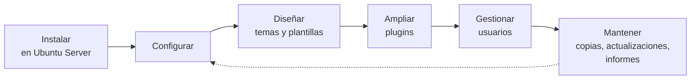

## 2. Objetivos de la unidad

- Comprender qué es WordPress, cómo está construido y qué diferencia WordPress.org de WordPress.com.
- Instalar WordPress en una máquina virtual con Ubuntu Server 24.04, Apache, PHP y MySQL, acceder a él desde el host mediante NAT y reenvío de puertos, y protegerlo con HTTPS.
- Configurar el sitio desde el panel de administración y crear contenidos con el editor de bloques.
- Gestionar temas y plantillas, y personalizar el diseño sin perder los cambios al actualizar.
- Seleccionar, instalar y configurar plugins según las necesidades del sitio, y crear un plugin sencillo.
- Crear usuarios con distintos roles y adaptar sus permisos.
- Ofrecer y consumir contenidos mediante sindicación (RSS/Atom).
- Importar y exportar contenidos en distintos formatos.
- Realizar copias de seguridad, restaurarlas y actualizar el sitio de forma segura.
- Obtener e interpretar informes de acceso y de actividad.

## 3. WordPress: conceptos básicos

### 3.1 ¿Qué es WordPress?

WordPress es un sistema de gestión de contenidos (CMS, *Content Management System*) de código abierto, escrito en PHP y que guarda la información en una base de datos MySQL o MariaDB. Permite crear, organizar y publicar contenido web desde el navegador, a través de un panel de administración, sin tener que programar cada página.

La idea central de cualquier CMS, y de WordPress en particular, es separar tres cosas:

- **El contenido:** los textos, imágenes, documentos y datos que escriben los usuarios. Se guarda en la base de datos.
- **La presentación:** el diseño, es decir, cómo se ve ese contenido. Lo decide el tema activo.
- **La funcionalidad:** lo que el sitio sabe hacer, como formularios, tienda, copias de seguridad o estadísticas. La aportan el núcleo y los plugins.

Gracias a esa separación, una persona sin conocimientos técnicos puede publicar una noticia mientras otra cambia el diseño del sitio sin tocar ni una línea del contenido.

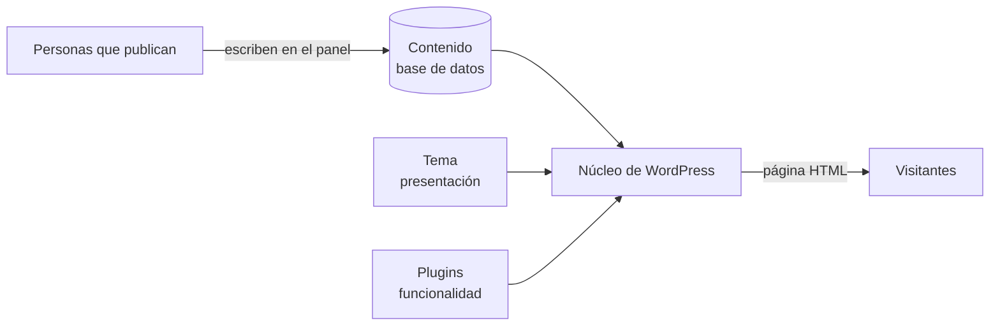

**Un poco de historia.** WordPress nació en 2003, cuando Matt Mullenweg y Mike Little partieron del código de un programa de blogs abandonado (b2/cafelog) para crear uno nuevo. Desde entonces lo desarrolla una comunidad abierta de miles de personas voluntarias y de empresas. Cada versión principal lleva el nombre de un músico de jazz.

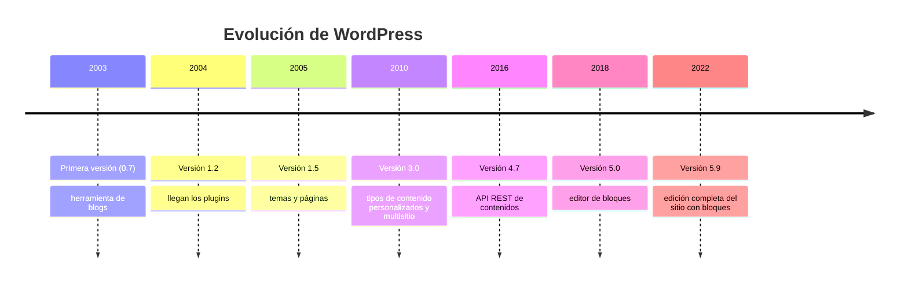

Esa evolución explica cómo ha pasado de ser una herramienta para blogs a un CMS de uso general: primero se pudo ampliar (plugins), luego cambiar el diseño (temas), después crear cualquier tipo de contenido (productos, cursos, eventos) y, por último, diseñar el sitio entero con bloques.

**Vocabulario básico.** Estos términos aparecerán a lo largo de toda la unidad:

| Término | Qué es |
| --- | --- |
| Núcleo (*core*) | El código base de WordPress, común a todas las instalaciones |
| Escritorio (*dashboard*) | El panel de administración, en `/wp-admin` |
| Entrada (*post*) | Contenido fechado: noticias, artículos de blog |
| Página (*page*) | Contenido estable: Inicio, Contacto, Aviso legal |
| Medios | Imágenes, vídeos, PDF y otros archivos subidos |
| Categorías y etiquetas | Formas de clasificar las entradas |
| Bloque | Cada elemento del contenido en el editor: párrafo, imagen, tabla, botón… |
| Tema | Paquete que define el diseño del sitio |
| Plantilla | Diseño de un tipo de vista concreto (una entrada, una página, un archivo…) |
| Plugin | Complemento que añade funciones |
| Shortcode | Código entre corchetes, como `[gallery]`, que un plugin sustituye por contenido |
| Rol | Conjunto de permisos de un usuario: administrador, editor, autor… |
| Feed | Archivo RSS o Atom con las últimas publicaciones, para la sindicación |

**Ventajas e inconvenientes**

| Ventajas | Inconvenientes |
| --- | --- |
| Gratuito y libre, sin dependencia de un proveedor | Hay que mantenerlo: actualizaciones, copias y seguridad |
| Fácil de usar para quien publica | Es el objetivo principal de los ataques automatizados, precisamente por ser el más usado |
| Miles de temas y plugins | Abusar de plugins lo vuelve lento, inestable e inseguro |
| Comunidad enorme, documentación y traducción al español | La calidad de temas y plugins de terceros es muy desigual |
| Funciona en casi cualquier servidor con PHP y MySQL | Para aplicaciones web muy específicas puede quedarse corto o complicarse |
| Exporta sus contenidos en formatos estándar | Algunos plugins comerciales encarecen el proyecto con licencias anuales |

### 3.2 ¿Para qué se usa?

Aunque nació para blogs, hoy WordPress sirve para casi cualquier tipo de sitio web. Según W3Techs, lo usan en torno a cuatro de cada diez sitios de Internet, desde blogs personales hasta webs de grandes organizaciones. El escaparate oficial, [wordpress.org/showcase](https://wordpress.org/showcase/), recoge ejemplos como la web de la Casa Blanca, el centro de noticias de Microsoft o TechCrunch.

| Tipo de sitio | Cómo lo resuelve WordPress | Ejemplo de uso |
| --- | --- | --- |
| Blog | Entradas, categorías, comentarios y feeds de serie | Blog personal, blog de un departamento |
| Web corporativa o institucional | Páginas, menús, formularios de contacto | Web de una empresa, un ayuntamiento o un instituto |
| Periódico o revista digital | Entradas por secciones, varios autores y roles, flujo editorial | Diario local, revista de tecnología |
| Tienda en línea | Plugin WooCommerce: productos, carrito, pagos y envíos | Comercio local que vende por Internet |
| Portafolio | Galerías, proyectos y diseño visual | Fotógrafo, estudio de diseño |
| Plataforma de formación | Plugins LMS (Tutor LMS, LearnDash, Sensei) | Academia que vende cursos en línea |
| Comunidad o foro | Plugins bbPress y BuddyPress | Asociación, club de usuarios |
| Intranet | Sitio privado con acceso por roles | Documentación interna de una empresa |
| Sitio multilingüe | Plugins Polylang o TranslatePress | Web turística en varios idiomas |
| CMS desacoplado (*headless*) | WordPress gestiona el contenido y lo entrega por la API REST a otra aplicación | App móvil o web hecha con React que lee las noticias de WordPress |

**Cuándo no es la mejor opción.** WordPress no siempre es la respuesta:

- Para una plataforma de aprendizaje con matriculaciones, calificaciones y seguimiento académico, un LMS como Moodle (UD2) está mejor preparado.
- Para una aplicación web a medida (gestión de citas compleja, un ERP, una red social), suele ser mejor un *framework* de programación como Laravel o Django.
- Para una página sencilla que casi nunca cambia, un sitio estático es más rápido, barato y seguro.
- Para quien no puede o no quiere mantener un servidor, un servicio alojado (WordPress.com, Wix, Squarespace) evita ese trabajo, a cambio de menos control.

**Comparación con otros CMS**

| CMS | Puntos fuertes | Puntos débiles |
| --- | --- | --- |
| WordPress | Facilidad de uso, ecosistema enorme, comunidad | Mantenimiento y seguridad de plugins |
| Joomla | Gestión de usuarios y multilingüe integrados | Comunidad y ecosistema menores |
| Drupal | Muy potente y flexible para sitios grandes y complejos | Curva de aprendizaje alta |
| Wix, Squarespace | Sin servidor ni mantenimiento, editor visual | Propietarios, menos control, difícil migrar |

### 3.3 WordPress.org y WordPress.com

Es una de las confusiones más habituales. Los dos nombres se refieren al mismo software, pero a dos formas muy distintas de usarlo:

- **WordPress.org:** es la web del proyecto libre. Desde ella se descarga WordPress para instalarlo en un servidor propio o contratado (de ahí que se llame "autoalojado", *self-hosted*). También alberga la documentación, los foros de soporte y los directorios oficiales de temas y plugins. El software pertenece a la comunidad y su marca la protege la Fundación WordPress.
- **WordPress.com:** es un servicio comercial de la empresa Automattic, fundada por Matt Mullenweg, uno de los creadores de WordPress. Ofrece WordPress ya instalado y mantenido: creas una cuenta y empiezas a publicar, sin servidor. Tiene un plan gratuito, con publicidad, subdominio del tipo `misitio.wordpress.com` y funciones limitadas, y planes de pago que añaden dominio propio, plugins y temas.

| | **WordPress.org** (autoalojado) | **WordPress.com** (servicio) |
| --- | --- | --- |
| Qué es | El software libre que descargas e instalas | Una plataforma comercial que aloja WordPress por ti |
| Servidor | Lo pones tú: hosting, VPS, nube o, como en esta unidad, una máquina virtual | Lo pone Automattic |
| Dominio | El que contrates | Subdominio `.wordpress.com` gratis; dominio propio en planes de pago |
| Temas y plugins | Cualquiera, incluidos los tuyos | Limitados en los planes básicos; libres en los superiores |
| Acceso al código y a la base de datos | Total | Muy limitado o nulo, según el plan |
| Publicidad | Solo la que tú pongas | El plan gratuito muestra anuncios de la plataforma |
| Mantenimiento | Tu responsabilidad: copias, actualizaciones y seguridad | Lo hace el proveedor |
| Coste | Software gratuito; pagas el servidor y el dominio | Plan gratuito limitado y planes de pago |
| En esta unidad | **Sí: es lo que vamos a implantar** | No |

Entre ambos extremos hay una tercera vía muy común: los proveedores de *hosting* que ofrecen WordPress instalado con un clic o "WordPress gestionado". Es WordPress.org, con control total, pero el proveedor se encarga de parte del mantenimiento.

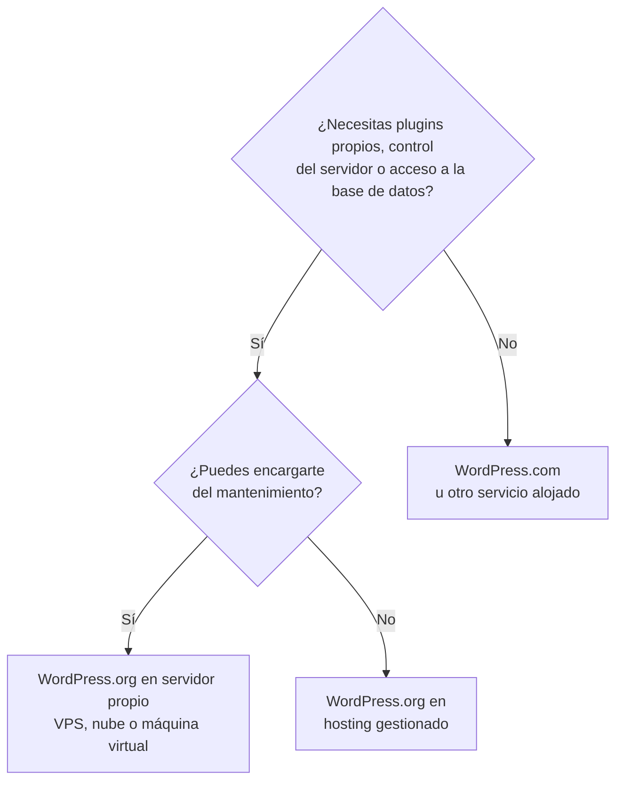

Como técnicos de implantación, nos interesa WordPress.org: es el que instalaremos, configuraremos y mantendremos en nuestro propio servidor.

> **Probar WordPress sin instalar nada.** [WordPress Playground](https://playground.wordpress.net/) ejecuta un WordPress completo dentro del navegador, sin servidor. Es útil para curiosear el panel o probar un plugin antes de instalarlo, pero todo se borra al cerrar la pestaña.

### 3.4 Licencia

WordPress se distribuye bajo la licencia GNU GPL versión 2 o posterior. Los temas y plugins que se publican en el directorio oficial también deben ser compatibles con la GPL. Sin embargo, muchos temas y plugins comerciales (*premium*) tienen condiciones adicionales para el soporte o las actualizaciones, y las imágenes, fuentes o textos que los acompañan pueden tener licencias diferentes. Comprueba siempre la licencia de cada elemento antes de usarlo y respeta los derechos de autor de los contenidos que publiques.

### 3.5 Arquitectura y requisitos

WordPress es una aplicación web escrita en PHP que guarda la información en una base de datos MySQL o MariaDB. Cuando un visitante pide una página, el proceso es:

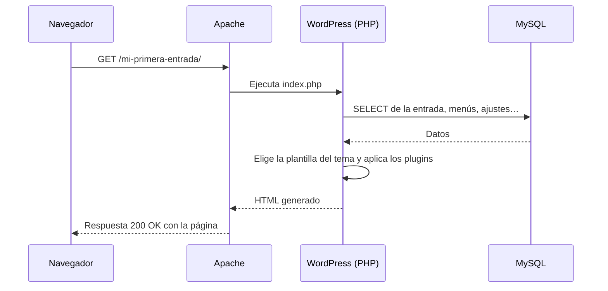

Es decir, las páginas no existen como archivos HTML: se generan en cada petición combinando los datos de la base de datos con las plantillas del tema. Por eso un mismo contenido puede cambiar de aspecto con solo cambiar de tema.

Requisitos recomendados (consulta siempre la [página oficial de requisitos](https://wordpress.org/about/requirements/), porque cambian con cada versión):

| Componente | Recomendación |
| --- | --- |
| PHP | 8.3 o superior, con las extensiones `mysqli`, `curl`, `gd` o `imagick`, `mbstring`, `xml`, `zip` e `intl` |
| Base de datos | MySQL 8.0 o superior, o MariaDB 10.6 o superior |
| Servidor web | Apache con `mod_rewrite` o Nginx |
| Conexión | HTTPS (certificado TLS) |

### 3.6 Estructura de archivos y de la base de datos

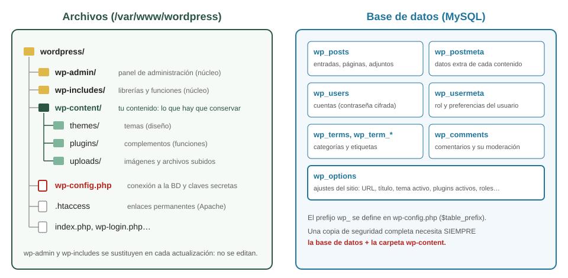

*Figura: carpetas principales de WordPress y tablas de su base de datos.*

Ideas clave:

- **`wp-admin` y `wp-includes` forman el núcleo**. Se reemplazan en cada actualización: cualquier cambio que hagas en ellos se perderá.
- **`wp-content` es "tuyo"**: temas, plugins y archivos subidos. Junto con la base de datos, es lo que hay que copiar en una copia de seguridad.
- **`wp-config.php` es el archivo más sensible**: contiene el usuario y la contraseña de la base de datos y las claves secretas. Nunca debe publicarse ni compartirse.
- En la base de datos, el contenido (entradas, páginas, menús, plantillas editadas…) vive en `wp_posts`, y los ajustes generales en `wp_options`.

## 4. Instalación de WordPress en Ubuntu Server 24.04

Instalaremos WordPress en una máquina virtual (VM) de VirtualBox con Ubuntu Server 24.04 LTS, sobre la pila que ya conoces: Linux, Apache, MySQL y PHP (LAMP). La VM usará la red NAT de VirtualBox y visualizaremos el sitio desde el navegador del equipo anfitrión con Windows (el *host*) mediante reenvío de puertos.

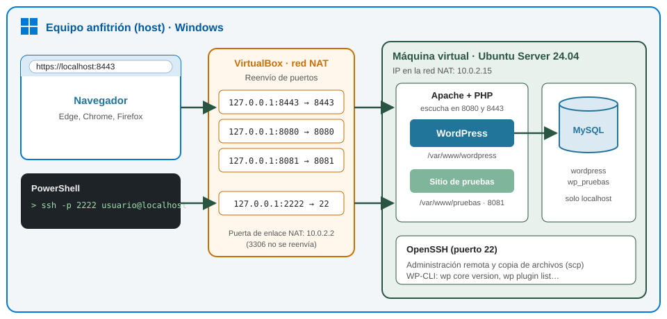

*Figura: el navegador del host pide `localhost:8080`; VirtualBox reenvía la petición a la VM a través de la red NAT; dentro, Apache ejecuta WordPress, que consulta MySQL.*

### 4.1 La red NAT y el reenvío de puertos

Con el adaptador de red en modo NAT, VirtualBox actúa como un pequeño *router* para la VM:

- La VM recibe una dirección privada, normalmente `10.0.2.15`, y sale a Internet a través del host (puede descargar paquetes y actualizaciones).
- Para la VM, el host aparece con la dirección `10.0.2.2` (la puerta de enlace de la red NAT).
- Pero el host no puede llegar directamente a `10.0.2.15`: esa red solo existe dentro de VirtualBox.

Para que el navegador de Windows vea el servidor web de la VM, hay que reenviar puertos: le decimos a VirtualBox que lo que llegue a un puerto del host se entregue a un puerto de la VM.

| Nombre | Protocolo | IP anfitrión | Puerto anfitrión | IP invitado | Puerto invitado | Uso |
| --- | --- | --- | --- | --- | --- | --- |
| `ssh` | TCP | `127.0.0.1` | `2222` | *(vacío)* | `22` | Administrar la VM por SSH desde Windows |
| `http` | TCP | `127.0.0.1` | `8080` | *(vacío)* | `8080` | WordPress por HTTP |
| `https` | TCP | `127.0.0.1` | `8443` | *(vacío)* | `8443` | WordPress por HTTPS |
| `pruebas` | TCP | `127.0.0.1` | `8081` | *(vacío)* | `8081` | Sitio de pruebas (apartado 4.11) |

Dos decisiones importantes de esta tabla:

- **IP anfitrión `127.0.0.1`**: los puertos solo se abren para el propio equipo Windows; nadie más de la red del aula o de casa puede conectarse a tu VM.
- **El mismo número de puerto dentro y fuera (8080 → 8080)**: WordPress guarda su dirección (`http://localhost:8080`) en la base de datos y a veces se hace peticiones a sí mismo (tareas programadas, comprobaciones de *Salud del sitio*, la API REST). Si Apache, dentro de la VM, escucha también en el 8080, esa dirección funciona igual desde el host que desde la propia VM. Si reenviáramos 8080 → 80, dentro de la VM `localhost:8080` no respondería y esas funciones fallarían.

**Configurarlo desde la interfaz de VirtualBox:**

1. Selecciona la VM y abre Configuración > Red > Adaptador 1.
2. Comprueba que está habilitado y conectado a NAT.
3. Despliega Avanzadas y pulsa Reenvío de puertos.
4. Añade con el botón + las reglas de la tabla y acepta.

**O desde PowerShell en Windows**, con la VM apagada (sustituye `UbuntuWP` por el nombre de tu VM):

```powershell
cd "C:\Program Files\Oracle\VirtualBox"
.\VBoxManage.exe modifyvm "UbuntuWP" --natpf1 "ssh,tcp,127.0.0.1,2222,,22"
.\VBoxManage.exe modifyvm "UbuntuWP" --natpf1 "http,tcp,127.0.0.1,8080,,8080"
.\VBoxManage.exe modifyvm "UbuntuWP" --natpf1 "https,tcp,127.0.0.1,8443,,8443"
.\VBoxManage.exe modifyvm "UbuntuWP" --natpf1 "pruebas,tcp,127.0.0.1,8081,,8081"
.\VBoxManage.exe showvminfo "UbuntuWP" | Select-String "NIC 1 Rule"
```

Con la VM encendida, el comando equivalente es `.\VBoxManage.exe controlvm "UbuntuWP" natpf1 "http,tcp,127.0.0.1,8080,,8080"`.

> Usaremos la máquina virtual de la UD2, en la que ya está Moodle. Si en la UD2 configuraste el adaptador en modo puente, cámbialo ahora a NAT (con la VM apagada). Moodle seguirá instalado, pero su dirección (`wwwroot`) apunta a la IP del modo puente: si vuelves a necesitarlo, restablece el modo puente. Recursos recomendados para la VM: 2 CPU, 2 GB de RAM como mínimo y al menos 10 GB de disco libre.

### 4.2 Preparar el sistema

Inicia sesión en la VM, actualiza el sistema y ajusta la zona horaria (la usarán los registros, las copias y las publicaciones programadas):

```bash
sudo apt update && sudo apt upgrade -y
sudo timedatectl set-timezone Europe/Madrid
ip -br address
```

El último comando muestra la IP de la VM (`10.0.2.15` en la interfaz `enp0s3`). Comprueba también que la VM tiene salida a Internet con `ping -c 3 wordpress.org`.

Si tienes activado el cortafuegos de Ubuntu (`sudo ufw status`), permite los puertos que vamos a usar:

```bash
sudo ufw allow 22/tcp
sudo ufw allow 8080/tcp
sudo ufw allow 8443/tcp
sudo ufw allow 8081/tcp
```

### 4.3 Conectarse por SSH desde Windows

Trabajar desde una terminal de Windows es más cómodo que desde la consola de VirtualBox: puedes copiar y pegar comandos. Si no instalaste el servidor SSH al instalar Ubuntu, hazlo ahora en la VM:

```bash
sudo apt install -y openssh-server
sudo systemctl enable --now ssh
```

Desde PowerShell en Windows, conéctate al puerto reenviado (cambia `usuario` por tu usuario de Ubuntu):

```powershell
ssh -p 2222 usuario@localhost
```

La primera vez te pedirá confirmar la huella del servidor: escribe `yes`. Para copiar archivos entre la VM y Windows usaremos `scp` con el mismo puerto (en mayúscula: `-P 2222`).

### 4.4 Comprobar Apache, MySQL y PHP

Usaremos la misma máquina virtual de la UD2: Apache, PHP 8.3 y MySQL 8.4 ya se instalaron y configuraron para Moodle en el apartado [7.1 Comprobar, actualizar e instalar los servicios necesarios](ud2.md#71-comprobar-actualizar-e-instalar-los-servicios-necesarios) de la UD2. No hay que reinstalarlos: basta con comprobar que siguen funcionando y añadir lo poco que WordPress necesita y Moodle no.

> Si trabajas con una máquina virtual nueva, sigue primero el apartado 7.1 de la UD2 para instalar los servicios. WordPress funciona tanto con el MySQL 8.0 de los repositorios de Ubuntu como con el MySQL 8.4 instalado en la UD2, así que la actualización de MySQL no es imprescindible para esta unidad.

**Paso 1. Comprobar que los servicios están activos y sus versiones:**

```bash
sudo apt update && sudo apt upgrade -y
sudo systemctl is-active apache2 mysql
sudo apache2ctl configtest
apache2 -v
php -v
sudo mysql -NBe 'SELECT VERSION();'
```

Apache y MySQL deben aparecer como `active`, la prueba de Apache debe indicar `Syntax OK`, PHP debe ser la versión 8.3 o superior y MySQL, la 8.0 o superior. Si algún servicio está inactivo, arráncalo con `sudo systemctl enable --now apache2 mysql`.

**Paso 2. Comprobar las extensiones de PHP.** WordPress utiliza las mismas que Moodle (`mysqli`, `curl`, `gd`, `intl`, `mbstring`, `xml`, `zip`), y además aprovecha `imagick` (mejor tratamiento de imágenes) y `bcmath`:

```bash
php -m | grep -E -i 'mysqli|curl|gd|intl|mbstring|xml|zip|imagick|bcmath'
dpkg -s php-imagick php-bcmath unzip 2>/dev/null | grep -E '^(Package|Status)'
```

Instala solo lo que falte (`apt` mantiene lo que ya está instalado) y reinicia Apache para que cargue las nuevas extensiones:

```bash
sudo apt install -y php-imagick php-bcmath unzip
sudo systemctl restart apache2
```

**Paso 3. Revisar la configuración de PHP.** En la UD2 ya se ampliaron en `/etc/php/8.3/apache2/php.ini` los límites de subida de archivos (`upload_max_filesize = 100M` y `post_max_size = 110M`), que también le sirven a WordPress para subir imágenes, temas y archivos de importación. Compruébalo junto con la memoria y el tiempo de ejecución:

```bash
grep -E '^[[:space:]]*(upload_max_filesize|post_max_size|memory_limit|max_execution_time)[[:space:]]*=' /etc/php/8.3/apache2/php.ini
```

Si `memory_limit` es inferior a `256M` o `max_execution_time` inferior a `120`, ajústalos (por ejemplo, para importaciones grandes o al instalar plugins pesados) con el mismo método que en la UD2 y reinicia Apache:

```bash
sudo sed -i -E 's/^[[:space:]]*;?[[:space:]]*memory_limit[[:space:]]*=.*/memory_limit = 256M/' /etc/php/8.3/apache2/php.ini
sudo sed -i -E 's/^[[:space:]]*;?[[:space:]]*max_execution_time[[:space:]]*=.*/max_execution_time = 120/' /etc/php/8.3/apache2/php.ini
sudo systemctl restart apache2
```

Estos cambios afectan a todo el PHP de Apache, por lo que también se aplican a Moodle. Son valores compatibles con ambas aplicaciones.

### 4.5 Crear la base de datos

En Ubuntu, el usuario `root` de MySQL se autentica con el sistema, así que puedes entrar con `sudo mysql`. Crea una base de datos y un usuario exclusivo para WordPress, con permisos solo sobre ella. No reutilices la base de datos ni el usuario de Moodle: cada aplicación debe tener los suyos, de modo que un fallo de seguridad en una no comprometa los datos de la otra.

```bash
sudo mysql
```

```sql
CREATE DATABASE wordpress DEFAULT CHARACTER SET utf8mb4 COLLATE utf8mb4_unicode_ci;
CREATE USER 'wpuser'@'localhost' IDENTIFIED BY 'Cambia_Esta_Clave_2026!';
GRANT ALL PRIVILEGES ON wordpress.* TO 'wpuser'@'localhost';
FLUSH PRIVILEGES;
EXIT;
```

Comprueba que el nuevo usuario puede conectarse:

```bash
mysql -u wpuser -p -e "SHOW DATABASES;"
```

> El usuario se crea como `'wpuser'@'localhost'`: solo puede conectarse desde la propia VM. MySQL no debe ser accesible desde fuera, por eso no reenviamos el puerto 3306.

### 4.6 Descargar WordPress

Descarga la última versión en español desde el sitio oficial, descomprímela y colócala en `/var/www/wordpress`:

```bash
cd /tmp
wget https://es.wordpress.org/latest-es_ES.tar.gz
tar -xzf latest-es_ES.tar.gz
sudo mv wordpress /var/www/wordpress
```

Asigna los archivos al usuario de Apache (`www-data`) y unos permisos razonables: directorios `755` y archivos `644`.

```bash
sudo chown -R www-data:www-data /var/www/wordpress
sudo find /var/www/wordpress -type d -exec chmod 755 {} \;
sudo find /var/www/wordpress -type f -exec chmod 644 {} \;
```

Que los archivos pertenezcan a `www-data` permite que WordPress instale plugins, temas y actualizaciones desde el panel sin pedir credenciales FTP.

### 4.7 Configurar Apache

**Paso 1. Hacer que Apache escuche en el puerto 8080.** Edita `/etc/apache2/ports.conf`:

```bash
sudo nano /etc/apache2/ports.conf
```

Debajo de `Listen 80`, añade:

```apache
Listen 8080
```

**Paso 2. Crear el sitio virtual de WordPress:**

```bash
sudo nano /etc/apache2/sites-available/wordpress.conf
```

```apache
<VirtualHost *:8080>
    ServerName localhost
    DocumentRoot /var/www/wordpress

    <Directory /var/www/wordpress>
        Options FollowSymLinks
        AllowOverride All
        Require all granted
    </Directory>

    ErrorLog ${APACHE_LOG_DIR}/wordpress_error.log
    CustomLog ${APACHE_LOG_DIR}/wordpress_access.log combined
</VirtualHost>
```

- `AllowOverride All` permite que WordPress use su archivo `.htaccess` para los enlaces permanentes.
- Los registros propios (`wordpress_access.log`) nos servirán en el apartado 14 para obtener informes de acceso.

**Paso 3. Activar el sitio y el módulo `rewrite`, y recargar Apache:**

```bash
sudo a2ensite wordpress
sudo a2enmod rewrite
sudo apache2ctl configtest
sudo systemctl restart apache2
```

`configtest` debe responder `Syntax OK`. El sitio de Moodle de la UD2 sigue en el puerto 80 y WordPress está en el 8080: son sitios virtuales distintos y no interfieren entre sí.

**Paso 4. Comprobar que Apache responde**, primero dentro de la VM y después desde Windows:

```bash
sudo ss -tlnp | grep apache2
curl -I http://localhost:8080
```

```powershell
Test-NetConnection localhost -Port 8080
```

El primer comando debe mostrar Apache escuchando en los puertos 80 y 8080; `curl` debe devolver una respuesta HTTP (`302 Found` hacia el instalador); y en Windows debe aparecer `TcpTestSucceeded : True`. Si da `False`, revisa las reglas de reenvío de puertos de VirtualBox y el cortafuegos de Ubuntu.

### 4.8 El instalador web

En el navegador de Windows, abre `http://localhost:8080`. WordPress detecta que no existe `wp-config.php` y lanza el asistente:

1. **Idioma**: español.
2. **Datos de la base de datos**:

| Campo | Valor |
| --- | --- |
| Nombre de la base de datos | `wordpress` |
| Nombre de usuario | `wpuser` |
| Contraseña | la que definiste |
| Servidor de la base de datos | `localhost` |
| Prefijo de tabla | `wp_` (puedes cambiarlo, p. ej. `iaw_`) |

3. WordPress crea `wp-config.php` con esos datos y con unas claves secretas aleatorias. Pulsa Ejecutar la instalación.
4. **Datos del sitio**: título, nombre de usuario administrador (no uses `admin`), contraseña robusta y correo electrónico. Como es un sitio de laboratorio, marca Pedir a los motores de búsqueda que no indexen este sitio.
5. Inicia sesión en `http://localhost:8080/wp-admin`.

WordPress ha guardado `http://localhost:8080` como dirección del sitio: accede siempre con esa URL. Si entraras con otra (por ejemplo, `http://127.0.0.1:8080`), WordPress te redirigiría a la guardada.

Por último, protege el archivo de configuración para que solo lo lean su propietario y el grupo:

```bash
sudo chmod 640 /var/www/wordpress/wp-config.php
```

### 4.9 Administrar desde la terminal: WP-CLI

WP-CLI es la herramienta oficial de línea de comandos de WordPress. Permite hacer desde la terminal casi todo lo que se hace en el panel, y es imprescindible para automatizar copias y actualizaciones.

```bash
curl -O https://raw.githubusercontent.com/wp-cli/builds/gh-pages/phar/wp-cli.phar
php wp-cli.phar --info
chmod +x wp-cli.phar
sudo mv wp-cli.phar /usr/local/bin/wp
```

Ejecútala siempre como el usuario de Apache e indicando la ruta del sitio:

```bash
sudo -u www-data wp --path=/var/www/wordpress core version
sudo -u www-data wp --path=/var/www/wordpress option get siteurl
sudo -u www-data wp --path=/var/www/wordpress plugin list
```

Para escribir menos, puedes crear un alias en tu `~/.bashrc`:

```bash
echo "alias wp='sudo -u www-data /usr/local/bin/wp --path=/var/www/wordpress'" >> ~/.bashrc
source ~/.bashrc
wp core version
```

En el resto de la unidad usaremos ese alias.

### 4.10 HTTPS con un certificado autofirmado

Un sitio real debe usar HTTPS. En producción, el certificado lo emite una autoridad de certificación como Let's Encrypt para un nombre de dominio público. Nuestro sitio solo es accesible en `localhost`, así que crearemos un certificado autofirmado: cifra la conexión igual, pero el navegador avisará de que no lo firma ninguna autoridad de confianza.

**Paso 1. Generar el certificado y su clave privada** (válidos un año, para `localhost`):

```bash
sudo openssl req -x509 -nodes -days 365 -newkey rsa:2048 \
  -keyout /etc/ssl/private/wordpress.key \
  -out /etc/ssl/certs/wordpress.crt \
  -subj "/C=ES/ST=Andalucia/O=IAW/CN=localhost" \
  -addext "subjectAltName=DNS:localhost,IP:127.0.0.1"
```

**Paso 2. Escuchar en el puerto 8443.** En `/etc/apache2/ports.conf`, añade debajo de `Listen 8080`:

```apache
Listen 8443
```

**Paso 3. Crear el sitio HTTPS y redirigir el HTTP.** Edita `wordpress.conf` para que quede así:

```apache
<VirtualHost *:8080>
    ServerName localhost
    # Todo lo que llegue por HTTP se redirige a HTTPS
    Redirect permanent / https://localhost:8443/
</VirtualHost>

<VirtualHost *:8443>
    ServerName localhost
    DocumentRoot /var/www/wordpress

    SSLEngine on
    SSLCertificateFile    /etc/ssl/certs/wordpress.crt
    SSLCertificateKeyFile /etc/ssl/private/wordpress.key

    <Directory /var/www/wordpress>
        Options FollowSymLinks
        AllowOverride All
        Require all granted
    </Directory>

    ErrorLog ${APACHE_LOG_DIR}/wordpress_error.log
    CustomLog ${APACHE_LOG_DIR}/wordpress_access.log combined
</VirtualHost>
```

```bash
sudo a2enmod ssl
sudo apache2ctl configtest
sudo systemctl restart apache2
```

**Paso 4. Indicar a WordPress su nueva dirección** y actualizar los enlaces ya guardados en el contenido:

```bash
wp option update home 'https://localhost:8443'
wp option update siteurl 'https://localhost:8443'
wp search-replace 'http://localhost:8080' 'https://localhost:8443' --all-tables --dry-run
wp search-replace 'http://localhost:8080' 'https://localhost:8443' --all-tables
```

`search-replace` cambia las direcciones también dentro de los datos serializados; `--dry-run` muestra antes cuántos cambios haría sin aplicarlos.

**Paso 5. Comprobar.** Abre `https://localhost:8443` en Windows. El navegador mostrará un aviso (*"La conexión no es privada"*): es lo esperado con un certificado autofirmado. Pulsa Configuración avanzada > Continuar a localhost. Comprueba también que `http://localhost:8080` te lleva a la versión HTTPS.

> **Opcional: evitar el aviso en Edge y Chrome.** Copia el certificado (¡solo el `.crt`, nunca la clave!) a Windows y añádelo a las entidades de confianza de tu usuario. Desde PowerShell:
>
> ```powershell
> scp -P 2222 usuario@localhost:/etc/ssl/certs/wordpress.crt .
> Import-Certificate -FilePath .\wordpress.crt -CertStoreLocation Cert:\CurrentUser\Root
> ```
>
> Firefox usa su propio almacén de certificados: allí se importa desde *Ajustes > Privacidad y seguridad > Ver certificados > Autoridades*.

### 4.11 Un segundo sitio de pruebas

Más adelante necesitaremos un sitio de pruebas (*staging*) para comprobar importaciones y actualizaciones sin arriesgar el sitio principal. Con WP-CLI se monta en un par de minutos en la misma VM, en el puerto 8081.

```bash
# 1. Base de datos (el mismo usuario wpuser tendrá permisos también sobre ella)
sudo mysql -e "CREATE DATABASE wp_pruebas DEFAULT CHARACTER SET utf8mb4 COLLATE utf8mb4_unicode_ci;
GRANT ALL PRIVILEGES ON wp_pruebas.* TO 'wpuser'@'localhost'; FLUSH PRIVILEGES;"

# 2. Descargar, configurar e instalar WordPress con WP-CLI
sudo mkdir -p /var/www/pruebas
sudo chown www-data:www-data /var/www/pruebas
WPP="sudo -u www-data /usr/local/bin/wp --path=/var/www/pruebas"
$WPP core download --locale=es_ES
$WPP config create --dbname=wp_pruebas --dbuser=wpuser --prompt=dbpass
$WPP core install --url=http://localhost:8081 --title="Sitio de pruebas" \
  --admin_user=profe --admin_email=profe@ejemplo.com --prompt=admin_password
```

`--prompt` hace que WP-CLI pida la contraseña por teclado en lugar de escribirla en el comando (y, por tanto, en el historial).

Después añade `Listen 8081` en `ports.conf` y crea el sitio `/etc/apache2/sites-available/pruebas.conf`:

```apache
<VirtualHost *:8081>
    ServerName localhost
    DocumentRoot /var/www/pruebas
    <Directory /var/www/pruebas>
        AllowOverride All
        Require all granted
    </Directory>
</VirtualHost>
```

```bash
sudo a2ensite pruebas
sudo systemctl restart apache2
```

El sitio de pruebas estará en `http://localhost:8081` desde Windows.

### 4.12 Apagar la VM e instantáneas

- Apaga la VM correctamente con `sudo poweroff` (o *Máquina > Apagado ACPI*). Cerrarla "a lo bruto" puede dañar la base de datos.
- Una instantánea de VirtualBox (Máquina > Instantáneas > Tomar) guarda el estado completo de la VM en ese momento. Haz una al terminar la instalación: si algo se estropea en las prácticas, podrás volver a ella con Restaurar.
- Para entregar o trasladar la VM completa, usa Archivo > Exportar servicio virtualizado (genera un archivo `.ova`).

### **Práctica 1:** instalación de WordPress en Ubuntu Server 24.04

**Enunciado**

Instala WordPress en una máquina virtual de VirtualBox con Ubuntu Server 24.04 siguiendo el apartado 4, y deja el sitio accesible desde el navegador del equipo anfitrión con Windows mediante la red NAT y el reenvío de puertos.

**Debes realizar:**

1. Configurar la red NAT de la VM con las reglas de reenvío de puertos necesarias (SSH, HTTP y HTTPS), limitadas a `127.0.0.1`.
2. Conectarte a la VM por SSH desde PowerShell.
3. Comprobar que Apache, PHP y MySQL instalados en la UD2 funcionan, añadir las extensiones de PHP que falten y crear la base de datos y el usuario exclusivo de WordPress.
4. Instalar WordPress en español y completar el asistente con un usuario administrador que no se llame `admin`.
5. Instalar WP-CLI y obtener con él la versión de WordPress, la URL del sitio y la lista de plugins.
6. Configurar HTTPS con un certificado autofirmado y la redirección de HTTP a HTTPS.
7. Ir a Herramientas > Salud del sitio y resolver o justificar los avisos que aparezcan.
8. Tomar una instantánea de la VM con la instalación terminada.

**Entrega:** un documento con capturas de cada paso (VirtualBox, terminal y navegador), una explicación breve de cómo funciona la red NAT y por qué es necesario el reenvío de puertos, y una tabla con los problemas encontrados y su solución. No incluyas contraseñas: tápalas en las capturas.

**Comprobación final:** desde Windows, `https://localhost:8443` carga el sitio, `http://localhost:8080` redirige a la versión HTTPS y puedes iniciar sesión en el panel.

## 5. El panel de administración

Todo WordPress se administra desde el panel, en `https://localhost:8443/wp-admin`. Si no has iniciado sesión, WordPress te lleva primero a la pantalla de acceso (`wp-login.php`), donde también está el enlace para recuperar la contraseña.

Todas las pantallas del panel tienen la misma estructura:

- **Barra de herramientas:** la franja negra superior. De izquierda a derecha contiene el logotipo de WordPress (enlaces a la documentación y a WordPress.org), el nombre del sitio (lleva a la web pública), el icono de actualizaciones pendientes, el buscador de comandos (Ctrl+K), los comentarios pendientes, el botón + Añadir (entrada, medio, página o usuario) y, a la derecha, el saludo con tu nombre, que despliega tu perfil y Cerrar sesión. También aparece encima de la web pública mientras tienes la sesión iniciada.
- **Buscador de comandos (Ctrl+K):** abre un cuadro en el que puedes escribir lo que quieres hacer o adónde quieres ir («añadir entrada», «plugins», «enlaces permanentes») y saltar directamente a esa pantalla.
- **Menú lateral:** las secciones del panel. La sección activa se resalta y muestra su submenú. Al final, Cerrar menú lo pliega para dejar más espacio de trabajo.
- **Avisos:** debajo de la barra aparecen los mensajes importantes, como que hay una versión nueva de WordPress disponible.
- **Área de trabajo:** el contenido de la sección elegida. Arriba a la derecha suelen aparecer dos pestañas: Opciones de pantalla, para elegir qué columnas o cajas se muestran y cuántos elementos por página, y Ayuda, con una explicación de la pantalla actual.

El menú que ve cada usuario depende de su rol: un autor solo verá Escritorio, Entradas, Medios, Comentarios, Perfil y Herramientas, mientras que el administrador lo ve todo. Además, muchos plugins añaden sus propios menús (por ejemplo, *Contacto*, *SEO* o *UpdraftPlus*).

| Menú | Para qué sirve | Se estudia en |
| --- | --- | --- |
| Escritorio | Resumen del sitio y actualizaciones | 5.1 y 13 |
| Entradas | Noticias y artículos fechados, con categorías y etiquetas | 5.2 y 6 |
| Medios | Biblioteca de imágenes, vídeos, PDF y otros archivos | 5.3 y 6.4 |
| Páginas | Contenido estable: inicio, contacto, aviso legal… | 5.4 y 6 |
| Comentarios | Moderación de los comentarios de los visitantes | 5.5 |
| Apariencia | Temas, editor del sitio y fuentes | 5.6 y 7 |
| Plugins | Instalar, activar, actualizar y eliminar complementos | 5.7 y 8 |
| Usuarios | Cuentas, roles y perfiles | 5.8 y 9 |
| Herramientas | Importar, exportar, Salud del sitio, datos personales y editores de archivos | 5.9, 11 y 14 |
| Ajustes | Configuración general del sitio | 5.10 |

> Las capturas de este apartado están hechas sobre una instalación recién terminada de WordPress 7.1, por eso las listas solo muestran el contenido de ejemplo que crea WordPress al instalarse: la entrada «¡Hola, mundo!», la «Página de ejemplo», un comentario y los plugins Akismet y Hello Dolly. A medida que añadas contenido, las pantallas se irán llenando.

### 5.1 Escritorio

Es la primera pantalla que aparece al entrar en el panel.

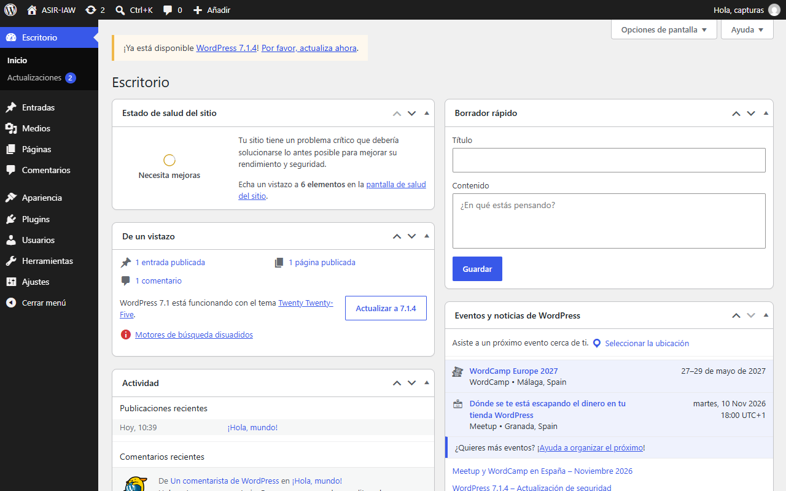

*Figura: el Escritorio de WordPress 7.1.*

El área de trabajo está formada por cajas que se pueden arrastrar para cambiarlas de sitio, plegar con sus flechas o, desde Opciones de pantalla, ocultar:

- **Estado de salud del sitio:** resumen del estado técnico, con enlace al informe completo (5.9). Justo después de instalar aparece vacío hasta que se ejecutan las primeras comprobaciones.
- **De un vistazo:** número de entradas, páginas y comentarios, versión de WordPress y tema activo, con un botón para actualizar si hay una versión nueva. Si marcaste en la instalación que los buscadores no indexen el sitio, aquí aparece el aviso *Motores de búsqueda disuadidos*.
- **Actividad:** publicaciones recientes, entradas programadas y comentarios recientes, con acciones rápidas de moderación.
- **Borrador rápido:** escribir el título y el texto de una idea y guardarla como borrador sin abrir el editor.
- **Eventos y noticias de WordPress:** próximos encuentros de la comunidad cerca de ti (WordCamps y Meetups) y noticias oficiales.
- **Te damos la bienvenida:** en el primer acceso aparece además un panel con accesos directos para empezar a configurar el sitio. Se puede cerrar y recuperar desde Opciones de pantalla.

Submenús:

- **Inicio:** el propio escritorio.
- **Actualizaciones:** lista de todo lo que se puede actualizar (WordPress, plugins, temas y traducciones) y permite hacerlo desde ahí. El número junto al menú indica cuántas actualizaciones hay pendientes. Lo estudiaremos en el apartado 13.

### 5.2 Entradas

En Entradas se gestionan las noticias y artículos del sitio.

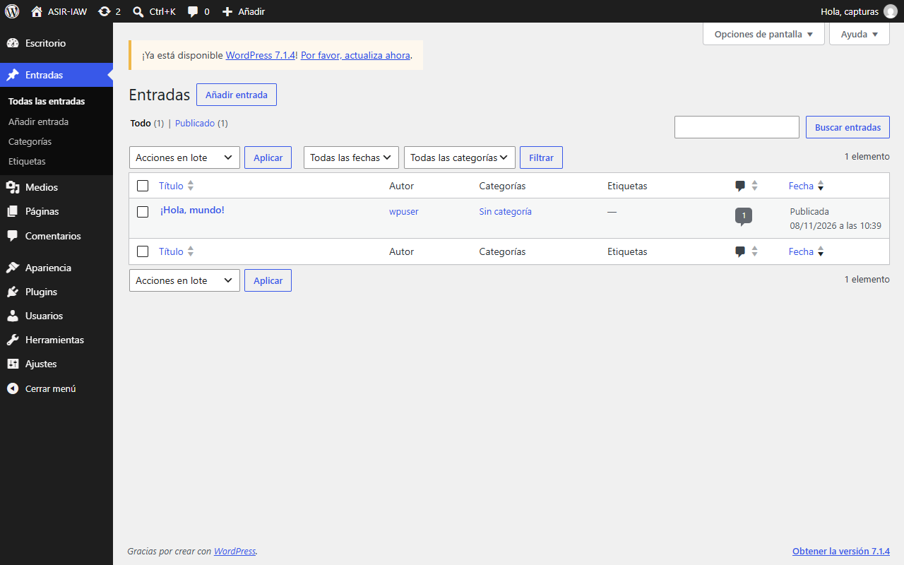

*Figura: la pantalla Todas las entradas.*

- **Botón Añadir entrada:** junto al título de la pantalla, abre el editor de bloques con una entrada nueva.
- **Filtros por estado:** encima de la tabla, muestran todas las entradas o solo las de un estado. En una instalación nueva solo aparecen *Todo* y *Publicado*; según vayas creando contenido aparecerán *Borrador*, *Programada*, *Pendiente*, *Privada* y *Papelera*, con el número de entradas de cada uno.
- **Buscador:** a la derecha, encuentra entradas por palabras del título o del contenido.
- **Acciones en lote y filtros:** marca varias entradas con las casillas y aplícales a la vez una acción (*Editar* o *Mover a la papelera*). Los desplegables filtran la lista por mes o por categoría.
- **Tabla de entradas:** cada fila muestra el título, el autor, las categorías, las etiquetas, el número de comentarios (el bocadillo) y la fecha con su estado. Las columnas con flechas se pueden ordenar pulsando en su encabezado.
- **Acciones de la fila:** aparecen bajo el título al pasar el ratón por encima.
  - *Editar* abre el editor.
  - *Edición rápida* permite cambiar sin salir de la lista el título, el *slug* (la parte final de la URL), la fecha, el autor, las categorías, las etiquetas, el estado y si admite comentarios.
  - *Papelera* la envía a la papelera, donde se conserva 30 días antes de borrarse definitivamente. Desde el filtro *Papelera* se puede restaurar.
  - *Ver* la abre en la web pública (o *Vista previa*, si aún no está publicada).

Submenús:

- **Todas las entradas:** la lista de la captura.
- **Añadir entrada:** abre el editor de bloques con una entrada nueva (apartado 6).
- **Categorías:** crear, editar y borrar categorías. Cada una tiene nombre, *slug*, categoría superior (para crear jerarquías como *Noticias > Eventos*) y descripción. La categoría por defecto (*Sin categoría*) no se puede borrar, pero sí cambiarle el nombre.
- **Etiquetas:** lo mismo para las etiquetas, que no tienen jerarquía.

### 5.3 Medios

Medios es la biblioteca de todos los archivos subidos al sitio: imágenes, documentos, audio y vídeo.

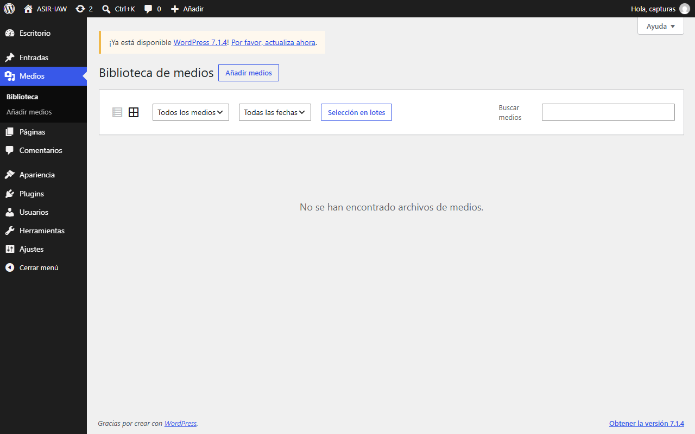

*Figura: la Biblioteca de medios, todavía vacía.*

- **Botón Añadir medios:** abre la zona para subir archivos. Basta con arrastrarlos desde el explorador de Windows o pulsar *Seleccionar archivos*. El tamaño máximo lo fija `upload_max_filesize` de PHP (apartado 4.4).
- **Tipo de vista:** los dos iconos de la izquierda cambian entre la vista de lista (tabla con nombre, autor, entrada a la que está adjunto y fecha) y la de cuadrícula (miniaturas).
- **Filtros:** por tipo de archivo (imágenes, audio, vídeo, documentos, hojas de cálculo, archivos sin adjuntar) o por mes.
- **Selección en lotes:** permite marcar varios archivos para borrarlos a la vez.
- **Buscar medios:** encuentra archivos por su nombre o título.
- **Detalles del adjunto:** al pulsar sobre una miniatura se abre una ventana con el nombre, la fecha, el peso y las dimensiones del archivo, y sus campos editables:
  - *Texto alternativo:* descripción de la imagen para lectores de pantalla y buscadores. Es el campo más importante.
  - *Título*, *Leyenda* (texto que puede mostrarse bajo la imagen) y *Descripción*.
  - *URL del archivo* y el botón *Copiar URL*, para enlazarlo desde cualquier sitio.
  - *Editar imagen:* recortar, girar, voltear y escalar la imagen sin programas externos.
  - *Eliminar permanentemente:* borra el archivo del servidor. Los medios no pasan por la papelera, así que esta acción no se puede deshacer.

Submenús:

- **Biblioteca:** la pantalla de la captura.
- **Añadir medios:** la página para subir archivos.

Los archivos también se suben directamente desde el editor, al insertar un bloque de Imagen, Galería o Archivo; en ese caso aparecen igualmente en la biblioteca.

### 5.4 Páginas

Páginas funciona como Entradas, pero para el contenido estable del sitio.

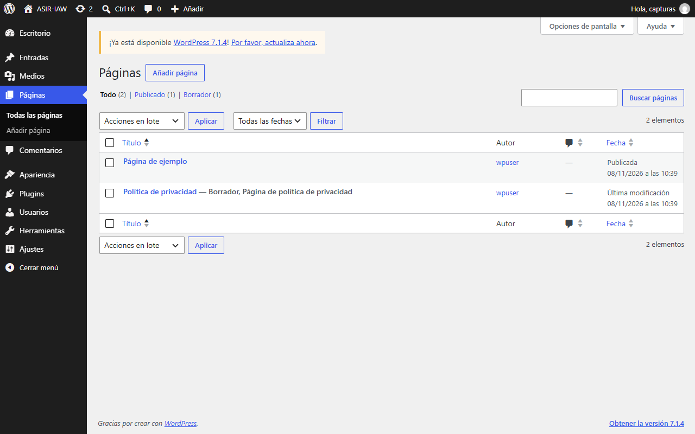

*Figura: la pantalla Todas las páginas con las dos páginas que crea la instalación.*

- **Botón Añadir página, filtros, buscador y acciones en lote:** funcionan igual que en Entradas. Las páginas no tienen categorías ni etiquetas, así que no aparecen esas columnas ni ese filtro.
- **Estados especiales:** WordPress indica junto al título las páginas que cumplen una función. En la captura, *Política de privacidad* aparece como *Borrador, Página de política de privacidad*: WordPress la crea al instalarse, pero sin publicar, para que la completes. Otros estados especiales son *Portada* (la página de inicio) y *Página de entradas* (donde se listan las noticias); se asignan en Ajustes > Lectura y Ajustes > Privacidad.
- **Jerarquía:** una página puede tener una página superior. Las páginas hijas aparecen en la lista con un guion delante, y su URL incluye la de la página superior: si *Desarrollo web* es hija de *Cursos*, su dirección será `/cursos/desarrollo-web/`.
- **Acciones de la fila:** las mismas que en Entradas. La *Edición rápida* de una página permite, además, cambiar la página superior, el orden y la plantilla que usa.

Submenús:

- **Todas las páginas:** la lista de la captura.
- **Añadir página:** abre el editor de bloques con una página nueva.

### 5.5 Comentarios

Desde aquí se moderan los comentarios que dejan los visitantes en las entradas.

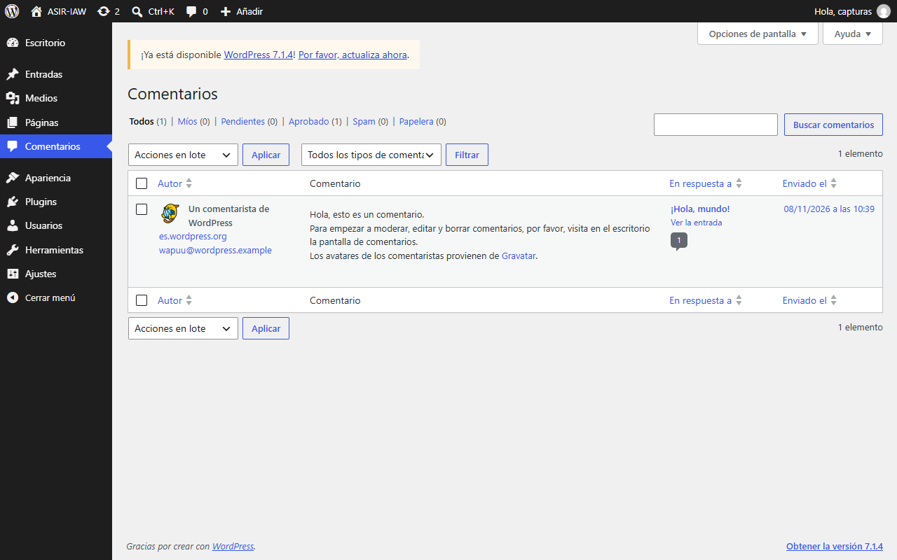

*Figura: la pantalla Comentarios con el comentario de ejemplo de la instalación.*

- **Filtros:** *Todos*, *Míos*, *Pendientes*, *Aprobado*, *Spam* y *Papelera*. Cuando hay comentarios pendientes, el menú lateral y la barra de herramientas muestran un número junto al icono de comentarios.
- **Columnas:** el autor (con su avatar, web y correo), el texto del comentario, la entrada en la que se escribió (*En respuesta a*) y la fecha de envío.
- **Comentarios pendientes:** se distinguen por su fondo amarillo y una barra a la izquierda. No son visibles en la web hasta que se aprueban.
- **Acciones de moderación:** aparecen bajo el texto al pasar el ratón.
  - *Aprobar* o *No aprobar*: lo publica o lo devuelve a pendiente.
  - *Responder*: escribe una respuesta sin salir de la lista.
  - *Edición rápida* y *Editar*: corrigen el texto o los datos del autor.
  - *Spam*: lo marca como correo basura (los plugins antispam, como Akismet, aprenden de esta marca).
  - *Papelera*: lo elimina.

Cómo se comportan los comentarios (si se permiten, si requieren aprobación, si se cierran en entradas antiguas) se decide en Ajustes > Comentarios (5.10).

### 5.6 Apariencia

Apariencia controla el aspecto del sitio.

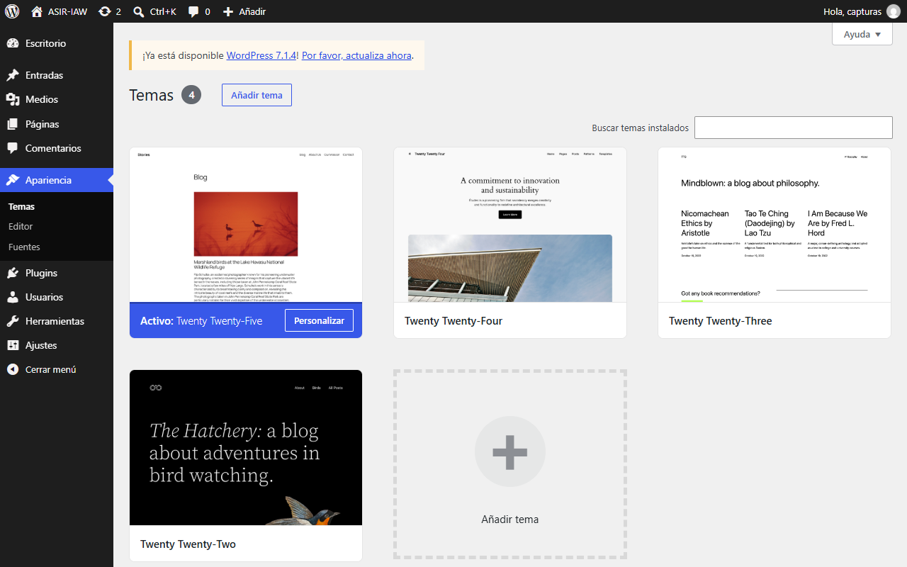

*Figura: Apariencia > Temas con los temas por defecto de WordPress.*

- **Tema activo:** aparece el primero, con su nombre en la franja azul (*Activo: Twenty Twenty-Five*). El botón *Personalizar* abre el editor del sitio para modificarlo.
- **Otros temas instalados:** al pasar el ratón sobre ellos aparecen *Activar* y *Vista previa en vivo* (para ver cómo quedaría el sitio sin cambiar el tema). Pulsando sobre la miniatura se abren los *Detalles del tema*, con su versión, autor, descripción y el enlace *Borrar*.
- **Añadir tema:** el botón junto al título y la tarjeta con el símbolo + abren el buscador del directorio oficial de temas y la opción *Subir tema* para instalar uno desde un archivo `.zip`.
- **Buscar temas instalados:** útil cuando hay muchos temas.

Submenús en un tema de bloques:

- **Temas:** la pantalla de la captura.
- **Editor:** el editor del sitio, donde se modifican la navegación, los estilos globales, las plantillas y los patrones. Lo estudiaremos a fondo en el apartado 7.
- **Fuentes:** la biblioteca de tipografías del sitio. Permite activar las fuentes que trae el tema, instalar otras de Google Fonts o subir archivos de fuentes propios para usarlos luego en los estilos.

Si el tema activo es clásico, en lugar de *Editor* aparecen *Personalizar*, *Widgets* y *Menús*.

### 5.7 Plugins

En Plugins se gestionan los complementos instalados.

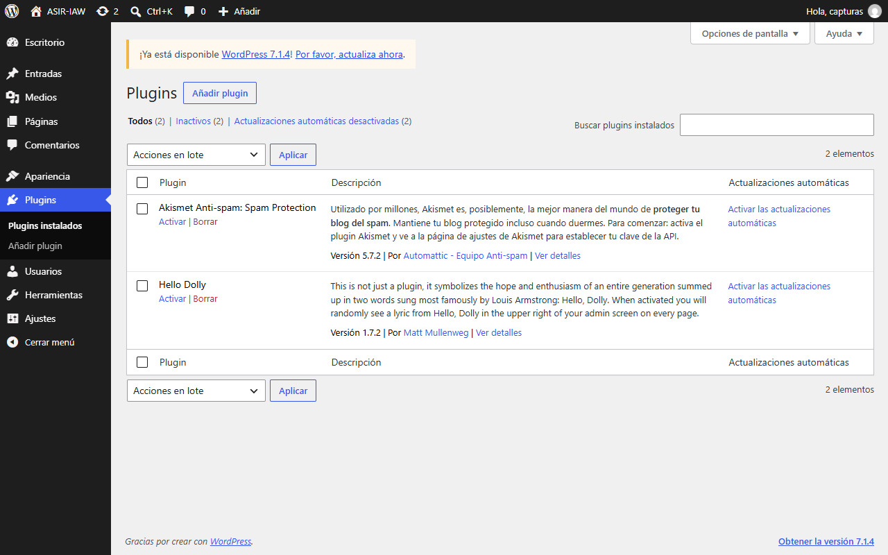

*Figura: la pantalla Plugins instalados con los dos plugins que trae WordPress.*

- **Botón Añadir plugin:** abre el buscador del directorio oficial de plugins.
- **Filtros:** *Todos*, *Activos*, *Inactivos*, *Actualización disponible* y *Actualizaciones automáticas activadas o desactivadas*. Solo aparecen los que tienen algún plugin.
- **Acciones del plugin:** bajo su nombre, *Activar* o *Desactivar*, *Borrar* (solo cuando está desactivado) y, en muchos plugins, un enlace directo a sus *Ajustes*. Los plugins activos se muestran con fondo azulado y una barra a la izquierda.
- **Descripción:** qué hace el plugin, su versión, su autor y el enlace *Ver detalles*, que abre su ficha del directorio oficial (descripción, valoraciones, compatibilidad y registro de cambios).
- **Actualizaciones automáticas:** el enlace de la última columna activa o desactiva que WordPress actualice ese plugin por su cuenta cuando salga una versión nueva.
- **Aviso de actualización:** cuando existe una versión nueva de un plugin, aparece debajo de su fila una franja amarilla desde la que se pueden ver las novedades y actualizar con un clic.

Los dos plugins de la captura vienen con WordPress: Akismet (antispam, necesita una clave de su servicio) y Hello Dolly (un ejemplo sin utilidad real). Si no los vas a usar, lo recomendable es borrarlos.

Submenús:

- **Plugins instalados:** la lista de la captura.
- **Añadir plugin:** busca e instala plugins del directorio oficial, con pestañas de destacados, populares y recomendados, o sube un plugin en `.zip` con el botón *Subir plugin*.

### 5.8 Usuarios

En Usuarios se gestionan las cuentas que pueden entrar en el panel.

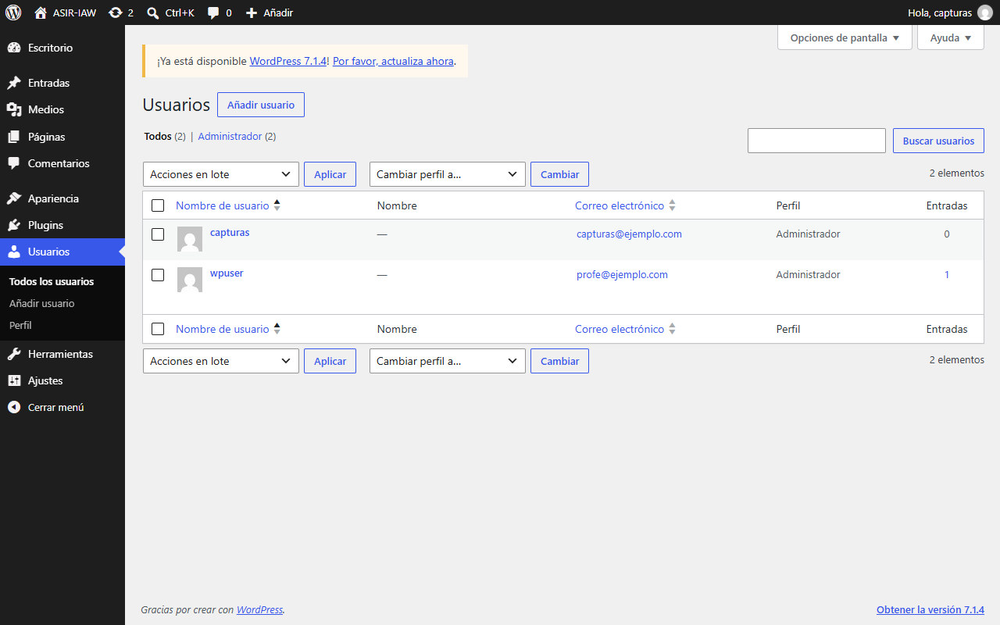

*Figura: la pantalla Todos los usuarios.*

- **Botón Añadir usuario:** abre el formulario para crear una cuenta.
- **Filtros por rol:** muestran solo los usuarios de un perfil concreto (*Administrador*, *Editor*, *Autor*…). Solo aparecen los roles que tienen algún usuario.
- **Cambiar perfil a…:** marca varios usuarios con las casillas y cámbiales el rol a la vez.
- **Columnas:** nombre de usuario, nombre (vacío si no se ha rellenado en el perfil), correo electrónico, perfil (el rol) y número de entradas publicadas.
- **Acciones del usuario:** al pasar el ratón, *Editar* su perfil, *Ver* sus publicaciones, *Enviar restablecimiento de contraseña* (le llega un correo para crear una nueva) y *Borrar*. Al borrar un usuario, WordPress pregunta a quién atribuir sus entradas para no perderlas.

Submenús:

- **Todos los usuarios:** la lista de la captura.
- **Añadir usuario:** formulario con nombre de usuario (no se puede cambiar después), correo, nombre y apellidos, web, contraseña (WordPress propone una segura), la casilla para enviar un aviso por correo al nuevo usuario y el perfil (rol).
- **Perfil:** los datos de tu propia cuenta: esquema de colores del panel, si quieres ver la barra de herramientas en la web, nombre público, correo, biografía, cambio de contraseña, *contraseñas de aplicación* (para que otros programas accedan por la API REST) y el botón *Cerrar el resto de sesiones*, útil si has iniciado sesión en un equipo ajeno.

Los roles y permisos se explican en detalle en el apartado 9.

### 5.9 Herramientas

Herramientas reúne utilidades de mantenimiento. La más importante es Salud del sitio.

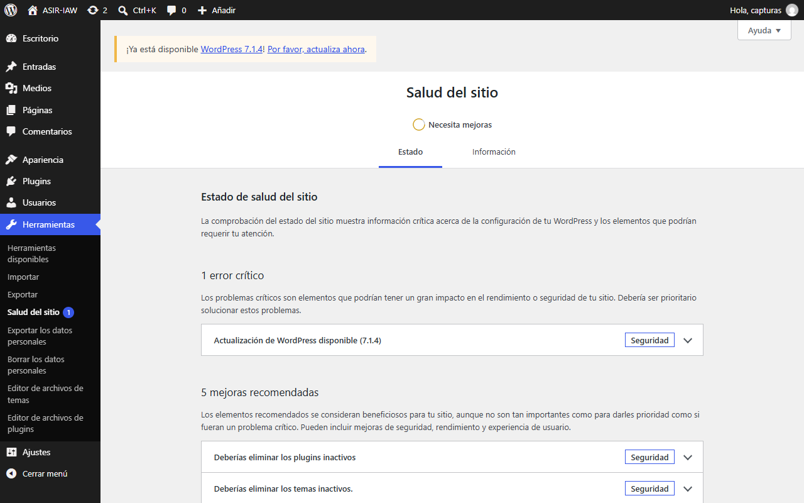

*Figura: Herramientas > Salud del sitio en una instalación recién hecha.*

- **Indicador de salud:** valoración global del estado técnico del sitio. En la captura aparece *Necesita mejoras*; cuando todo está correcto pasa a *Bien*.
- **Pestañas Estado e Información:** *Estado* muestra los problemas detectados; *Información* recoge todos los datos técnicos del sitio y del servidor (versiones de WordPress, PHP y MySQL, rutas, permisos, plugins, constantes de `wp-config.php`…) con un botón para *Copiar la información del sitio al portapapeles*, muy útil para pedir soporte.
- **Errores críticos y mejoras recomendadas:** cada problema se despliega con una explicación y cómo resolverlo, y lleva una etiqueta con su categoría (seguridad, rendimiento). En la captura hay un error crítico (hay una actualización de WordPress pendiente) y cinco mejoras recomendadas, entre ellas eliminar los plugins y temas que no se usan.

Submenús:

- **Herramientas disponibles:** utilidades varias, como el conversor de categorías a etiquetas.
- **Importar y Exportar:** mover contenidos entre sitios (apartado 11).
- **Salud del sitio:** la pantalla de la captura. El número junto al menú indica los errores críticos.
- **Exportar los datos personales y Borrar los datos personales:** atender las solicitudes que el RGPD reconoce a las personas usuarias. Se introduce el correo de la persona, WordPress le envía un mensaje para confirmar la solicitud y, una vez confirmada, genera un archivo con sus datos o los elimina.
- **Editor de archivos de temas y Editor de archivos de plugins:** permiten modificar el código de temas y plugins desde el navegador. Son peligrosos: un error de sintaxis puede dejar el sitio inaccesible, y si alguien consigue entrar como administrador puede usarlos para inyectar código malicioso. Los desactivaremos con `DISALLOW_FILE_EDIT` (apartado 13.4), y entonces dejarán de aparecer en el menú.

### 5.10 Ajustes

Antes de crear contenido, conviene revisar los Ajustes. Cambiarlos más tarde, especialmente los enlaces permanentes, puede romper enlaces ya compartidos.

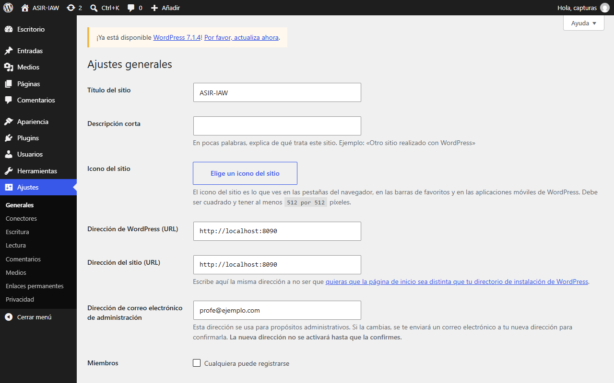

*Figura: Ajustes > Generales (la pantalla continúa hacia abajo con el perfil predeterminado, el idioma, la zona horaria y los formatos de fecha y hora).*

- **Título del sitio y descripción corta:** el nombre del sitio y su lema. Aparecen en la cabecera, en la pestaña del navegador y en los resultados de los buscadores.
- **Icono del sitio:** la imagen que se muestra en la pestaña del navegador y en los favoritos. Debe ser cuadrada y de al menos 512 × 512 píxeles.
- **Direcciones de WordPress y del sitio:** la URL de la instalación y la de la web pública. Normalmente son la misma. Cambiarlas mal deja el sitio inaccesible; si ocurre, se corrige con WP-CLI (`wp option update home …` y `wp option update siteurl …`).
- **Correo electrónico de administración:** recibe los avisos del sitio (actualizaciones, nuevos usuarios, errores). Si lo cambias, WordPress pide confirmarlo desde la nueva dirección.
- **Miembros:** si se marca *Cualquiera puede registrarse*, cualquier visitante puede crear una cuenta con el *Perfil predeterminado* indicado debajo. Déjalo desmarcado salvo que lo necesites.
- **Idioma, zona horaria y formatos:** afectan a la fecha de las publicaciones, a las entradas programadas y a los registros.

Cada submenú de Ajustes agrupa un tipo de configuración:

| Ajuste | Qué revisar |
| --- | --- |
| **Generales** | Título y descripción, icono, direcciones, correo de administración, registro de usuarios, idioma, zona horaria (`Madrid`) y formato de fecha. |
| **Conectores** | Conexiones del sitio con servicios externos, como proveedores de inteligencia artificial, y sus claves de acceso. |
| **Escritura** | Categoría y formato de entrada por defecto. |
| **Lectura** | Qué muestra la portada (últimas entradas o una página estática, y cuál es la página de entradas), número de entradas por página, número de elementos y texto completo o extracto en el feed, y visibilidad para los buscadores. |
| **Comentarios** | Si se permiten, si requieren aprobación manual, datos obligatorios del autor, cierre automático en entradas antiguas, avisos por correo y avatares. |
| **Medios** | Tamaños en los que WordPress recorta automáticamente las imágenes subidas y si se organizan en carpetas por año y mes. |
| **Enlaces permanentes** | Estructura de las URL. Elige *Nombre de la entrada* (`/mi-primera-entrada/`): es legible y mejor para el SEO. |
| **Privacidad** | Página de política de privacidad del sitio, con una guía para redactarla. |

Puedes consultar o cambiar cualquier ajuste también con WP-CLI:

```bash
wp option get blogname
wp option update timezone_string 'Europe/Madrid'
wp rewrite structure '/%postname%/'
```

## 6. Creación de contenidos

En este apartado vamos a aprender a crear contenido construyendo un ejemplo real, paso a paso: la página «Curso de Desarrollo Web» de un centro de formación, desde que se crea hasta que se ve publicada en la web. Después crearemos una noticia con categorías, etiquetas e imagen destacada, y veremos los patrones, las revisiones y la navegación.

### 6.1 Entradas y páginas

Lo primero es decidir qué tipo de contenido vamos a crear. WordPress tiene dos tipos principales:

| | **Entradas** | **Páginas** |
| --- | --- | --- |
| Naturaleza | Contenido fechado que se va publicando con el tiempo | Contenido estable, sin fecha relevante |
| Orden | Cronológico inverso (lo más reciente primero) | Jerárquico (páginas superiores e hijas) |
| Clasificación | Categorías y etiquetas | No tienen |
| Aparecen en el feed RSS | Sí | No |
| Plantilla del tema | Muestra autor, fecha, categorías, etiquetas y comentarios | Muestra solo el título y el contenido |
| Ejemplos | Noticias, artículos, novedades | Inicio, Quiénes somos, Contacto, Aviso legal |

La información de un curso (qué se aprende, duración, horario) es estable y no caduca, así que la crearemos como una página. El anuncio del plazo de matrícula es una novedad con fecha, así que será una entrada.

### 6.2 El editor de bloques

Desde la versión 5.0, WordPress usa el editor de bloques (conocido por su nombre de proyecto, *Gutenberg*). Cada elemento del contenido (un párrafo, un título, una imagen, una tabla, un botón) es un bloque independiente que se puede mover, configurar y combinar con otros.

Al abrir el editor se ven tres zonas:

- **Barra superior:** a la izquierda, el botón para volver al panel, el insertador de bloques (+), deshacer y rehacer, y la vista de lista. En el centro, el título del documento. A la derecha, *Guardar como borrador*, la vista previa, el botón para mostrar u ocultar el panel de ajustes, *Publicar* y el menú de opciones (⋮).
- **Lienzo:** el contenido, bloque a bloque, con un aspecto muy parecido al que tendrá en la web.
- **Panel de ajustes:** con dos pestañas. *Página* (o *Entrada*) contiene los ajustes del documento completo; *Bloque* contiene los del bloque seleccionado.

Bloques más utilizados:

| Grupo | Bloques |
| --- | --- |
| Texto | Párrafo, Encabezado, Lista, Cita, Tabla, Código, Detalles |
| Medios | Imagen, Galería, Audio, Vídeo, Archivo, Medios y texto, Portada |
| Diseño | Grupo, Columnas, Fila, Pila, Separador, Espaciador, Botones |
| Widgets | Últimas entradas, Categorías, Calendario, Buscar, RSS, Shortcode |
| Incrustados | YouTube, Vimeo, Spotify y otros servicios (basta con pegar la URL) |

Atajos que ahorran mucho tiempo:

- Escribir `/` en una línea vacía y el nombre del bloque (`/imagen`, `/tabla`) para insertarlo sin abrir el insertador.
- Empezar una línea con `## ` crea un encabezado de nivel 2; con `- ` o `1. ` crea una lista.
- Pegar una URL de YouTube en una línea vacía crea directamente el bloque de vídeo incrustado.
- `Ctrl + Z` deshace y `Ctrl + S` guarda.

### 6.3 Ejemplo guiado: la página «Curso de Desarrollo Web»

#### Paso 1. Crear la página

Ve a Páginas > Añadir página. En los temas de bloques, WordPress muestra primero la ventana *Elige un patrón* con diseños de página completos ya preparados. Son útiles para partir de un diseño hecho, pero en este ejemplo queremos construir la página desde cero, así que la cerramos con la X. Si desmarcas *Mostrar siempre patrones de inicio para las páginas nuevas*, no volverá a aparecer.

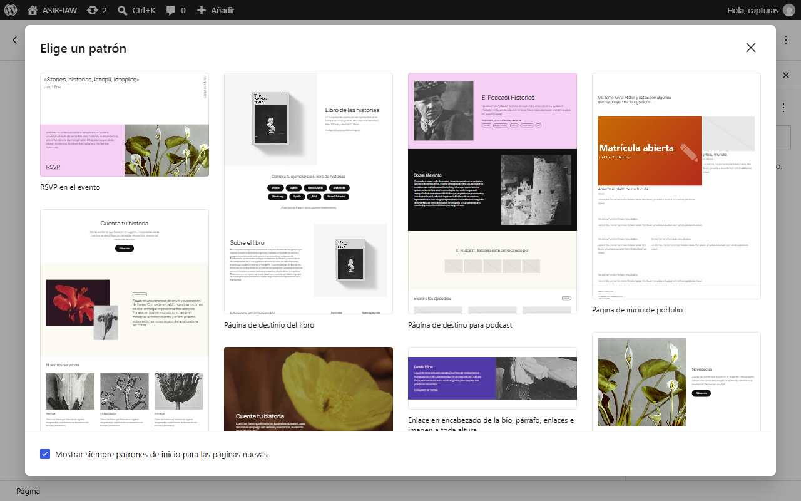

*Figura: patrones de inicio que ofrece el tema al crear una página nueva.*

Al cerrarla aparece el editor vacío, con el texto *Escribe un título* y, debajo, *Teclea / para elegir un bloque*. En el panel de la derecha ya se ven los ajustes de la página: estado *Borrador*, fecha de publicación, slug, autor, plantilla, comentarios y página superior.

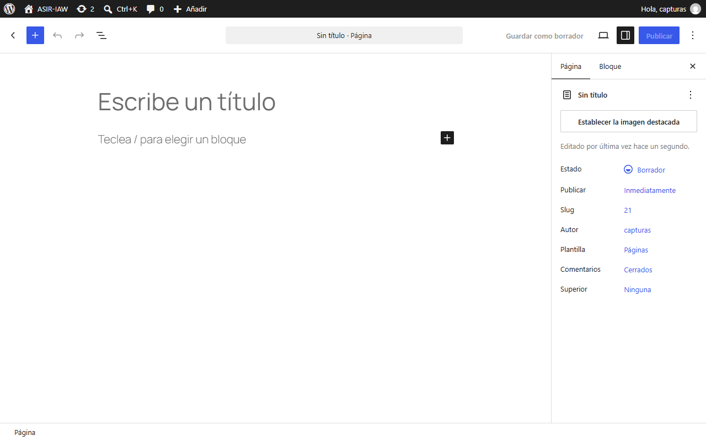

*Figura: el editor de bloques con una página nueva.*

#### Paso 2. Escribir el título y el primer párrafo

Pulsa en *Escribe un título*, escribe «Curso de Desarrollo Web» y pulsa Intro: el cursor baja a un bloque de párrafo. Escribe el texto de presentación del curso.

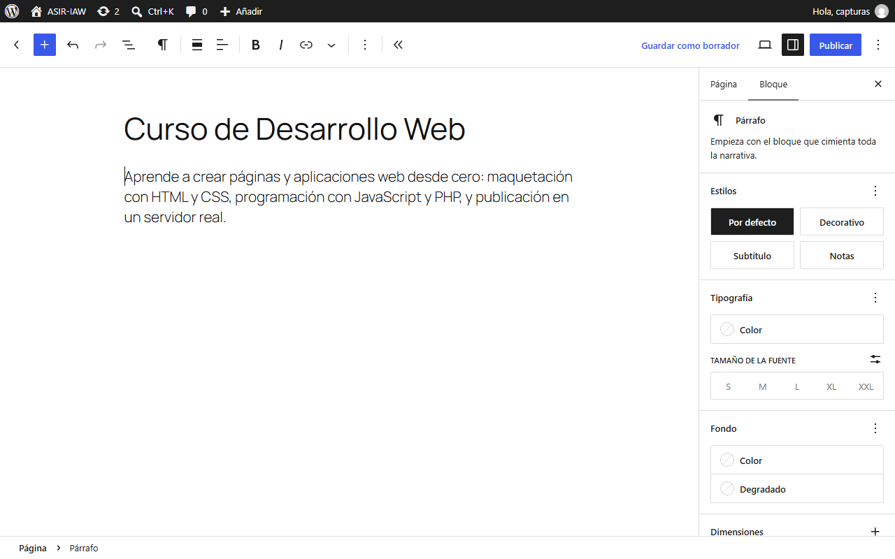

*Figura: el bloque de párrafo seleccionado, con su barra de herramientas y sus ajustes.*

Fíjate en lo que cambia al seleccionar un bloque:

- **La barra de herramientas del bloque:** aparece encima del bloque (en la captura está fijada en la barra superior con la opción *Barra de herramientas superior* del menú ⋮). Contiene el tipo de bloque (pulsando en él se puede transformar, por ejemplo, de párrafo a encabezado o a lista), la alineación, negrita, cursiva, enlace y más opciones de formato.
- **La pestaña Bloque del panel derecho:** muestra los ajustes del párrafo: estilos (*Por defecto*, *Decorativo*, *Subtítulo*, *Notas*, que dependen del tema), color del texto, tamaño de la fuente, color de fondo y dimensiones.
- **La ruta de navegación inferior:** *Página > Párrafo* indica dónde está el bloque seleccionado. Es útil cuando hay bloques dentro de otros.

#### Paso 3. El insertador de bloques

Para añadir bloques de cualquier tipo, pulsa el botón azul + de la barra superior. Se abre el insertador, con tres pestañas:

- **Bloques:** todos los bloques disponibles, agrupados por categorías (texto, medios, diseño, widgets, temas, incrustados). El buscador de arriba los filtra por nombre.
- **Patrones:** diseños formados por varios bloques (los veremos en el apartado 6.6).
- **Medios:** las imágenes y vídeos de la biblioteca, para insertarlos directamente.

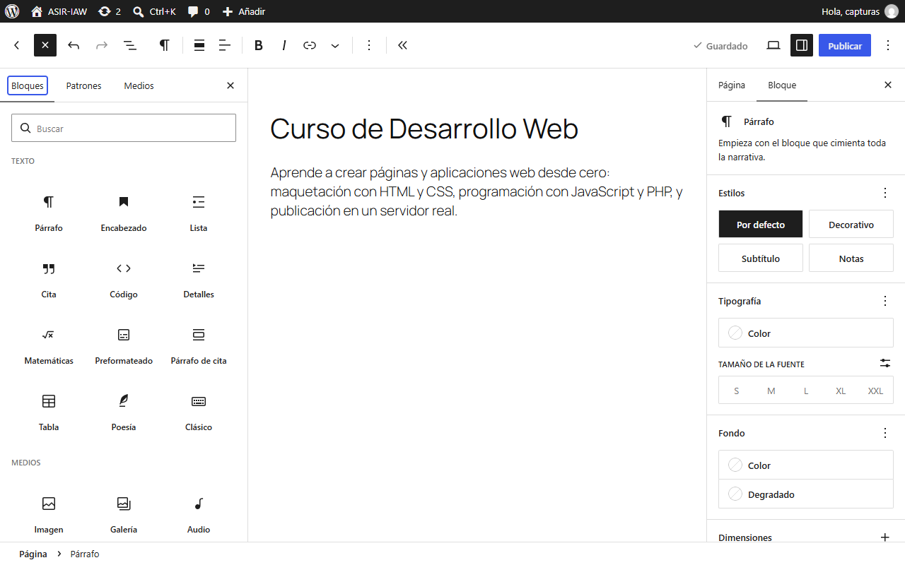

*Figura: el insertador de bloques con la pestaña Bloques.*

Al pulsar sobre un bloque, se inserta debajo del bloque seleccionado. También se puede arrastrar al lugar exacto del lienzo. Al guardar, aparece abajo el aviso *Borrador guardado* con el enlace *Ver una vista previa*.

#### Paso 4. Añadir un encabezado y una lista

Debajo del párrafo añadimos la sección «¿Qué aprenderás?»:

1. Pulsa Intro al final del párrafo para crear un bloque nuevo y escribe `/encabezado` (o `## ` seguido del texto).
2. Escribe «¿Qué aprenderás?». En la barra del bloque puedes elegir el nivel: usa H2 para las secciones de la página y H3 para las subsecciones. No elijas el nivel por el tamaño de la letra, sino por la estructura: los lectores de pantalla y los buscadores se guían por ellos.
3. Pulsa Intro y escribe `- ` para empezar una lista. Cada Intro crea un elemento nuevo; dos Intro seguidos terminan la lista.

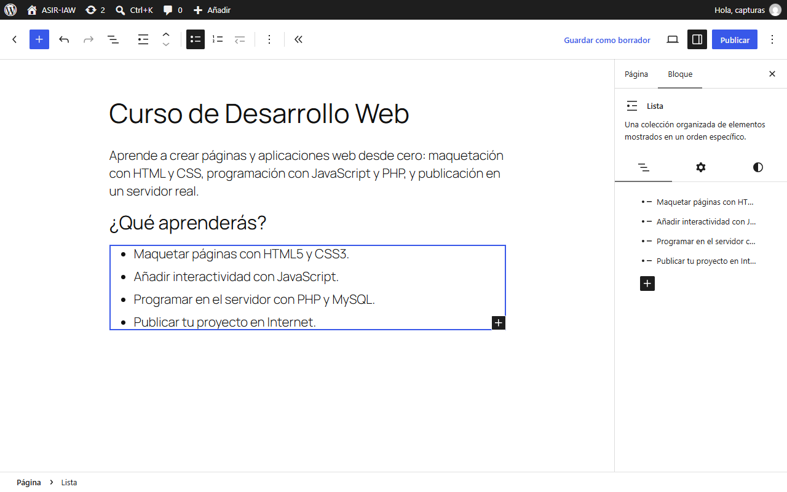

*Figura: el bloque Lista seleccionado; en su barra se elige entre lista con viñetas o numerada.*

El bloque Lista contiene un bloque *Elemento de la lista* por cada línea; por eso el panel derecho muestra sus elementos. En la barra del bloque se cambia entre lista con viñetas y lista numerada, y se aumenta o reduce la sangría para crear sublistas.

#### Paso 5. Insertar una imagen

Vamos a añadir el cartel del curso debajo del párrafo de presentación:

1. Selecciona el párrafo de presentación, pulsa + y elige el bloque Imagen.
2. En el bloque aparecen tres opciones: *Subir* (desde tu ordenador), *Biblioteca de medios* (una imagen ya subida) e *Insertar desde URL*. Pulsa *Subir* y elige el archivo.
3. Con la imagen seleccionada, escribe en el panel derecho el texto alternativo: una descripción breve de lo que muestra la imagen. Es lo que leen los lectores de pantalla y lo que indexan los buscadores.
4. Debajo de la imagen puedes escribir una leyenda, que se mostrará en la web como pie de foto.

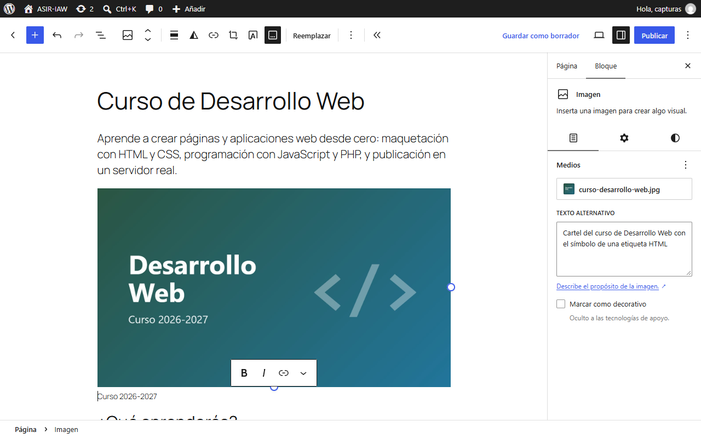

*Figura: el bloque Imagen con su barra de herramientas, la leyenda y el texto alternativo en el panel derecho.*

La barra del bloque Imagen permite alinearla, enlazarla, recortarla, añadir texto encima o reemplazarla por otra. La imagen subida queda guardada en la biblioteca de medios (apartado 6.4).

#### Paso 6. Organizar en columnas y añadir un botón

Para mostrar la duración, la modalidad y las plazas una junto a otra usamos el bloque Columnas:

1. Inserta el bloque Columnas y elige la distribución *33 / 33 / 33* (tres columnas iguales).
2. Dentro de cada columna, añade un encabezado H3 («Duración», «Modalidad», «Plazas») y un párrafo con el dato.
3. Debajo, inserta el bloque Botones, escribe «Solicitar información» y, con el icono de enlace de su barra, indica la página a la que lleva (por ejemplo, `/contacto/`).

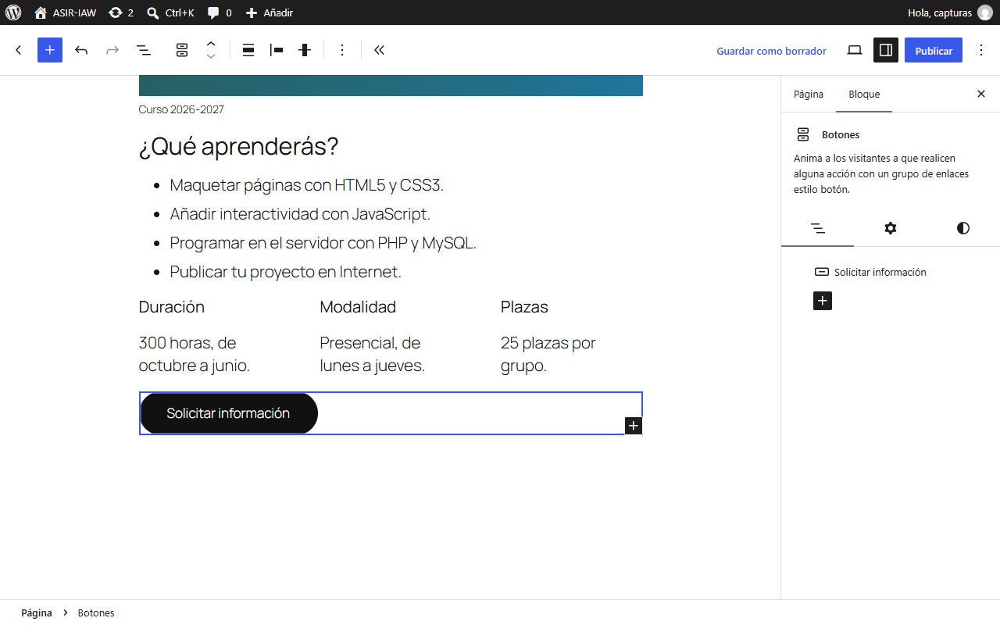

*Figura: tres columnas con encabezado y párrafo, y el bloque Botones seleccionado.*

Columnas y Botones son bloques contenedores: dentro llevan otros bloques (Columna y Botón). En la web, las columnas se colocan una debajo de otra automáticamente cuando la pantalla es estrecha, como en un móvil.

#### Paso 7. Añadir una tabla

Añadimos el horario del curso:

1. Inserta un encabezado H2 «Horario».
2. Inserta el bloque Tabla, indica 3 columnas y 5 filas y pulsa *Crear tabla*.
3. Rellena las celdas moviéndote con el tabulador.
4. En el panel derecho, activa *Sección de la cabecera* para que la primera fila sea el encabezado de la tabla, y *Celdas de tabla de ancho fijo* para que todas las columnas midan lo mismo.

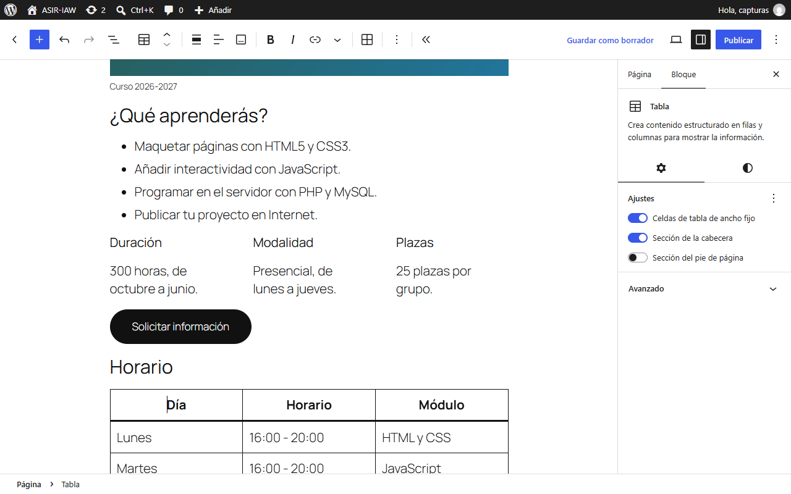

*Figura: el bloque Tabla con la sección de cabecera activada.*

Desde el botón de edición de la tabla de su barra (el icono de cuadrícula) se pueden insertar o borrar filas y columnas.

#### Paso 8. Revisar la estructura con la vista de lista

Cuando la página crece, es fácil perderse. El botón Vista de lista (☰, en la barra superior) muestra todos los bloques del documento en orden, como un índice:

- Pulsando en un bloque de la lista se selecciona y el lienzo salta hasta él.
- Arrastrando los bloques en la lista se cambia su orden.
- Las flechas despliegan los bloques que contienen otros (Lista, Columnas, Botones).
- La pestaña *Esquema* muestra solo los encabezados, para comprobar que la jerarquía H2/H3 es correcta.

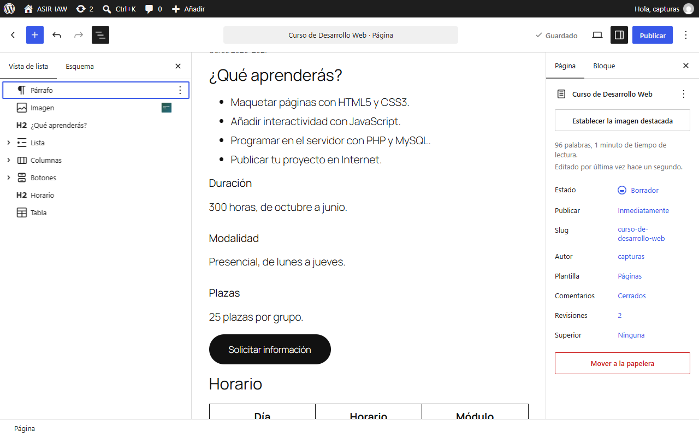

*Figura: la vista de lista con la estructura completa de la página.*

#### Paso 9. Ajustes de la página

Antes de publicar, revisa la pestaña Página del panel derecho:

- **Estado:** *Borrador* hasta que se publique (apartado 6.7).
- **Publicar:** *Inmediatamente* o una fecha futura para programar la publicación.
- **Slug:** la parte final de la URL. WordPress la genera a partir del título (`curso-de-desarrollo-web`); se puede acortar, pero conviene decidirla antes de publicar.
- **Plantilla:** el diseño del tema con el que se mostrará la página (apartado 7).
- **Comentarios:** si se permiten en esta página (normalmente no).
- **Revisiones:** el número de versiones guardadas (apartado 6.7).
- **Superior:** la página de la que depende. Hemos creado antes una página «Cursos» y la elegimos como superior, de modo que la URL será `/cursos/curso-de-desarrollo-web/` y aparecerá como submenú de *Cursos*.
- **Imagen destacada:** la imagen que representa la página en listados y portadas. En este ejemplo no la usamos, porque el tema Twenty Twenty-Five la muestra encima del título y aparecería repetida con la imagen que ya hemos puesto en el contenido. La usaremos en la entrada del apartado 6.5.
- **Mover a la papelera:** al final del panel.

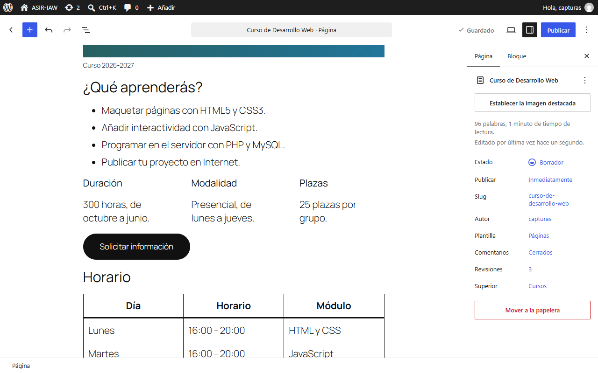

*Figura: la pestaña Página del panel de ajustes, con la página superior «Cursos».*

#### Paso 10. Guardar el borrador y ver la vista previa

Pulsa Guardar como borrador cada cierto tiempo (WordPress también guarda automáticamente cada pocos minutos). El borrador no es visible en la web.

Para ver cómo quedará antes de publicar, pulsa el icono de la vista previa (el portátil, junto a *Publicar*). Desde ahí se puede ver cómo quedaría en escritorio, tableta o móvil, o abrir la vista previa en una pestaña nueva, que muestra la página con el diseño real del tema: cabecera, menú, tipografías y pie.

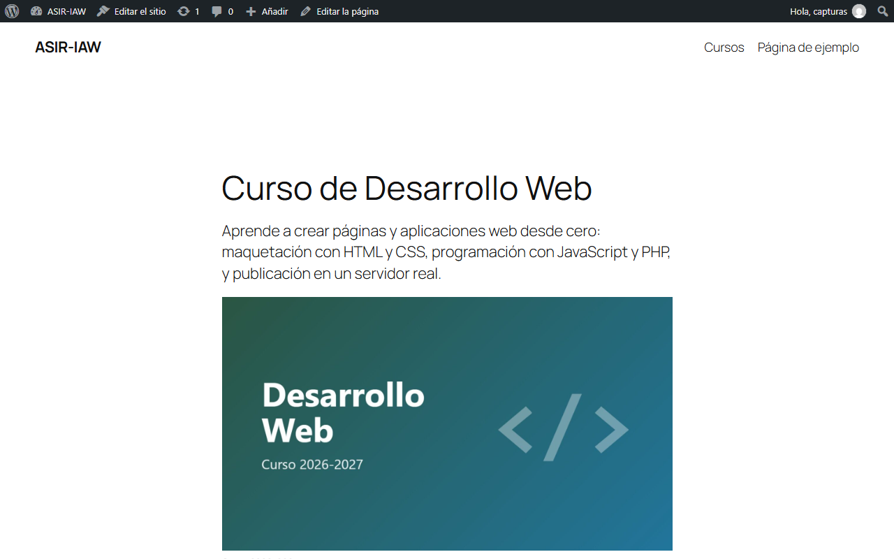

*Figura: la vista previa del borrador con el diseño del tema.*

#### Paso 11. Publicar

Cuando esté lista, pulsa Publicar. WordPress abre las comprobaciones previas a la publicación: un último resumen con la visibilidad (*Pública*, *Privada* o *Protegida con contraseña*) y la fecha de publicación, que todavía se pueden cambiar. Pulsa Publicar otra vez para confirmar.

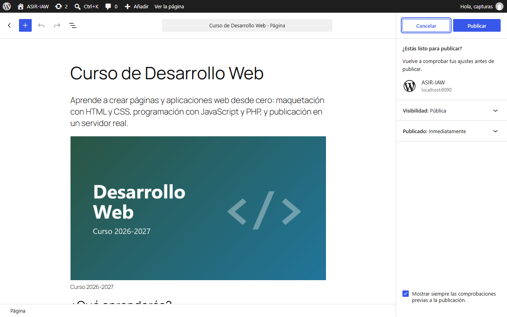

*Figura: el panel «¿Estás listo para publicar?».*

Tras publicar, el panel confirma que la página «está ahora visible» y ofrece su dirección, el botón Ver la página y el botón *Añadir página* para crear otra.

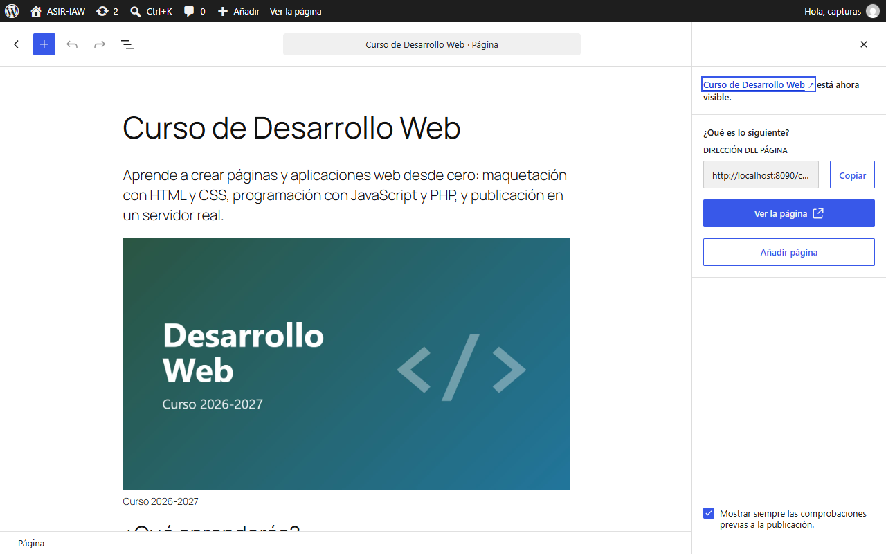

*Figura: confirmación de la publicación con la dirección de la página.*

A partir de ahora, el botón *Publicar* se convierte en Guardar (o *Actualizar*): los cambios que hagas en una página publicada no se ven en la web hasta que pulses ese botón.

#### Paso 12. La página en la web

Pulsa Ver la página. Así es como la verá cualquier visitante:

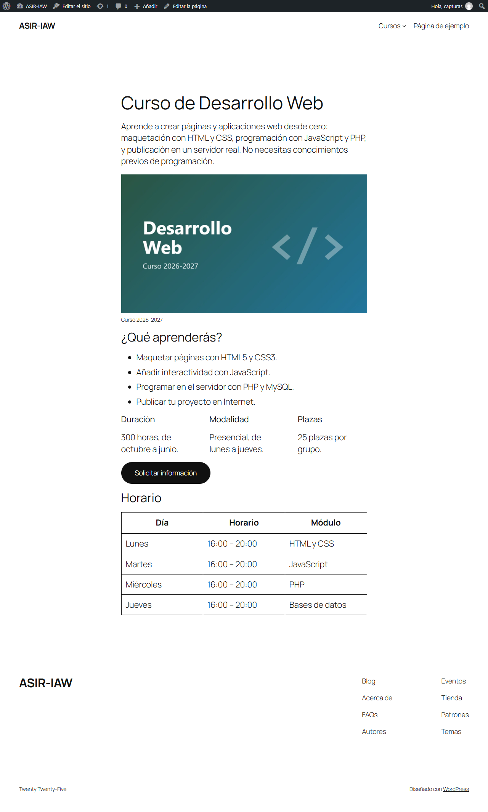

*Figura: la página «Curso de Desarrollo Web» publicada, con la cabecera y el pie del tema.*

Compara la página con el editor:

- **Lo que hemos escrito:** el título, el párrafo, la imagen con su leyenda, la lista, las columnas, el botón y la tabla aparecen en el mismo orden que en el editor.
- **Lo que pone el tema:** la cabecera con el nombre del sitio y el menú, el pie de página y el estilo de todos los elementos (tipografías, colores, separaciones). Por eso la misma página cambiaría de aspecto con otro tema.
- **El menú:** *Cursos* aparece con una flecha y, al pasar por encima, muestra *Curso de Desarrollo Web*. Como todavía no hemos creado ningún menú, WordPress muestra automáticamente todas las páginas publicadas respetando su jerarquía (apartado 6.8).
- **La barra de herramientas superior:** solo la ves tú porque has iniciado sesión. Desde *Editar la página* vuelves al editor.

### 6.4 Medios

La imagen que subimos en el paso 5 quedó guardada en la biblioteca de medios. Si vas a Medios > Biblioteca y pulsas sobre ella, se abren sus detalles:

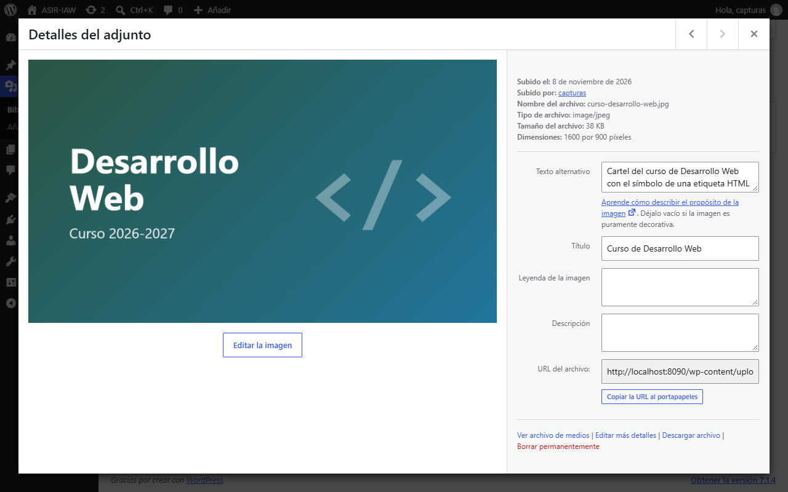

*Figura: los detalles del adjunto de la imagen del curso.*

- **Datos del archivo:** fecha de subida, autor, nombre, tipo, tamaño y dimensiones.
- **Campos editables:** texto alternativo (el que escribimos en el paso 5), título, leyenda y descripción.
- **URL del archivo:** la dirección directa de la imagen, con el botón para copiarla.
- **Editar la imagen:** recortar, girar, voltear y escalar sin programas externos.
- **Enlaces inferiores:** ver la página del adjunto, editar más detalles, descargar el archivo o borrarlo permanentemente.

Al subir una imagen, WordPress la guarda en `wp-content/uploads/AAAA/MM/` (en el ejemplo, `uploads/2026/11/curso-desarrollo-web.jpg`) y genera además copias en varios tamaños (miniatura, mediana y grande) para usar la más adecuada en cada sitio. Buenas prácticas:

- Sube imágenes optimizadas: un ancho de 1600–2000 px suele ser suficiente, en formato WebP o JPEG comprimido.
- Pon nombres de archivo descriptivos (`curso-desarrollo-web.jpg`, no `IMG_2034.jpg`).
- Rellena siempre el texto alternativo. Si la imagen es solo decorativa, déjalo vacío o marca *Marcar como decorativo* en el bloque.
- Usa solo imágenes propias, con licencia libre (Openverse, Wikimedia Commons, Unsplash) o con permiso, y cita al autor cuando la licencia lo exija.

### 6.5 Entradas: categorías, etiquetas e imagen destacada

Ahora creamos una noticia: «Abierto el plazo de matrícula».

#### Paso 1. Crear las categorías

Las categorías son la clasificación principal y jerárquica de las entradas (*Noticias > Eventos*); toda entrada tiene al menos una. Antes de escribir, crea las que vayas a usar en Entradas > Categorías: escribe el nombre, opcionalmente el slug, la categoría superior y una descripción, y pulsa *Añadir nueva categoría*. Creamos *Noticias* y *Eventos*.

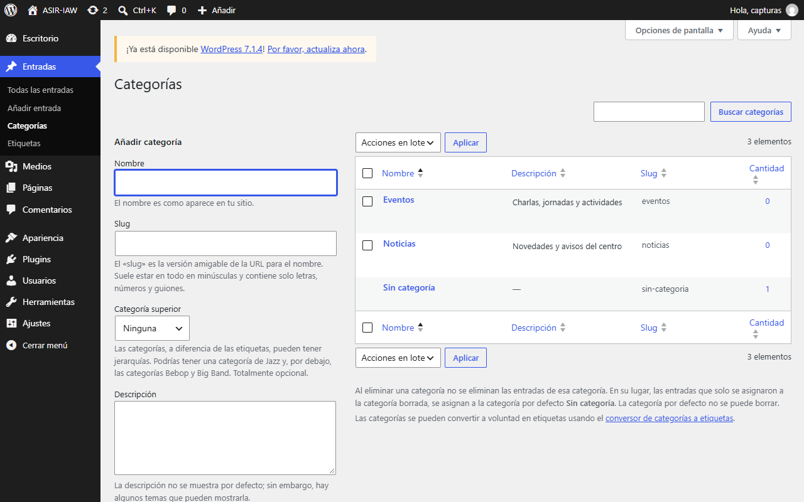

*Figura: Entradas > Categorías con las categorías Noticias y Eventos.*

La columna *Cantidad* indica cuántas entradas tiene cada categoría. La categoría *Sin categoría* es la categoría por defecto: no se puede borrar, pero sí cambiarle el nombre.

#### Paso 2. Escribir la entrada y clasificarla

Ve a Entradas > Añadir entrada. El editor es el mismo que el de las páginas, pero la pestaña Entrada del panel derecho tiene paneles propios:

- **Categorías:** marca *Noticias*. Desde *Añadir categoría* se puede crear una nueva sin salir del editor.
- **Etiquetas:** escribe palabras clave separadas por comas o con Intro (*matrícula*, *cursos*). Las etiquetas son libres y no jerárquicas. Úsalas con moderación: diez entradas con cuarenta etiquetas distintas no ayudan a nadie a encontrar nada.
- **Imagen destacada:** en la parte superior del panel, *Establecer la imagen destacada* permite elegir o subir la imagen que representará la entrada en la página del blog, en los listados y al compartirla en redes sociales.
- **Extracto:** un resumen breve que se muestra en los listados en lugar del texto completo.
- **Formato:** algunos temas muestran de forma distinta las entradas de tipo cita, galería, vídeo, etc.

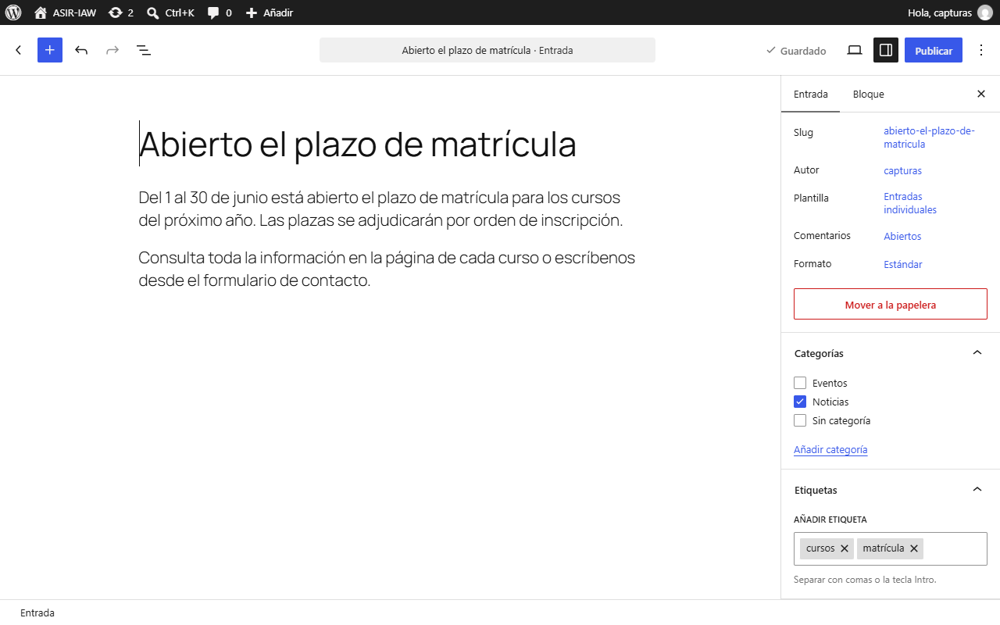

*Figura: el editor de una entrada con los paneles Categorías y Etiquetas.*

#### Paso 3. Publicar y ver la entrada

Publica la entrada igual que la página y pulsa Ver la entrada:

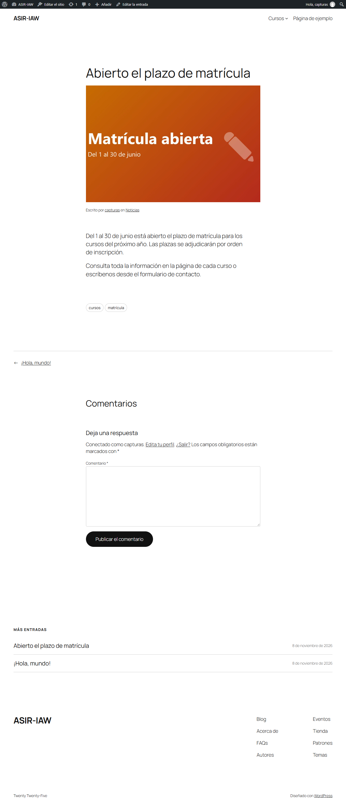

*Figura: la entrada publicada, con su imagen destacada, autor, categoría, etiquetas y comentarios.*

La plantilla de entrada del tema muestra elementos que la página no tenía:

- **La imagen destacada:** debajo del título.
- **Los metadatos:** «Escrito por *capturas* en *Noticias*»; el nombre de la categoría es un enlace al archivo con todas las noticias.
- **Las etiquetas:** al final del texto, cada una enlazada a su archivo.
- **La navegación entre entradas:** el enlace a la entrada anterior (*¡Hola, mundo!*).
- **El formulario de comentarios:** porque en las entradas los comentarios están abiertos por defecto.
- **Más entradas:** la lista de las últimas publicaciones.

Además, la entrada aparece en la página del blog y en el feed RSS del sitio (apartado 10).

### 6.6 Patrones

Un patrón es un conjunto de bloques ya diseñado (una cabecera con imagen y botón, una sección de precios, un pie de página…) que se inserta con un clic y luego se edita como cualquier otro contenido. Se encuentran en la pestaña Patrones del insertador, agrupados por categorías: *Contenido inicial*, *Banners*, *Cabeceras*, *Contacto*, *Llamada a la acción*, *Galería*, *Pies de página*, etc. La mayoría los aporta el tema activo.

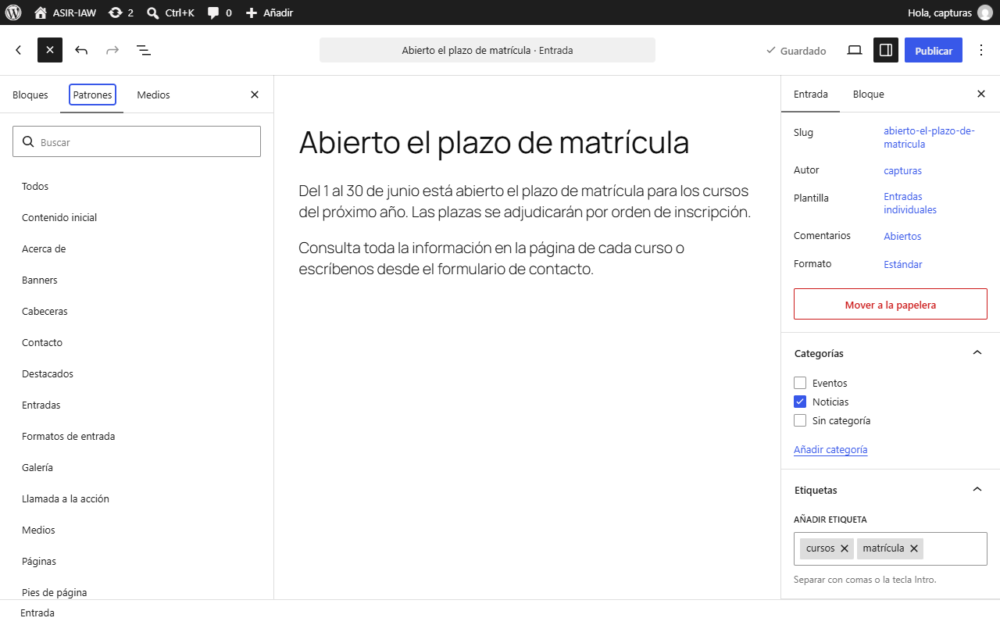

*Figura: las categorías de patrones disponibles en el insertador.*

También puedes crear patrones propios: selecciona uno o varios bloques, abre el menú ⋮ de su barra y elige *Crear patrón*. Al crearlo hay que decidir si es sincronizado:

- **No sincronizado:** cada vez que lo insertas se copia; después, cada copia se edita por separado. Sirve como plantilla para ahorrar tiempo.
- **Sincronizado:** todas las copias son el mismo contenido. Si lo editas en un sitio, cambia en todas las páginas donde se usa. Es ideal para un aviso que aparece en varias páginas («Matrícula abierta hasta el 30 de junio»).

Los patrones propios se gestionan en Apariencia > Editor > Patrones (apartado 7).

### 6.7 Estados, visibilidad y revisiones

Cada entrada o página tiene un estado:

| Estado | Significado |
| --- | --- |
| Borrador | En preparación. No es visible en la web. |
| Pendiente de revisión | Terminado, a la espera de que un editor lo publique. Lo usan los colaboradores, que no pueden publicar (apartado 9). |
| Programado | Se publicará automáticamente en la fecha y hora indicadas. |
| Publicado | Visible en la web. |
| Privado | Publicado, pero solo lo ven los usuarios con permiso (editores y administradores). |

La visibilidad se elige en el panel de ajustes o en las comprobaciones previas: *Pública*, *Privada* o *Protegida con contraseña* (el visitante debe escribir una contraseña para ver el contenido).

Las revisiones son las versiones guardadas de cada entrada y página. Cada vez que guardas, WordPress conserva la versión anterior. Pulsando el número de revisiones del panel de ajustes se abre la pantalla de comparación:

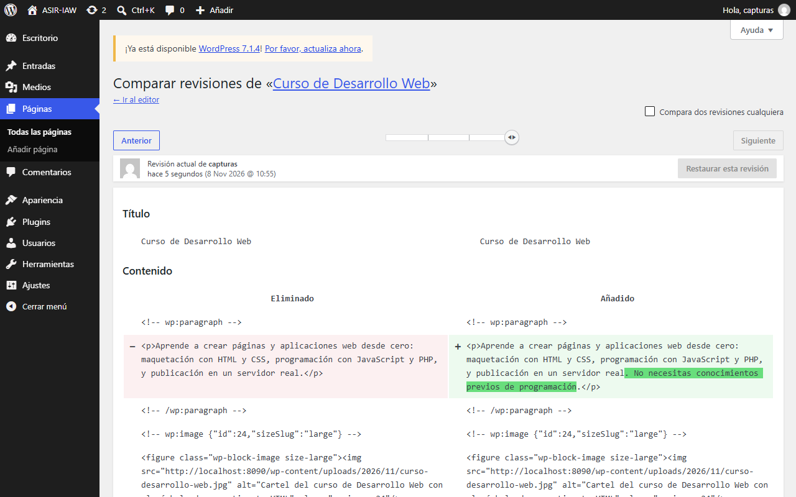

*Figura: comparación entre dos revisiones de la página del curso.*

- **El control deslizante** de la parte superior recorre todas las revisiones, de la más antigua a la más reciente. Los botones *Anterior* y *Siguiente* hacen lo mismo paso a paso.
- **La comparación** muestra en rojo lo eliminado y en verde lo añadido. En la captura se ve que tras publicar se añadió la frase «No necesitas conocimientos previos de programación». El contenido se muestra en el código que WordPress guarda realmente: el HTML de cada bloque con sus comentarios `<!-- wp:... -->`.
- **Compara dos revisiones cualquiera:** permite comparar dos versiones no consecutivas.
- **Restaurar esta revisión:** vuelve a la versión seleccionada. La versión actual no se pierde: queda guardada como una revisión más.

### 6.8 Navegación

El menú del sitio se gestiona de forma diferente según el tipo de tema:

- **En un tema de bloques:** con el bloque Navegación, desde Apariencia > Editor > Navegación.
- **En un tema clásico:** desde Apariencia > Menús.

Si todavía no has creado ningún menú, como en nuestro ejemplo, el bloque Navegación muestra automáticamente todas las páginas publicadas respetando su jerarquía: por eso *Curso de Desarrollo Web* aparece dentro de *Cursos*.

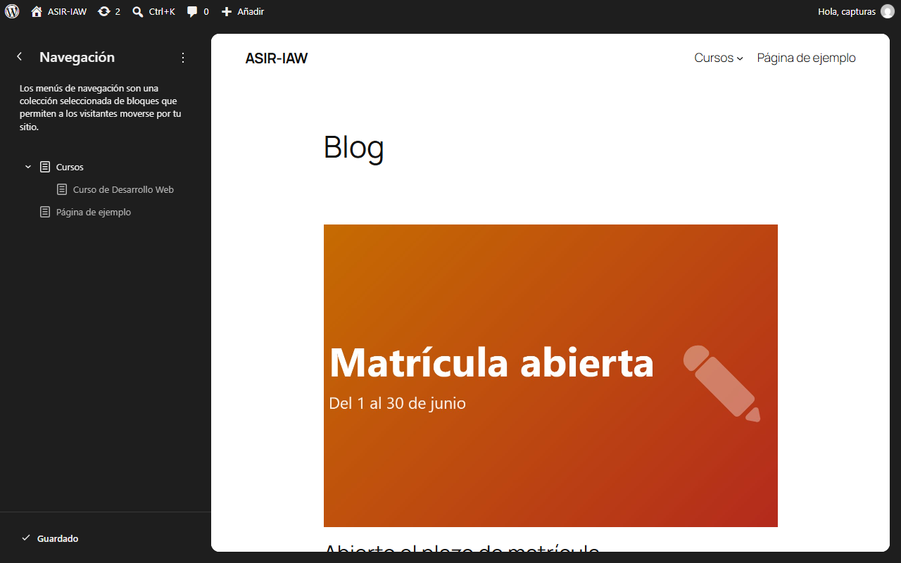

*Figura: Apariencia > Editor > Navegación con las páginas del sitio y su jerarquía.*

Desde esta pantalla, el menú ⋮ permite editar la navegación para:

- añadir páginas, entradas, categorías o enlaces personalizados (por ejemplo, a una red social);
- cambiar el orden arrastrando los elementos;
- crear submenús arrastrando un elemento debajo de otro;
- cambiar el texto que se muestra en el menú sin cambiar el título de la página.

Al editar la navegación por primera vez, WordPress convierte la lista automática en un menú propio. A partir de entonces, las páginas nuevas ya no se añaden solas: hay que incluirlas en el menú a mano.

## 7. Temas y plantillas

Un tema determina el aspecto y la estructura del sitio: tipografías, colores, disposición, cabecera, pie y cómo se muestra cada tipo de contenido. Cambiar de tema no borra el contenido, porque este está en la base de datos y no en el tema.

### 7.1 Temas de bloques y temas clásicos

| | **Tema de bloques** | **Tema clásico** |
| --- | --- | --- |
| Plantillas | Archivos HTML con bloques (`templates/*.html`) | Archivos PHP (`single.php`, `header.php`…) |
| Personalización | **Editor del sitio** (visual) | Personalizador y widgets, o código |
| Estilos globales | Archivo `theme.json` y panel *Estilos* | CSS y opciones del tema |
| Ejemplos | Twenty Twenty-Five, Twenty Twenty-Four, Ollie, Kadence Blocks | Twenty Twenty-One, Astra, GeneratePress |

Los temas por defecto de WordPress (*Twenty Twenty-…*) son temas de bloques mantenidos por el propio proyecto. Son una buena base: ligeros, accesibles y siempre actualizados.

### 7.2 Instalar y gestionar temas

Desde Apariencia > Temas > Añadir tema puedes buscar en el [directorio oficial](https://wordpress.org/themes/), previsualizar e instalar. También se puede subir un tema en `.zip` o usar WP-CLI:

```bash
wp theme list
wp theme install twentytwentyfour
wp theme activate twentytwentyfive
wp theme delete twentytwentythree
```

Elimina los temas que no utilices (deja solo el activo y uno por defecto de reserva): un tema inactivo pero desactualizado también puede contener vulnerabilidades.

Para elegir un tema, revisa: fecha de la última actualización, número de instalaciones activas, valoraciones, compatibilidad con tu versión de WordPress, accesibilidad, si es de bloques o clásico y si su licencia y soporte se ajustan a lo que necesitas.

### 7.3 El editor del sitio

En un tema de bloques, Apariencia > Editor permite diseñar el sitio completo de forma visual:

| Sección | Qué contiene |
| --- | --- |
| **Navegación** | Los menús del sitio |
| **Estilos** | Estilos globales: paleta de colores, tipografías, tamaños, espaciados y estilo de cada tipo de bloque. Incluye variaciones de estilo predefinidas. |
| **Páginas** | Las páginas, editables en contexto |
| **Plantillas** | El diseño de cada tipo de vista: Índice, Entrada individual, Página, Archivo, Búsqueda, 404… |
| **Patrones** | Patrones del sitio y partes de plantilla: Cabecera, Pie de página, Barra lateral |

Plantilla y parte de plantilla son conceptos clave:

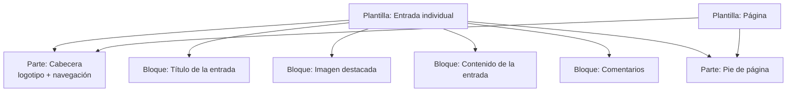

Una parte de plantilla (como la cabecera) se reutiliza en muchas plantillas: si la cambias una vez, cambia en todo el sitio.

Puedes crear plantillas nuevas desde Plantillas > Añadir plantilla: por ejemplo, una plantilla específica para la categoría *Noticias* o para una página concreta. También puedes crear plantillas personalizadas y asignarlas a páginas concretas desde el panel *Página > Plantilla* del editor (por ejemplo, una plantilla "Ancho completo sin título" para la página de inicio).

> Los cambios que haces en el editor del sitio se guardan en la base de datos, no en los archivos del tema. Si quieres volver al diseño original, en la lista de plantillas aparece la acción Restablecer. Y si quieres llevarte el diseño a otro sitio, hay que exportarlo (apartado 7.6).

### 7.4 Jerarquía de plantillas

¿Cómo decide WordPress qué plantilla usar? Sigue la jerarquía de plantillas: busca de la más específica a la más general y usa la primera que encuentra en el tema.

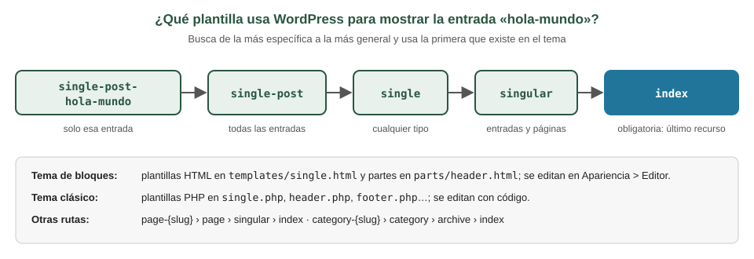

*Figura: orden de búsqueda de plantillas para una entrada individual.*

Así, si creas una plantilla `category-noticias`, solo afectará al archivo de la categoría *Noticias*; el resto de categorías seguirá usando `category`, `archive` o `index`.

### 7.5 Tema hijo

Si modificas directamente los archivos de un tema, perderás los cambios en cuanto se actualice. La solución es un tema hijo: un tema que hereda todo del tema padre y solo contiene lo que cambia. Si se actualiza el padre, el hijo se conserva.

Vamos a crear un tema hijo de *Twenty Twenty-Five* que cambia la paleta de colores y la tipografía. Desde la terminal del servidor:

```bash
sudo -u www-data mkdir -p /var/www/wordpress/wp-content/themes/iaw-hijo
sudo -u www-data nano /var/www/wordpress/wp-content/themes/iaw-hijo/style.css
```

**`style.css`**: la cabecera identifica el tema. La línea `Template` indica la carpeta del tema padre.

```css
/*
Theme Name:   IAW Hijo
Description:  Tema hijo de Twenty Twenty-Five para el módulo IAW
Author:       Tu nombre
Template:     twentytwentyfive
Version:      1.0.0
License:      GNU General Public License v2 or later
Text Domain:  iaw-hijo
*/

/* Estilos adicionales que no se puedan definir en theme.json */
.wp-block-post-title {
    letter-spacing: -0.02em;
}
```

**`theme.json`**: en los temas de bloques, los estilos globales se definen aquí. El hijo se combina con el `theme.json` del padre: solo hay que escribir lo que cambia.

```json
{
  "$schema": "https://schemas.wp.org/trunk/theme.json",
  "version": 3,
  "settings": {
    "color": {
      "palette": [
        { "slug": "base",     "color": "#ffffff", "name": "Base" },
        { "slug": "contrast", "color": "#1b2f25", "name": "Contraste" },
        { "slug": "accent-1", "color": "#2a5542", "name": "Verde IAW" },
        { "slug": "accent-2", "color": "#e8f1ec", "name": "Verde claro" }
      ]
    }
  },
  "styles": {
    "typography": {
      "fontFamily": "system-ui, -apple-system, 'Segoe UI', Roboto, sans-serif"
    },
    "elements": {
      "link": { "color": { "text": "var(--wp--preset--color--accent-1)" } },
      "button": {
        "color": {
          "background": "var(--wp--preset--color--accent-1)",
          "text": "var(--wp--preset--color--base)"
        }
      }
    }
  }
}
```

En los temas de bloques, el `style.css` del tema hijo no se carga automáticamente en la parte pública. Si añades CSS en él, encola la hoja con un pequeño `functions.php`:

```php
<?php
// Carga la hoja de estilos del tema hijo después de los estilos del tema padre.
add_action( 'wp_enqueue_scripts', function () {
    wp_enqueue_style(
        'iaw-hijo-style',
        get_stylesheet_uri(),
        array(),
        wp_get_theme()->get( 'Version' )
    );
} );
```

Comprueba la sintaxis y activa el tema:

```bash
php -l /var/www/wordpress/wp-content/themes/iaw-hijo/functions.php
python3 -m json.tool /var/www/wordpress/wp-content/themes/iaw-hijo/theme.json > /dev/null && echo "JSON correcto"
wp theme activate iaw-hijo
```

Un tema hijo también puede sobrescribir plantillas: si copias `templates/single.html` del padre a `iaw-hijo/templates/single.html` y la modificas, WordPress usará la del hijo.

> **Alternativa visual:** el plugin oficial Create Block Theme permite crear un tema hijo desde el propio editor, guardar en los archivos del tema los cambios hechos en el editor del sitio y exportar el tema como `.zip`.

### 7.6 Exportar e importar el diseño

- **Tema completo**: con Create Block Theme (*Exportar como zip*) o comprimiendo la carpeta del tema hijo. Se importa en otro sitio desde *Apariencia > Temas > Subir tema*.
- **Patrones**: en *Apariencia > Editor > Patrones*, cada patrón propio se puede exportar como JSON e importarse en otro sitio con *Importar desde JSON*.
- **Plantillas y estilos editados en el editor**: se guardan en la base de datos, así que se incluyen en las copias de seguridad de la base de datos, pero no en la exportación de contenidos de *Herramientas > Exportar*.

### **Práctica 2:** diseño del sitio con plantillas y tema hijo

**Enunciado**

Diseña la web de un centro de formación ficticio sobre tu instalación de la práctica 1.

**Debes realizar:**

1. Configura los ajustes básicos: título, descripción, zona horaria, enlaces permanentes con el nombre de la entrada y una página estática como portada.
2. Crea al menos cuatro páginas (*Inicio*, *Cursos*, *Quiénes somos*, *Contacto*) y seis entradas repartidas en dos categorías (*Noticias* y *Eventos*), con imagen destacada y texto alternativo.
3. Crea un tema hijo de un tema de bloques con su `style.css` y un `theme.json` que defina una paleta de colores propia y la tipografía. Actívalo.
4. En el editor del sitio:
   - Modifica la cabecera (logotipo, título y navegación con submenú) y el pie (datos de contacto y enlaces legales).
   - Crea una plantilla específica para la categoría *Eventos* que se distinga de la de *Noticias*.
   - Crea una plantilla personalizada para la página de inicio y asígnala.
   - Crea un patrón sincronizado (por ejemplo, un aviso de "Matrícula abierta") y úsalo en al menos dos páginas.
5. Exporta el tema hijo como `.zip` y el patrón como JSON.

**Entrega:** capturas del sitio público (escritorio y móvil) y del editor del sitio, el `.zip` del tema hijo y el JSON del patrón, y una breve explicación de la diferencia entre plantilla, parte de plantilla y patrón.

## 8. Plugins

Un plugin (complemento) es un paquete de código PHP que añade o modifica funciones de WordPress sin tocar su núcleo: formularios, SEO, copias de seguridad, tienda en línea, seguridad, estadísticas… Se guardan en `wp-content/plugins/`.

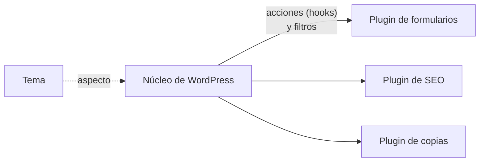

WordPress ofrece ganchos (*hooks*): puntos de su ejecución donde los plugins pueden "engancharse" para hacer algo (acciones) o modificar un dato (filtros). Así, un plugin cambia el comportamiento sin editar el núcleo, y las actualizaciones no lo borran.

### 8.1 Instalar, activar y eliminar

Desde Plugins > Añadir plugin puedes buscar en el [directorio oficial](https://wordpress.org/plugins/), instalar y activar. También se pueden subir en `.zip` o usar WP-CLI:

```bash
wp plugin search formulario --per-page=5 --fields=name,slug,active_installs
wp plugin install contact-form-7 --activate
wp plugin list
wp plugin deactivate hello
wp plugin delete hello akismet
```

- **Desactivar** detiene el plugin pero conserva sus archivos y su configuración.
- **Eliminar** borra sus archivos y, en muchos casos, también sus datos de la base de datos.

### 8.2 Cómo elegir un plugin

Cada plugin es código de terceros que se ejecuta en tu servidor. Antes de instalar uno, comprueba:

| Criterio | Qué mirar |
| --- | --- |
| Necesidad | ¿Lo puede hacer WordPress o el tema sin plugin? ¿Ya tienes otro plugin que lo hace? |
| Mantenimiento | Fecha de la última actualización y versión de WordPress con la que se ha probado |
| Popularidad | Número de instalaciones activas y valoraciones |
| Soporte | ¿Se responden las consultas del foro de soporte? |
| Origen | Descárgalo del directorio oficial o de la web de su autor. Nunca uses versiones "nulled" (de pago pirateadas): suelen contener código malicioso. |
| Rendimiento y privacidad | ¿Carga muchos scripts? ¿Envía datos a terceros o instala cookies? |

**Menos es más:** cada plugin añade código que mantener, posibles conflictos y posibles vulnerabilidades.

### 8.3 Plugins gratuitos más utilizados

Todos los de la tabla tienen versión gratuita en el directorio oficial (algunos tienen además una versión de pago con funciones extra).

| Categoría | Plugins | Para qué |
| --- | --- | --- |
| Formularios | **Contact Form 7**, WPForms Lite, Fluent Forms | Formularios de contacto e inscripción |
| SEO | **Yoast SEO**, Rank Math | Títulos, metadescripciones, mapa del sitio XML, datos estructurados |
| Antispam | **Akismet**, Antispam Bee | Filtrar comentarios y envíos de spam |
| Seguridad | **Wordfence**, Limit Login Attempts Reloaded, Two Factor | Cortafuegos, análisis de malware, límite de intentos, doble factor |
| Copias de seguridad | **UpdraftPlus**, All-in-One WP Migration, Duplicator | Copias programadas, restauración y migración |
| Caché y rendimiento | WP Super Cache, W3 Total Cache, LiteSpeed Cache | Servir páginas en caché para responder más rápido |
| Imágenes | Smush, EWWW Image Optimizer, Converter for Media | Comprimir imágenes y convertirlas a WebP |
| Constructores visuales | Elementor, Spectra, Kadence Blocks | Diseño de páginas avanzado |
| Tienda en línea | **WooCommerce** | Productos, carrito, pagos y envíos |
| Correo | WP Mail SMTP | Enviar el correo del sitio mediante un servidor SMTP fiable |
| Legal y cookies | Complianz, CookieYes | Aviso de cookies y bloqueo previo al consentimiento (RGPD) |
| Multilingüe | Polylang, TranslatePress | Sitio en varios idiomas |
| Usuarios y roles | Members, User Role Editor | Crear roles y modificar capacidades |
| Estadísticas | Site Kit by Google, Independent Analytics, Koko Analytics, WP Statistics | Visitas y comportamiento de los usuarios |
| Registro de actividad | Simple History, WP Activity Log | Quién hizo qué y cuándo en el panel |
| Importación y exportación | WordPress Importer, WP All Import / WP All Export | Mover contenidos en XML o CSV |
| Utilidades | Redirection, Create Block Theme, Classic Editor | Redirecciones 301, herramientas de tema, editor antiguo |

### 8.4 Configurar un plugin: ejemplo con Contact Form 7

1. Instala y activa Contact Form 7. Aparece el menú Contacto.
2. En Contacto > Formularios de contacto, edita el formulario de ejemplo. Su plantilla usa etiquetas entre corchetes:

```text
<label> Nombre (obligatorio)
    [text* tu-nombre autocomplete:name] </label>

<label> Correo electrónico (obligatorio)
    [email* tu-email autocomplete:email] </label>

<label> Curso de interés
    [select tu-curso "Desarrollo web" "Sistemas" "Redes"] </label>

<label> Mensaje
    [textarea tu-mensaje] </label>

[acceptance acepto-privacidad] He leído y acepto la política de privacidad [/acceptance]

[submit "Enviar"]
```

3. En la pestaña Correo, configura el destinatario y el cuerpo del mensaje con las mismas etiquetas (`[tu-nombre]`, `[tu-curso]`…).
4. Copia el shortcode del formulario (`[contact-form-7 id="…" title="…"]`) y pégalo en la página *Contacto* con el bloque Shortcode.

> En nuestra máquina virtual el envío de correo no funcionará: el servidor no tiene configurado ningún servicio de correo. Para un sitio real se usa un plugin SMTP (WP Mail SMTP) con un servicio de correo (la cuenta de correo del dominio, un proveedor de envío transaccional…). Para las prácticas, comprueba los envíos con un plugin como Flamingo, que guarda en la base de datos los mensajes recibidos por Contact Form 7.

### 8.5 Un plugin propio

Crear un plugin sencillo ayuda a entender cómo funciona WordPress por dentro y permite adaptar el sitio a una necesidad concreta sin depender de terceros. Vamos a crear un plugin que añade un shortcode `[aviso]` para mostrar un recuadro de aviso configurable.

```bash
sudo -u www-data mkdir -p /var/www/wordpress/wp-content/plugins/iaw-avisos
sudo -u www-data nano /var/www/wordpress/wp-content/plugins/iaw-avisos/iaw-avisos.php
```

```php
<?php
/**
 * Plugin Name: IAW Avisos
 * Description: Añade el shortcode [aviso] para mostrar avisos destacados.
 * Version:     1.0.0
 * Author:      Tu nombre
 * License:     GPL-2.0-or-later
 * Text Domain: iaw-avisos
 */

// Impide que el archivo se ejecute si se accede a él directamente por URL.
if ( ! defined( 'ABSPATH' ) ) {
    exit;
}

/**
 * Genera el HTML del shortcode.
 * Uso: [aviso tipo="importante" titulo="Matrícula"]Texto del aviso[/aviso]
 */
function iaw_avisos_shortcode( $atts, $content = '' ) {
    // Valores por defecto de los atributos.
    $atts = shortcode_atts(
        array(
            'tipo'   => 'info',      // info | importante | exito
            'titulo' => 'Aviso',
        ),
        $atts,
        'aviso'
    );

    $colores = array(
        'info'       => '#21759b',
        'importante' => '#b3261e',
        'exito'      => '#2a5542',
    );
    $color = $colores[ $atts['tipo'] ] ?? $colores['info'];

    // Escapamos siempre los datos antes de mostrarlos para evitar XSS.
    return sprintf(
        '<div class="iaw-aviso" style="border-left:6px solid %1$s;padding:1em;background:#f6f7f7;margin:1em 0">
            <strong style="color:%1$s">%2$s</strong><br>%3$s
        </div>',
        esc_attr( $color ),
        esc_html( $atts['titulo'] ),
        wp_kses_post( $content )
    );
}
add_shortcode( 'aviso', 'iaw_avisos_shortcode' );
```

Comprueba la sintaxis y actívalo:

```bash
php -l /var/www/wordpress/wp-content/plugins/iaw-avisos/iaw-avisos.php
wp plugin activate iaw-avisos
```

Úsalo en cualquier página con el bloque Shortcode:

```text
[aviso tipo="importante" titulo="Matrícula abierta"]El plazo termina el 30 de junio.[/aviso]
```

Fíjate en tres buenas prácticas que aparecen en el código: la comprobación de `ABSPATH`, el prefijo `iaw_` en el nombre de la función (para no chocar con otros plugins) y el escapado de todo lo que se muestra (`esc_html`, `esc_attr`, `wp_kses_post`).

## 9. Usuarios y roles

WordPress controla lo que puede hacer cada persona mediante roles. Cada rol es un conjunto de capacidades (*capabilities*): permisos concretos como `edit_posts`, `publish_posts`, `upload_files` o `manage_options`.

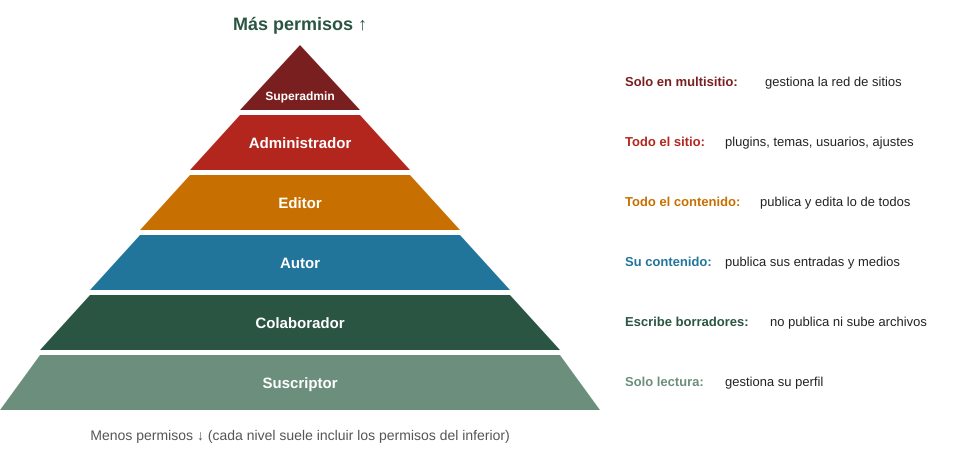

*Figura: roles predeterminados de WordPress, de más a menos permisos.*

| Capacidad | Suscriptor | Colaborador | Autor | Editor | Administrador |
| --- | :---: | :---: | :---: | :---: | :---: |
| Leer y editar su perfil | ✔ | ✔ | ✔ | ✔ | ✔ |
| Escribir y editar sus entradas (sin publicar) | | ✔ | ✔ | ✔ | ✔ |
| Publicar sus entradas | | | ✔ | ✔ | ✔ |
| Subir archivos | | | ✔ | ✔ | ✔ |
| Editar y publicar entradas de otros | | | | ✔ | ✔ |
| Gestionar páginas, categorías y comentarios | | | | ✔ | ✔ |
| Instalar plugins y temas | | | | | ✔ |
| Gestionar usuarios | | | | | ✔ |
| Cambiar los ajustes del sitio | | | | | ✔ |

El Superadministrador solo existe en las instalaciones multisitio (una red de varios sitios WordPress con una sola instalación) y administra la red completa.

### 9.1 Crear y gestionar usuarios

- **Usuarios > Añadir usuario**: nombre de usuario, correo, contraseña y rol. Se puede enviar un aviso por correo a la persona.
- **Usuarios > Todos los usuarios**: cambiar el rol de varios usuarios a la vez, restablecer contraseñas o eliminar cuentas. Al eliminar un usuario, WordPress pregunta a quién atribuir su contenido, para no perderlo.
- **Perfil**: cada usuario puede cambiar su nombre visible, su contraseña, su biografía y generar contraseñas de aplicación (para acceder a la API REST desde otros programas).
- **Ajustes > Generales**: si activas *Cualquiera puede registrarse*, elige con cuidado el rol por defecto (normalmente, *Suscriptor*).

Con WP-CLI:

```bash
wp user list --fields=ID,user_login,user_email,roles
wp user create lucia lucia@ejemplo.com --role=editor --display_name="Lucía Pérez"
wp user create pablo pablo@ejemplo.com --role=contributor
wp user set-role pablo author
wp user delete pablo --reassign=1
```

`create` muestra en pantalla la contraseña generada; el usuario debe cambiarla en su primer acceso.

### 9.2 Roles personalizados

A veces ningún rol predeterminado encaja. Por ejemplo, queremos un rol Revisor que pueda editar y publicar entradas de cualquiera (como un editor), pero no pueda borrar contenido ni gestionar páginas.

**Opción visual: plugin Members** (o User Role Editor).

1. Instala y activa *Members*. Aparece el menú Members > Roles.
2. **Add New Role**: nombre *Revisor*; marca las capacidades necesarias (`read`, `edit_posts`, `edit_others_posts`, `edit_published_posts`, `publish_posts`, `upload_files`, `moderate_comments`) y deja sin marcar las de borrado y las de páginas.
3. Asigna el rol a un usuario y comprueba lo que ve iniciando sesión con él (en una ventana privada del navegador).

**Opción por terminal: WP-CLI**

```bash
wp role create revisor "Revisor"
wp cap add revisor read edit_posts edit_others_posts edit_published_posts publish_posts upload_files moderate_comments
wp cap list revisor
wp user set-role lucia revisor
```

### 9.3 Buenas prácticas con usuarios

- **Principio de mínimo privilegio**: da a cada persona el rol mínimo que necesita. Quien solo escribe artículos no necesita ser administrador.
- Pocas cuentas de administrador, nominales (una por persona, nunca compartidas) y con doble factor de autenticación (plugin *Two Factor*).
- Contraseñas largas y únicas. Elimina o degrada las cuentas que ya no se usan.
- Nunca uses `admin` como nombre de usuario: es el primero que prueban los ataques automatizados.

### **Práctica 3:** usuarios, roles y plugins

**Enunciado**

Amplía el sitio de la práctica 2 para que lo gestione un equipo de personas y para cubrir nuevas necesidades.

**Debes realizar:**

1. **Usuarios.** Crea al menos un usuario de cada rol predeterminado (suscriptor, colaborador, autor y editor). Crea uno desde el panel y otro con WP-CLI.
2. **Flujo editorial.** Con el colaborador, escribe una entrada y envíala a revisión; con el editor, revísala y publícala. Documenta con capturas qué ve cada rol en su menú.
3. **Rol personalizado.** Crea el rol *Revisor* (o uno propio justificado) con un plugin o con WP-CLI, asígnalo y comprueba que sus permisos son los esperados.
4. **Plugins.** Selecciona, instala y configura al menos cuatro plugins que respondan a estas necesidades, justificando la elección de cada uno con los criterios del apartado 8.2:
   - Un formulario de contacto o de inscripción en la página *Contacto*.
   - SEO básico (título y metadescripción de la portada, mapa del sitio XML).
   - Protección del acceso (límite de intentos o doble factor).
   - Uno más, a tu elección, que aporte una funcionalidad útil al centro de formación (calendario de eventos, galería, preguntas frecuentes, multilingüe…).
5. **Plugin propio.** Instala el plugin `iaw-avisos` del apartado 8.5 y amplíalo con un nuevo tipo de aviso (`tipo="evento"`) con su propio color. Úsalo en una página.

**Entrega:** documento con capturas, tabla de usuarios con su rol (sin contraseñas), tabla de plugins con su función, versión y justificación, y el código del plugin propio.

## 10. Sindicación de contenidos

Sindicar un contenido es ponerlo a disposición de otros sitios o aplicaciones en un formato estándar, para que puedan leerlo o mostrarlo automáticamente sin visitar la web. El formato más conocido es RSS (y su alternativa Atom): un archivo XML con la lista de las últimas publicaciones.

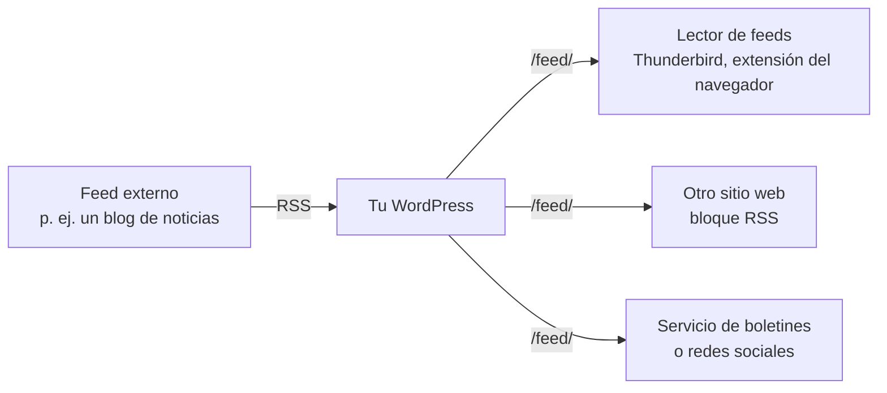

### 10.1 Feeds que genera WordPress

WordPress crea los feeds automáticamente, sin necesidad de plugins:

| Feed | URL (con enlaces permanentes "bonitos") |
| --- | --- |
| Últimas entradas (RSS 2.0) | `https://localhost:8443/feed/` |
| Últimas entradas (Atom) | `https://localhost:8443/feed/atom/` |
| Últimos comentarios | `https://localhost:8443/comments/feed/` |
| Una categoría | `https://localhost:8443/category/noticias/feed/` |
| Una etiqueta | `https://localhost:8443/tag/php/feed/` |
| Un autor | `https://localhost:8443/author/lucia/feed/` |
| Comentarios de una entrada | `https://localhost:8443/mi-entrada/feed/` |
| Resultados de una búsqueda | `https://localhost:8443/?s=moodle&feed=rss2` |

Con los enlaces permanentes simples, las URL usan parámetros: `?feed=rss2`, `?cat=3&feed=rss2`…

En Ajustes > Lectura se decide cuántas entradas incluye el feed y si muestran el texto completo o solo el extracto (el extracto obliga al lector a visitar la web para leer el resto).

Comprueba el feed desde la terminal:

```bash
curl -sk https://localhost:8443/feed/ | head -n 30
```

Verás un XML como este (simplificado):

```xml
<rss version="2.0">
  <channel>
    <title>Centro de Formación IAW</title>
    <link>https://localhost:8443</link>
    <description>Cursos de informática</description>
    <item>
      <title>Abierto el plazo de matrícula</title>
      <link>https://localhost:8443/abierto-el-plazo-de-matricula/</link>
      <pubDate>Fri, 06 Nov 2026 09:00:00 +0000</pubDate>
      <category>Noticias</category>
      <description>El plazo de matrícula para el curso…</description>
    </item>
  </channel>
</rss>
```

Puedes validar el feed en el [validador del W3C](https://validator.w3.org/feed/). Como nuestro sitio solo existe en `localhost`, el validador no puede descargarlo: abre el feed en el navegador, copia todo su contenido y pégalo en la pestaña Validate by Direct Input.

### 10.2 Ofrecer la suscripción

- Añade un enlace visible al feed: con el bloque Iconos sociales (incluye el icono RSS) o con un bloque Botones.
- La cabecera HTML de WordPress ya incluye etiquetas `<link rel="alternate" type="application/rss+xml">`: los navegadores y lectores detectan el feed solo con escribir la URL del sitio.
- Para que los visitantes reciban las novedades por correo, existen plugins de boletines que se alimentan del feed o de las entradas (MailPoet, Newsletter).

### 10.3 Mostrar feeds externos en tu sitio

El bloque RSS muestra las últimas entradas de cualquier feed externo. Por ejemplo, para mostrar en la portada las novedades del blog oficial de WordPress:

1. En el editor, inserta el bloque RSS.
2. Escribe la URL `https://es.wordpress.org/feed/` (o la del blog del INCIBE, una revista de tecnología, etc.).
3. En el panel del bloque, ajusta el número de elementos y si muestra fecha, autor y extracto.

Si necesitas importar de forma periódica las entradas de otros sitios como contenido propio, hay plugins agregadores (WP RSS Aggregator, Feedzy). Respeta siempre los derechos de autor: enlaza a la fuente original y no copies artículos completos sin permiso.

### 10.4 Más allá del RSS: la API REST

WordPress también ofrece sus contenidos en JSON a través de su API REST, pensada para que otras aplicaciones (una app móvil, otra web, un script) lean y escriban contenido:

```bash
curl -sk "https://localhost:8443/wp-json/wp/v2/posts?per_page=3&_fields=id,date,title,link"
```

```json
[
  {
    "id": 42,
    "date": "2026-11-06T10:00:00",
    "link": "https://localhost:8443/abierto-el-plazo-de-matricula/",
    "title": { "rendered": "Abierto el plazo de matrícula" }
  }
]
```

Leer contenido público no requiere autenticación; crearlo o modificarlo sí (por ejemplo, con una contraseña de aplicación del perfil del usuario).

Además, gracias a oEmbed, si pegas la URL de una entrada de tu WordPress en otro WordPress, se muestra como una tarjeta incrustada con título, extracto e imagen.

## 11. Importar y exportar contenidos

Mover contenidos entre sitios es una tarea habitual: migrar un blog, fusionar dos webs, cargar un catálogo desde una hoja de cálculo o entregar los datos a otra aplicación. Cada formato tiene su uso:

| Formato | Qué contiene | Herramienta | Uso típico |
| --- | --- | --- | --- |
| **WXR** (XML de WordPress) | Entradas, páginas, comentarios, categorías, etiquetas, menús, autores y referencias a los medios | *Herramientas > Exportar / Importar* | Pasar el contenido de un WordPress a otro |
| **CSV** | Datos tabulares (entradas, usuarios, productos…) | Plugins (WP All Export / WP All Import, importadores de usuarios) | Intercambio con hojas de cálculo |
| **JSON** | Contenido estructurado; patrones | API REST; exportación de patrones | Intercambio con otras aplicaciones |
| **SQL** | La base de datos completa | `mysqldump`, `wp db export` | Copias de seguridad y migraciones completas |
| **ZIP** | Archivos: temas, plugins, medios | Comprimir carpetas; Create Block Theme | Mover diseño y archivos |
| **RSS** | Últimas entradas | Importador RSS | Traer contenido de otros blogs o plataformas |

### 11.1 Exportar e importar con las herramientas de WordPress

**Exportar:**

1. **Herramientas > Exportar**.
2. Elige *Todo el contenido* o filtra por tipo (solo entradas, solo páginas, solo medios) y, en las entradas, por categoría, autor, fechas o estado.
3. Pulsa Descargar el archivo de exportación: obtendrás un archivo `.xml`.

**Importar** en otro sitio:

1. **Herramientas > Importar > WordPress > Instalar ahora** (instala el plugin oficial *WordPress Importer*) y después Ejecutar el importador.
2. Sube el `.xml`.
3. **Asigna los autores**: puedes crear usuarios nuevos o atribuir el contenido a usuarios existentes.
4. Marca Descargar e importar archivos adjuntos: el importador descarga las imágenes desde el sitio original (por eso este debe seguir accesible durante la importación).

> En nuestro laboratorio, el sitio de pruebas (`http://localhost:8081`) puede no conseguir descargar los adjuntos de `https://localhost:8443`: WordPress bloquea por seguridad las descargas hacia `localhost` en puertos poco habituales, y además el certificado es autofirmado. El contenido se importa igualmente y las imágenes siguen enlazadas al sitio original, que está en la misma VM. Si quieres copiarlas, copia la carpeta `uploads`: `sudo cp -a /var/www/wordpress/wp-content/uploads/. /var/www/pruebas/wp-content/uploads/`.

> El archivo WXR no incluye los ajustes del sitio, los plugins, el tema, los widgets ni, en la mayoría de los casos, los ajustes de los plugins. Para una migración completa hace falta una copia de la base de datos y de `wp-content`, o un plugin de migración.

En Herramientas > Importar hay importadores para otras plataformas: Blogger, Tumblr, LiveJournal, Movable Type y un importador genérico de RSS.

### 11.2 Con WP-CLI

```bash
# Exportar solo las entradas de la categoría "noticias"
# (www-data no puede escribir en /home/ubuntu, por eso usamos /tmp)
wp export --post_type=post --category=noticias --dir=/tmp --filename_format=noticias.xml

# Importar en el sitio de pruebas del apartado 4.11 (requiere el plugin wordpress-importer)
WPP="sudo -u www-data /usr/local/bin/wp --path=/var/www/pruebas"
$WPP plugin install wordpress-importer --activate
$WPP import /tmp/noticias.xml --authors=create
```

### 11.3 Contenidos en CSV

WordPress no trae de serie un importador CSV para entradas, pero hay plugins que lo resuelven:

- **WP All Export** (gratuito) exporta entradas, páginas o usuarios a CSV o XML, eligiendo qué campos incluir arrastrándolos.
- **WP All Import** (gratuito) importa un CSV o XML: subes el archivo, asignas cada columna a un campo (título, contenido, categoría, imagen destacada…) y lanzas la importación.
- Para usuarios, plugins como *Import and export users and customers* importan y exportan cuentas desde CSV.

Ejemplo de CSV de cursos para importar como entradas:

```csv
titulo,contenido,categoria,fecha
"Curso de HTML y CSS","Aprende a maquetar páginas web desde cero.",Cursos,2026-11-15
"Curso de Linux","Administración básica de sistemas Linux.",Cursos,2026-12-01
"Jornada de ciberseguridad","Charla sobre buenas prácticas de seguridad.",Eventos,2026-12-10
```

Guarda los CSV con codificación UTF-8 para que las tildes y la ñ se importen correctamente.

### 11.4 Exportar en JSON con la API REST

```bash
curl -sk "https://localhost:8443/wp-json/wp/v2/posts?per_page=100" -o entradas.json
curl -sk "https://localhost:8443/wp-json/wp/v2/pages?per_page=100" -o paginas.json
```

## 12. Copias de seguridad

Una copia de seguridad es el seguro de vida del sitio: permite recuperarse de un error humano, una actualización fallida, un ataque o la pérdida del servidor.

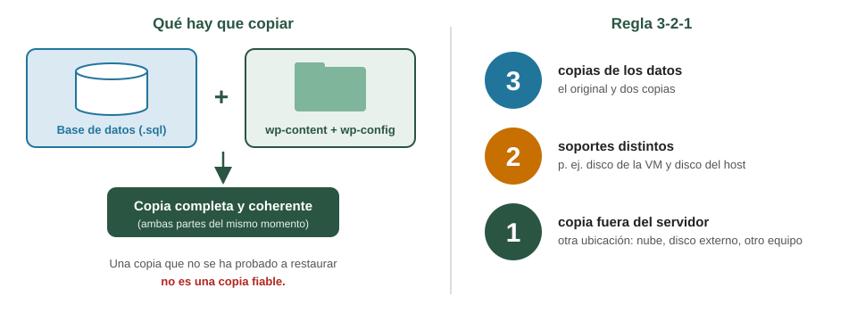

*Figura: una copia completa reúne la base de datos y los archivos; la regla 3-2-1 indica cuántas copias guardar y dónde.*

Preguntas que debe responder tu política de copias:

- **Qué**: base de datos + `wp-content` + `wp-config.php` (y conviene anotar las versiones de WordPress y de PHP).
- **Cuándo**: con una frecuencia acorde a lo que cambia el sitio (un periódico, cada hora; una web corporativa, a diario o semanalmente) y siempre antes de actualizar.
- **Cuánto tiempo**: la retención (por ejemplo, 7 copias diarias y 4 semanales).
- **Dónde**: fuera del propio servidor.
- **Cómo se restaura**: un procedimiento documentado y probado.

### 12.1 Copia manual desde la terminal

**Base de datos** (con WP-CLI, que usa los datos de `wp-config.php`):

```bash
mkdir -p ~/backups
wp db export - | gzip > ~/backups/bd_$(date +%F_%H%M).sql.gz
```

Sin WP-CLI se obtiene lo mismo con `mysqldump`:

```bash
mysqldump --no-tablespaces -u wpuser -p wordpress | gzip > ~/backups/bd_$(date +%F_%H%M).sql.gz
```

**Archivos:**

```bash
sudo tar -czf ~/backups/archivos_$(date +%F_%H%M).tar.gz -C /var/www wordpress
ls -lh ~/backups
```

**Descargar las copias a tu equipo** (desde PowerShell en Windows), para cumplir la regla de la copia fuera del servidor:

```powershell
scp -P 2222 "usuario@localhost:~/backups/*.gz" .
```

### 12.2 Automatizar las copias

Crea un script:

```bash
sudo nano /usr/local/bin/backup-wordpress.sh
```

```bash
#!/bin/bash
# Copia de seguridad diaria de WordPress: base de datos + archivos.
set -euo pipefail

SITIO=/var/www/wordpress
DESTINO=/var/backups/wordpress
FECHA=$(date +%F_%H%M)
DIAS_RETENCION=7

mkdir -p "$DESTINO"

# 1. Base de datos
sudo -u www-data /usr/local/bin/wp --path="$SITIO" db export - | gzip > "$DESTINO/bd_$FECHA.sql.gz"

# 2. Archivos
tar -czf "$DESTINO/archivos_$FECHA.tar.gz" -C /var/www wordpress

# 3. Borrar las copias con más días de los indicados
find "$DESTINO" -type f -name '*.gz' -mtime +"$DIAS_RETENCION" -delete

echo "$(date '+%F %T') Copia completada: $FECHA" >> /var/log/backup-wordpress.log
```

Dale permisos, pruébalo y prográmalo en el `cron` de `root` para que se ejecute cada día a las 3:30:

```bash
sudo chmod 750 /usr/local/bin/backup-wordpress.sh
sudo /usr/local/bin/backup-wordpress.sh
sudo ls -lh /var/backups/wordpress
sudo crontab -e
```

```cron
30 3 * * * /usr/local/bin/backup-wordpress.sh
```

### 12.3 Copias con un plugin: UpdraftPlus

Los plugins de copia son la opción más cómoda cuando no se tiene acceso a la terminal (por ejemplo, en un *hosting* compartido).

1. Instala y activa UpdraftPlus. Ve a Ajustes > Copias de seguridad UpdraftPlus.
2. Pulsa Hacer copia de seguridad ahora, marcando base de datos y archivos.
3. En Ajustes: programa las copias de archivos y de la base de datos (p. ej. semanal y diaria), indica cuántas conservar y elige un almacenamiento remoto (Google Drive, Dropbox, Amazon S3, correo…).
4. Las copias aparecen en Copias de seguridad existentes, desde donde se pueden descargar y restaurar eligiendo qué componentes (base de datos, plugins, temas, uploads, otros).

### 12.4 Instantáneas de VirtualBox

VirtualBox permite tomar una instantánea (*snapshot*) de la máquina virtual: guarda el estado completo del disco en ese momento (sistema, configuración y WordPress). Con la VM apagada, abre Máquina > Instantáneas > Tomar y dale un nombre descriptivo (*Antes de actualizar a 6.x*). Para volver a ese estado, selecciona la instantánea y pulsa Restaurar. Para tener una copia de la VM completa fuera de VirtualBox, usa Archivo > Exportar servicio virtualizado (`.ova`).

Es ideal justo antes de una actualización importante, pero no sustituye a las copias de WordPress: es una copia "de todo o nada", ocupa más y se guarda en el mismo equipo que la VM: si se estropea el disco del host, se pierden ambas.

| Método | Ventajas | Inconvenientes |
| --- | --- | --- |
| Terminal (WP-CLI, `tar`) | Control total, automatizable, sin plugins | Requiere acceso SSH y conocimientos |
| Plugin (UpdraftPlus) | Sencillo, restauración guiada, almacenamiento remoto | Consume recursos del sitio; depende del plugin |
| Instantánea de VirtualBox | Copia de todo el servidor en segundos y vuelta atrás inmediata | Todo o nada; ocupa mucho espacio; está en el mismo equipo |

### 12.5 Restaurar

Una copia solo es válida si sabes restaurarla. Pruébalo en un entorno de pruebas o tras hacer una instantánea:

```bash
# 1. Activar el modo mantenimiento
wp maintenance-mode activate

# 2. Restaurar los archivos
sudo rm -rf /var/www/wordpress
sudo tar -xzf /var/backups/wordpress/archivos_2026-11-06_0330.tar.gz -C /var/www
sudo chown -R www-data:www-data /var/www/wordpress

# 3. Restaurar la base de datos
gunzip -c /var/backups/wordpress/bd_2026-11-06_0330.sql.gz | sudo -u www-data /usr/local/bin/wp --path=/var/www/wordpress db import -

# 4. Desactivar el modo mantenimiento y comprobar
wp maintenance-mode deactivate
wp core verify-checksums
```

`wp core verify-checksums` compara los archivos del núcleo con los oficiales: es útil para detectar archivos modificados.

## 13. Actualizaciones

Mantener WordPress actualizado es la medida de seguridad más importante: la mayoría de los sitios comprometidos lo son por plugins o temas desactualizados con vulnerabilidades conocidas. Hay que actualizar cuatro elementos:

| Elemento | Cómo se actualiza por defecto |
| --- | --- |
| **Núcleo**: versiones menores (de mantenimiento y seguridad, p. ej. 6.8.1 → 6.8.2) | Automáticamente |
| **Núcleo**: versiones mayores (nuevas funciones, p. ej. 6.8 → 6.9) | Manualmente (se puede automatizar) |
| **Plugins y temas** | Manualmente; se puede activar la actualización automática de cada uno |
| **Traducciones** | Automáticamente |

Además, el servidor también se actualiza: el sistema operativo, Apache, PHP y MySQL (`sudo apt update && sudo apt upgrade`). Ubuntu instala por defecto las actualizaciones de seguridad con `unattended-upgrades`.

### 13.1 Procedimiento seguro

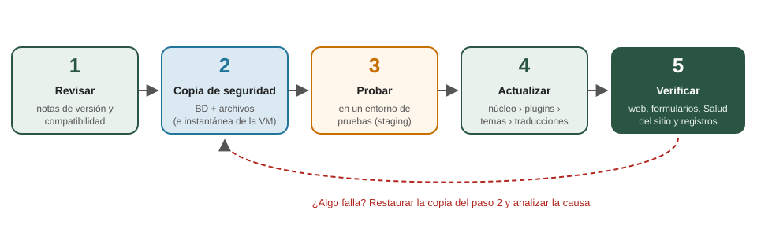

*Figura: pasos de una actualización segura.*

1. **Revisa** las notas de la versión y la compatibilidad de los plugins y del tema con la nueva versión.
2. **Haz una copia de seguridad** (y una instantánea de la VM).
3. **Prueba** la actualización en un entorno de pruebas (*staging*), como el sitio del apartado 4.11, si el sitio es importante.
4. **Actualiza** en orden: núcleo, plugins, temas y traducciones.
5. **Verifica**: navega por el sitio, prueba los formularios, revisa *Herramientas > Salud del sitio* y el registro de errores de Apache.

### 13.2 Desde el panel

Escritorio > Actualizaciones muestra todo lo pendiente. En Plugins y en Apariencia > Temas puedes Activar las actualizaciones automáticas de cada elemento: es recomendable en plugins de confianza y bien mantenidos, y para un sitio sin mantenimiento frecuente.

### 13.3 Desde la terminal

```bash
wp core check-update
wp plugin list --update=available
wp theme list --update=available

wp core update
wp core update-db
wp plugin update --all
wp theme update --all
wp language core update

wp core version
```

Si una actualización de un plugin rompe el sitio, puedes volver a la versión anterior:

```bash
wp plugin install contact-form-7 --version=6.0.6 --force
```

Si el panel no carga por culpa de un plugin, desactívalo desde la terminal (`wp plugin deactivate nombre`) o renombrando su carpeta en `wp-content/plugins`.

### 13.4 Configurar las actualizaciones automáticas en `wp-config.php`

```php
// Actualizar automáticamente también las versiones mayores del núcleo
define( 'WP_AUTO_UPDATE_CORE', true );     // true | 'minor' (por defecto) | false

// Impedir editar archivos de plugins y temas desde el panel (seguridad)
define( 'DISALLOW_FILE_EDIT', true );
```

Añádelas antes de la línea `/* That's all, stop editing! */` (o su traducción, *¡Eso es todo, deja de editar!*).

> Si WordPress se queda en "Temporalmente no disponible por mantenimiento programado", es que una actualización se interrumpió. Borra el archivo `.maintenance` de la raíz del sitio y repite la actualización.

## 14. Informes de acceso y estadísticas

Conocer quién visita el sitio, qué páginas se leen, de dónde llegan los visitantes y qué errores se producen permite mejorar el contenido, detectar problemas y descubrir ataques. Hay tres fuentes de información:

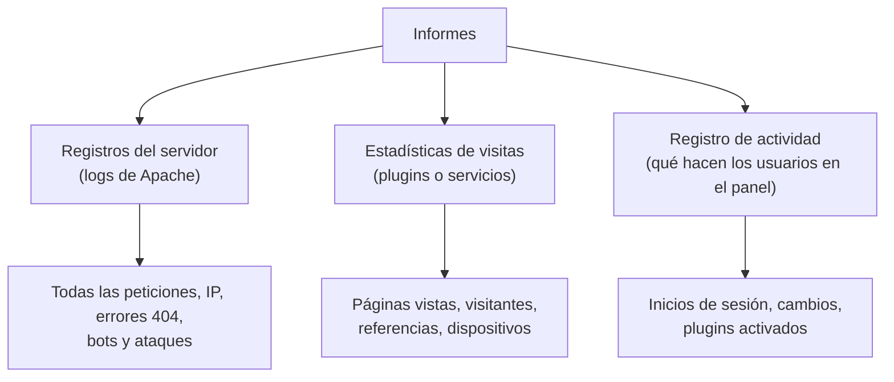

### 14.1 Registros de Apache

Cada petición queda registrada en `/var/log/apache2/wordpress_access.log` con el formato *combined*:

```text
88.12.34.56 - - [06/Nov/2026:10:15:32 +0100] "GET /cursos/ HTTP/1.1" 200 15432 "https://www.google.com/" "Mozilla/5.0 (Windows NT 10.0; Win64; x64) ..."
```

| Campo | Ejemplo | Significado |
| --- | --- | --- |
| IP | `88.12.34.56` | Quién hace la petición |
| Fecha | `[06/Nov/2026:10:15:32 +0100]` | Cuándo |
| Petición | `"GET /cursos/ HTTP/1.1"` | Método, recurso y protocolo |
| Estado | `200` | Código de respuesta HTTP |
| Tamaño | `15432` | Bytes enviados |
| Referente | `"https://www.google.com/"` | De dónde viene el visitante |
| Agente | `"Mozilla/5.0 ..."` | Navegador o bot |

Algunas consultas útiles:

```bash
LOG=/var/log/apache2/wordpress_access.log

# Ver las peticiones en tiempo real
sudo tail -f $LOG

# Las 10 IP con más peticiones
sudo awk '{print $1}' $LOG | sort | uniq -c | sort -nr | head

# Las 10 páginas más solicitadas
sudo awk '{print $7}' $LOG | sort | uniq -c | sort -nr | head

# Páginas que no existen (errores 404)
sudo awk '$9 == 404 {print $7}' $LOG | sort | uniq -c | sort -nr | head

# Intentos de acceso al formulario de inicio de sesión
sudo grep -c "POST /wp-login.php" $LOG
```

> **Ojo con la red NAT.** En nuestro laboratorio todas las visitas que llegan desde Windows aparecen con la IP `10.0.2.2` (la puerta de enlace NAT de VirtualBox), y las peticiones que WordPress se hace a sí mismo, con `127.0.0.1`. En un servidor publicado en Internet verías la IP real de cada visitante.

Muchas peticiones `POST /wp-login.php` o `POST /xmlrpc.php` desde la misma IP suelen ser un ataque de fuerza bruta.

### 14.2 Informes visuales con GoAccess

GoAccess analiza los registros de Apache y genera un informe con gráficos: visitantes únicos por día, páginas más vistas, referentes, sistemas operativos, navegadores, códigos de estado, etc.

```bash
sudo apt install -y goaccess

# Informe interactivo en la terminal
sudo goaccess /var/log/apache2/wordpress_access.log --log-format=COMBINED

# Informe en HTML
sudo goaccess /var/log/apache2/wordpress_access.log --log-format=COMBINED -o ~/informe-accesos.html
sudo chown ubuntu:ubuntu ~/informe-accesos.html
```

Descarga el informe a Windows con `scp -P 2222 usuario@localhost:~/informe-accesos.html .` y ábrelo en el navegador. No lo dejes en una carpeta pública de la web: contiene direcciones IP, que son datos personales.

### 14.3 Estadísticas desde WordPress

| Plugin | Cómo funciona | Privacidad |
| --- | --- | --- |
| **Independent Analytics**, Koko Analytics | Guardan las estadísticas en tu propia base de datos, sin cookies | Muy respetuosos: los datos no salen de tu servidor |
| **WP Statistics** | Estadísticas en tu base de datos, con opciones de anonimización de IP | Configurable |
| **Site Kit by Google** | Conecta Google Analytics y Search Console y muestra sus datos en el escritorio | Envía datos a Google y usa cookies: requiere consentimiento. Necesita un sitio publicado en Internet, así que no funciona en nuestra VM local |
| **Jetpack Stats** | Estadísticas alojadas en WordPress.com | Requiere cuenta de WordPress.com |

Con cualquiera de ellos obtendrás informes de páginas más vistas, visitantes, referentes (de dónde llegan), dispositivos y países, filtrables por periodos.

> **Protección de datos.** Según el RGPD y la normativa española, si las estadísticas usan cookies que no son técnicas (como Google Analytics), hay que pedir el consentimiento antes de instalarlas (plugins como Complianz o CookieYes) e informar de ello en la política de cookies.

### 14.4 Registro de actividad del panel

Los plugins Simple History o WP Activity Log guardan quién inició sesión, quién falló al iniciarla, quién publicó o borró contenido, qué plugins se activaron o actualizaron, etc. Son muy útiles cuando varias personas administran el sitio y para investigar un incidente.

### 14.5 Salud del sitio

Herramientas > Salud del sitio ofrece un informe del estado técnico: versión de PHP, módulos que faltan, HTTPS, actualizaciones pendientes, plugins inactivos, tareas programadas… La pestaña Información reúne todos los datos del servidor y se puede copiar al portapapeles para pedir soporte.

### **Práctica 4:** mantenimiento del sitio

**Enunciado**

Realiza las tareas de mantenimiento de tu sitio WordPress como lo haría la persona responsable de su administración.

**Debes realizar:**

1. **Sindicación.**
   - Comprueba los feeds general, de una categoría y de comentarios de tu sitio, y valida el general en el validador del W3C.
   - Suscríbete a tu feed desde un lector instalado en Windows (Thunderbird o una extensión lectora de RSS del navegador) y comprueba que aparece una entrada nueva al publicarla.
   - Muestra en la portada las últimas noticias de un feed externo relacionado con la temática del sitio.
2. **Importación y exportación.**
   - Exporta las entradas de la categoría *Noticias* en WXR e impórtalas en el sitio de pruebas del apartado 4.11, asignando los autores.
   - Importa al menos cinco entradas desde un archivo CSV con un plugin.
   - Obtén en JSON, con la API REST, el listado de las últimas entradas.
3. **Copias de seguridad.**
   - Crea y programa el script de copia del apartado 12.2 y descarga una copia a tu equipo.
   - Configura UpdraftPlus con una copia programada y almacenamiento remoto.
   - **Simula un desastre** (borra una página y desactiva el tema hijo) y restaura el sitio desde una de las copias. Documenta el tiempo empleado.
4. **Actualizaciones.** Antes de actualizar, haz una copia. Actualiza con WP-CLI el núcleo, los plugins y los temas que lo necesiten (si todo está al día, instala la versión anterior de un plugin y actualízalo) y activa las actualizaciones automáticas de al menos un plugin. Actualiza también los paquetes del sistema.
5. **Informes de acceso.**
   - Obtén con la terminal las 10 páginas más visitadas, las IP con más peticiones y los errores 404.
   - Genera un informe HTML con GoAccess.
   - Instala un plugin de estadísticas y otro de registro de actividad, y muestra sus informes tras navegar por el sitio con varios usuarios.

**Entrega:** documento con capturas y comandos, los archivos de exportación (XML, CSV y JSON) y un apartado de conclusiones con la política de mantenimiento que propondrías para el sitio: frecuencia de copias, retención, ubicación, frecuencia de actualizaciones e informes que revisarías cada mes.

## 15. Seguridad básica

Resumen de las medidas vistas a lo largo de la unidad, más algunas adicionales:

| Ámbito | Medida |
| --- | --- |
| Servidor (VM) | Reenvío de puertos limitado a `127.0.0.1`; solo los puertos necesarios; puerto 3306 sin reenviar; cortafuegos `ufw`; sistema actualizado; instantáneas antes de cambios importantes |
| Conexión | HTTPS con redirección automática (en producción, certificado de una autoridad como Let's Encrypt con renovación automática) |
| WordPress | Núcleo, plugins y temas actualizados; eliminar plugins y temas que no se usen; `DISALLOW_FILE_EDIT` |
| Archivos | Propietario `www-data`; directorios `755`, archivos `644`; `wp-config.php` con `640` |
| Base de datos | Usuario exclusivo con permisos solo sobre su base de datos; contraseña robusta |
| Usuarios | Mínimo privilegio; sin usuario `admin`; contraseñas robustas; doble factor para administradores |
| Acceso | Limitar los intentos de inicio de sesión; desactivar XML-RPC si no se usa; plugin de seguridad (Wordfence) |
| Recuperación | Copias automáticas, fuera del servidor y probadas |
| Supervisión | Revisar registros, Salud del sitio y registro de actividad |

Para desactivar XML-RPC (una vía antigua de acceso remoto muy usada en ataques de fuerza bruta) si no lo necesitas, puedes bloquearlo en Apache, dentro del `<VirtualHost>`:

```apache
<Files xmlrpc.php>
    Require all denied
</Files>
```

## 16. Proyecto práctico final


### Enunciado

Implanta, configura y diseña en WordPress la página web completa de una organización ficticia, instalada en una máquina virtual con Ubuntu Server 24.04 y accesible por HTTPS desde el equipo anfitrión con Windows. El proyecto integra todo lo trabajado en la unidad: instalación del servidor, diseño con plantillas, plugins, usuarios y roles, sindicación, importación y exportación, copias de seguridad, actualizaciones e informes de acceso. Partirás de una instalación limpia, distinta de la de las prácticas, o de la de las prácticas si la reinicias por completo.

### Temas a elegir

Cada alumno tendrá asignado uno de estos tipos de organización:

1. Academia de idiomas.
2. Restaurante con reservas.
3. Club deportivo.
4. ONG o asociación de voluntariado.
5. Tienda de informática local.
6. Departamento de Informática de un instituto.
7. Agencia de viajes.
8. Estudio de diseño o fotografía (portafolio).
9. Clínica veterinaria.
10. Librería con agenda cultural.
11. Empresa de servicios informáticos.
12. Revista digital de tecnología.

### Trabajo que debes realizar

#### Parte obligatoria

1. **Instalación del servidor.** VM de VirtualBox con Ubuntu Server 24.04, red NAT con reenvío de puertos limitado a `127.0.0.1`, pila LAMP, base de datos con usuario exclusivo, WordPress en español, WP-CLI, HTTPS con certificado autofirmado y redirección desde HTTP, y sitio de pruebas. Sin avisos críticos en *Salud del sitio*.
2. **Configuración.** Ajustes generales, de lectura, comentarios, medios y enlaces permanentes adecuados a la organización. Páginas legales: aviso legal, política de privacidad y política de cookies.
3. **Contenido.** Al menos seis páginas con estructura jerárquica (con alguna página hija) y diez entradas en al menos tres categorías, con imágenes optimizadas, texto alternativo y fuentes citadas. Contenido propio, con licencia libre o con permiso de uso.
4. **Diseño y plantillas.** Tema hijo de un tema de bloques con paleta de colores y tipografía propias en `theme.json`. Cabecera y pie personalizados, al menos dos plantillas creadas o modificadas (por ejemplo, una para una categoría y otra personalizada para la portada), un patrón sincronizado y una navegación con submenús. El sitio debe verse correctamente en el móvil.
5. **Plugins.** Al menos cinco plugins configurados que respondan a necesidades reales de la organización: formulario, SEO, seguridad, copias de seguridad y uno o más específicos del tema (reservas, eventos, galería, tienda, multilingüe…). Justifica cada uno con los criterios de selección del apartado 8.2.
6. **Plugin propio.** Un plugin sencillo desarrollado por ti que aporte una función útil al sitio (por ejemplo, un shortcode con información de la organización, un aviso configurable o un bloque de horario), con cabecera correcta, prefijos, comprobación de `ABSPATH` y escapado de la salida.
7. **Usuarios y roles.** Al menos cuatro usuarios con roles distintos, uno de ellos con un rol personalizado creado por ti. Demuestra el flujo editorial: un colaborador envía una entrada a revisión y un editor la publica.
8. **Sindicación.** Enlace visible al feed RSS del sitio, feed de al menos una categoría comprobado en un lector, y un feed externo relacionado con la temática mostrado en alguna página.
9. **Importación y exportación.** Importa parte del contenido desde un CSV y exporta el contenido en WXR, importándolo en un sitio de pruebas para verificarlo. Exporta también el tema hijo en `.zip`.
10. **Copias de seguridad.** Copias automáticas de la base de datos y de los archivos (script con `cron` o plugin), con al menos una copia fuera del servidor, y una restauración comprobada.
11. **Actualizaciones.** Procedimiento de actualización seguro aplicado y documentado (copia previa, actualización y verificación), y actualizaciones automáticas configuradas de forma justificada.
12. **Informes de acceso.** Un plugin de estadísticas, un registro de actividad y un informe de los registros de Apache (comandos o GoAccess) con su interpretación: páginas más visitadas, origen de las visitas, errores 404 e intentos de acceso sospechosos.

#### Apartados opcionales

Estos apartados no son obligatorios, pero permiten mejorar la calificación del proyecto:

1. **Opcional A: tienda en línea.** Instala y configura WooCommerce con al menos cinco productos (importados desde CSV), categorías, gastos de envío, impuestos y un método de pago en modo de pruebas. Realiza un pedido completo con una cuenta de cliente.
2. **Opcional B: copias en la nube.** Envía automáticamente las copias de seguridad a un almacenamiento en la nube (Google Drive, Dropbox u otro) con UpdraftPlus o con la herramienta `rclone` desde el script de copia, con una política de retención que borre las copias antiguas. Demuestra una restauración desde la nube. No muestres tokens ni credenciales en el vídeo.
3. **Opcional C: sitio multilingüe.** Traduce las páginas principales y el menú a un segundo idioma con Polylang o TranslatePress, con selector de idioma.

### Entrega

No se entregará una memoria escrita ni en papel. La entrega principal será un videotutorial que muestre el sitio y explique el trabajo realizado. Súbelo a YouTube con la visibilidad Oculto y entrega el enlace. La duración deberá estar comprendida entre 10 y 20 minutos.

En el videotutorial:

- Presenta la organización, los objetivos del sitio y su estructura, recorriendo la web pública en el ordenador y en el móvil.
- Muestra la máquina virtual, las reglas de reenvío de puertos de la red NAT y el acceso por HTTPS desde el host.
- Explica el tema hijo, las plantillas, las partes de plantilla y el patrón sincronizado.
- Enseña los plugins instalados y su configuración, justificando su elección.
- Muestra el código del plugin propio, explícalo brevemente y comprueba que funciona.
- Inicia sesión con los distintos usuarios y muestra las diferencias entre sus roles y el flujo editorial.
- Muestra los feeds, la importación CSV y la exportación e importación WXR.
- Explica la política de copias de seguridad y muestra una restauración.
- Muestra una actualización realizada con el procedimiento seguro.
- Presenta e interpreta los informes de acceso y de actividad.
- Si se realizan, presenta los apartados opcionales.

Entrega además el `.zip` del tema hijo, el código fuente del plugin propio, el archivo de exportación WXR y el CSV de importación. No incluyas contraseñas, claves privadas ni datos personales reales; oculta cualquier dato sensible que aparezca en el vídeo (contraseñas, claves, direcciones IP de tu casa, correos personales).

### Rúbrica orientativa

| Apartado | Qué se valora |
|---|---|
| Instalación del servidor | VM y red NAT correctas; LAMP configurado; HTTPS y sitio de pruebas operativos. |
| Configuración y contenido | Ajustes adecuados, páginas legales, contenido coherente, bien estructurado y con fuentes. |
| Diseño y plantillas | Tema hijo correcto, plantillas y partes personalizadas, patrón, coherencia visual y adaptación al móvil. |
| Plugins | Selección justificada, configuración correcta y funcionamiento. |
| Plugin propio | Estructura correcta, buenas prácticas de seguridad, utilidad y claridad del código. |
| Usuarios y roles | Roles adecuados, rol personalizado y flujo editorial demostrado. |
| Sindicación e intercambio de contenidos | Feeds ofrecidos y consumidos; importación CSV y exportación/importación WXR verificadas. |
| Mantenimiento | Copias automáticas fuera del servidor y restauración probada; actualización segura. |
| Informes | Estadísticas, registro de actividad e informe de registros, con interpretación. |
| Videotutorial | Explicación clara y ordenada, demostraciones legibles y protección de datos sensibles. |
| Opcionales | Tienda, copias en la nube o sitio multilingüe, con evidencia y explicación. |

### Criterios de finalización

La parte obligatoria estará completa cuando el sitio sea accesible por HTTPS desde el navegador del host; tenga el contenido, las páginas legales, el tema hijo, las plantillas y el patrón indicados; funcionen los cinco plugins y el plugin propio; existan los usuarios con sus roles, incluido el rol personalizado; se ofrezcan y consuman feeds; se haya importado contenido desde CSV y exportado e importado en WXR; existan copias automáticas con una restauración comprobada; se haya documentado una actualización segura; y se presenten los informes de acceso y de actividad. El videotutorial debe mostrar evidencias de todo ello y estar disponible mediante un enlace de YouTube con visibilidad Oculto (no listado). También se entregarán el `.zip` del tema hijo, el código del plugin propio, el archivo WXR y el CSV. Los apartados opcionales A, B y C se valoran de forma adicional.


## 17. Fuentes y documentación

- [Documentación oficial de WordPress (usuarios)](https://wordpress.org/documentation/)
- [Learn WordPress: cursos y tutoriales gratuitos oficiales](https://learn.wordpress.org/)
- [Requisitos de WordPress](https://wordpress.org/about/requirements/)
- [Roles y capacidades](https://wordpress.org/documentation/article/roles-and-capabilities/)
- [Manual de temas: jerarquía de plantillas y theme.json](https://developer.wordpress.org/themes/)
- [Temas hijo](https://developer.wordpress.org/themes/advanced-topics/child-themes/)
- [Manual de plugins](https://developer.wordpress.org/plugins/)
- [WordPress Feeds (sindicación)](https://wordpress.org/documentation/article/wordpress-feeds/)
- [Herramientas de importación y exportación](https://wordpress.org/documentation/article/tools-export-screen/)
- [Copias de seguridad de WordPress](https://developer.wordpress.org/advanced-administration/security/backup/)
- [Actualizar WordPress](https://wordpress.org/documentation/article/updating-wordpress/)
- [Seguridad en WordPress (hardening)](https://developer.wordpress.org/advanced-administration/security/hardening/)
- [WP-CLI: documentación de comandos](https://developer.wordpress.org/cli/commands/)
- [API REST de WordPress](https://developer.wordpress.org/rest-api/)
- [Manual de VirtualBox: redes y modo NAT](https://www.virtualbox.org/manual/topics/networkingdetails.html)
- [Documentación de Ubuntu Server](https://documentation.ubuntu.com/server/)
- [Let's Encrypt](https://letsencrypt.org/es/)
- [GoAccess](https://goaccess.io/)
- [Directorio oficial de plugins](https://wordpress.org/plugins/) y [de temas](https://wordpress.org/themes/)
